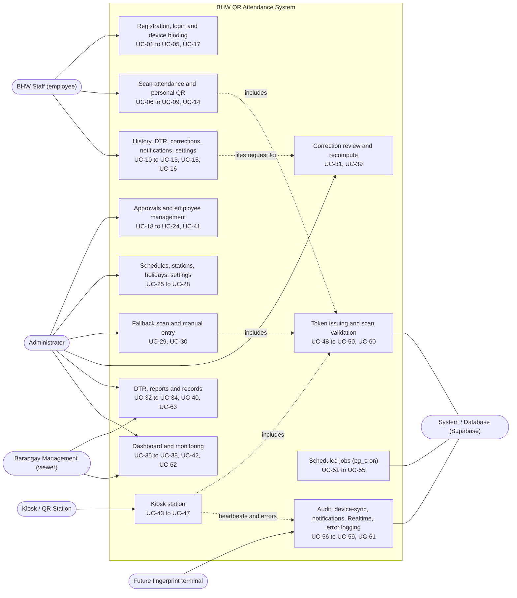

> **Role speaking: System Analyst**

# 04 – Use Cases

This document describes how each actor uses the BHW QR Attendance System. Every use case (UC) has an ID, actor, precondition, numbered main flow, alternate and exception flows, postcondition and the functional requirements (FR) it satisfies. FR IDs refer to [`02-functional-requirements.md`](./02-functional-requirements.md), NFR IDs to [`03-non-functional-requirements.md`](./03-non-functional-requirements.md) and D-xx to the binding decisions in [`00-assumptions-and-decisions.md`](./00-assumptions-and-decisions.md).

**Conventions**

- All dates and times are Asia/Manila and come from the server clock (FR-114). "Today" means the Manila calendar date.
- Error codes in `UPPER_SNAKE_CASE` are the codes from section D of the decisions file. Mobile-only codes (`CAMERA_DENIED`, `LOCATION_DENIED`, `LOCATION_UNAVAILABLE`, `OFFLINE`, `BIOMETRIC_FAILED`) are raised by the app and never sent to the server.
- "Includes UC-xx" means the steps of that use case always run at that point. "Extends to UC-xx" means the user may continue into that use case.
- Every message shown to a user is plain language in English, with a Filipino translation when the user selected Filipino (FR-56, NFR-35).
- Every write described below is protected by Row Level Security and a server-side role and status check (FR-138, FR-141). Every change to an audited table is recorded by UC-56.

## 1. Actors

| Actor | Type | Description | Main channel |
| --- | --- | --- | --- |
| BHW Staff (employee) | Primary, human | Barangay health worker who registers, binds one phone, scans to time in and out, views own records, files corrections | Website (`/register`, `/me`) and mobile app |
| Administrator | Primary, human | BHW office staff with role `admin`; approves registrations, manages employees, schedules, stations, corrections, DTRs, reports and monitoring | Web admin portal |
| Kiosk / QR Station | Primary, device | Tablet or monitor signed in with a `kiosk` account linked to one station (D-03); shows the rotating QR and reports its health | Web page `/kiosk/[stationId]` |
| System / Database (Supabase) | Secondary, system | Supabase Auth, Postgres (RLS, triggers, RPCs), Edge Functions, Realtime, Storage and pg_cron; validates scans, runs jobs, keeps the audit trail | Server side |
| Barangay Management (viewer) | Primary, human | Barangay officials with role `viewer`; read-only access to dashboard and reports | Web portal (read-only) |
| Future fingerprint terminal | Secondary, device | Not delivered in this build; uses the documented `device-sync` contract (UC-57) | `device-sync` Edge Function |

## 2. Use case overview diagram

## 3. Use case index

| Actor | Use cases | Count |
| --- | --- | --- |
| BHW Staff (employee) | UC-01 – UC-17 | 17 |
| Administrator | UC-18 – UC-42 | 25 |
| Kiosk / QR Station | UC-43 – UC-47 | 5 |
| System / Database (Supabase) | UC-48 – UC-61 | 14 |
| Barangay Management (viewer) | UC-62 – UC-63 | 2 |
| **Total** | UC-01 – UC-63 | **63** |

---

## 4. BHW Staff (employee) use cases

| ID | Actor | Use case | Precondition | Main flow | Alternate / exception flows | Postcondition | Related FR |
| --- | --- | --- | --- | --- | --- | --- | --- |
| UC-01 | BHW Staff (employee) | Register an account on the website | The person is a BHW of Barangay Kalawag II, has an email address and opens `/register` on any browser. | 1. Employee opens `/register`. 2. System shows the form: full name, BHW ID number, purok/area, contact number (`09XXXXXXXXX`), optional address, email, password, profile photo, and an unticked Data Privacy consent checkbox linked to `/privacy`. 3. Employee fills in the form, attaches a photo (JPEG, PNG or WebP, at most 5 MB) and ticks the consent box. 4. Employee taps "Register". 5. System validates the input with the shared zod schema. 6. System creates the Supabase Auth user; a trigger creates the `profiles` row with role `employee`, status `pending` and `consent_at` = now. 7. System encrypts contact number and address into `contact_number_enc` / `address_enc` and uploads the photo to the private `profile-photos` bucket, storing only the path. 8. System sends the verification email and shows "Check your email to verify your account". Extends to UC-02. | 5a. A required field is missing, the email or mobile number format is wrong, or the password has fewer than 8 characters: field-level messages are shown and the typed values are kept. 5b. BHW ID number or email already exists: "This BHW ID number / email is already registered. Contact the BHW office if this is a mistake." 3a. Consent box not ticked: the Register button stays disabled with the hint "Please read and accept the Data Privacy notice." 3b. Photo larger than 5 MB or wrong type: "Photo must be JPEG, PNG or WebP and not larger than 5 MB." 7a. Photo upload fails: the account is kept, the user is told to add the photo later from `/me` (UC-17), and the failure is written to `error_logs` (source `web`). 6a. Server error: `INTERNAL_ERROR`, "Something went wrong. Please try again." and the error is logged. | A `profiles` row exists with role `employee`, status `pending`, consent timestamp and encrypted contact fields; the registrant must verify email. | FR-01, FR-02, FR-03, FR-05, FR-06, FR-07, FR-09, FR-10 |
| UC-02 | BHW Staff (employee) | Verify email address | UC-01 completed; the verification email was delivered. | 1. Employee opens the email and clicks the verification link. 2. Supabase Auth marks the email as confirmed. 3. System redirects to `/pending` with "Email verified. Your registration is now waiting for the administrator's approval." 4. The registration now appears on the admin's Pending Approvals page (UC-18) and admins receive an in-app notification "New registration". | 1a. Link expired or already used: system shows "This link has expired" with a "Resend verification email" button. 1b. Email not received: employee uses "Resend verification email" on `/login` or `/pending`. 2a. Employee tries to log in before verifying: login shows "Please verify your email first" with the resend button. | Email confirmed; the pending registration is visible to admins. | FR-04, FR-21, FR-144 |
| UC-03 | BHW Staff (employee) | View registration status (pending, rejected, inactive) | Employee has an account whose status is not `active`. | 1. Employee signs in on the web (UC-04) or mobile (UC-05). 2. System reads the profile status. 3. If `pending`: web shows `/pending` and mobile shows the Blocked screen with "Your registration is waiting for approval." 4. If `rejected`: web shows `/rejected` and mobile shows the Blocked screen with the admin's rejection reason and the BHW office contact. 5. If `inactive`: a deactivated notice "Your account has been deactivated. Please contact the BHW office." 6. Only "Log out" (and "Privacy notice") is available. | 3a. Status changes to `active` while the screen is open: on the next app start or return to foreground (mobile) or page refresh (web), the user is routed to the role home page. 4a. Rejected registrant wants to try again: the screen explains that the record is deleted 90 days after rejection (D-32) and that they may contact the office. | User sees the correct status screen and cannot reach any other screen. | FR-08, FR-28, FR-34 |
| UC-04 | BHW Staff (employee); the same flow is used by Administrator and Viewer | Log in to the web portal | User has a verified account. | 1. User opens `/login` (shadcn login block). 2. User enters email and password and submits. 3. Supabase Auth checks the credentials and creates a session cookie (`@supabase/ssr`). 4. Next.js middleware reads role and status and routes: active employee to `/me`, admin to the admin dashboard, viewer to the read-only dashboard, kiosk to `/kiosk/[stationId]`, non-active employee to UC-03. 5. The home page loads. | 3a. Wrong email or password: "Incorrect email or password." (no hint which one is wrong). 3b. Too many attempts: Supabase Auth rate limit message "Too many attempts. Please wait a few minutes." 3c. Email not verified: see UC-02 step 2a. 2a. Forgot password: user clicks "Forgot password", enters email, receives a reset link, sets a new password (at least 8 characters) and logs in. 4a. User opens a page not allowed for their role: middleware redirects to their home page. 5a. Session expired later: any protected request returns `AUTH_REQUIRED` and the user is sent back to `/login`. | Authenticated session; user is on the page allowed for their role and status. | FR-08, FR-137, FR-138, FR-139 |
| UC-05 | BHW Staff (employee) | Log in to the mobile app and bind the device | App installed; account email verified; phone online. | 1. On first launch the app creates a random installation UUID and stores it in SecureStore. 2. Employee enters email and password on the Login screen. 3. Supabase Auth signs in; the session is stored in SecureStore. 4. App calls `bind-device` with the raw installation ID, platform and model over TLS. 5. System checks role `employee` and status `active`. 6. System computes `device_id_hash = HMAC-SHA256(DEVICE_HASH_PEPPER, raw_id)`. 7. If the employee has no active device, system inserts a `devices` row (hash, platform, model, `bound_at`) and the app shows "This phone is now registered to your account." 8. If the active device hash matches, binding is confirmed silently. 9. App opens Home. | 3a. Wrong credentials or unverified email: same messages as UC-04. 5a. `ACCOUNT_NOT_ACTIVE` (pending, rejected, inactive): Blocked screen per UC-03. 5b. Account is admin, viewer or kiosk: `ACCOUNT_NOT_ACTIVE`, "The mobile app is for BHW staff only. Please use the web portal." 7a. `DEVICE_MISMATCH`: employee already has another active phone: "Your account is registered to another phone. Ask the administrator to reset your device." 7b. `DEVICE_MISMATCH`: this phone's hash is active for another employee: "This phone is already registered to another BHW account." 4a. `OFFLINE`: "No internet connection. Connect and try again." 4b. `RATE_LIMITED` or `INTERNAL_ERROR`: friendly retry message; error logged. 9a. On every app start and return to foreground the app re-checks status and binding; if the device was reset (`DEVICE_NOT_BOUND`) the app runs steps 4–8 again, and if status is no longer active it shows the Blocked screen. | Exactly one active device row for the employee; the session is stored securely; the employee is on Home. | FR-27, FR-28, FR-29, FR-30, FR-31, FR-34, FR-137, FR-140 |
| UC-06 | BHW Staff (employee) | Unlock the scan screen with phone biometrics | Employee turned on "Biometric unlock" in Profile & Settings (UC-15); phone has fingerprint or Face ID enrolled. | 1. Employee taps the Scan button (Paper FAB) on Home. 2. App calls `expo-local-authentication` with the prompt "Confirm it's you to scan". 3. Phone verifies the fingerprint or face locally. 4. App opens the Scan screen and continues with UC-07. | 3a. `BIOMETRIC_FAILED` (not recognised or cancelled): "Fingerprint / Face ID not recognised. Try again." The phone's own screen-lock PIN fallback may be used if the phone offers it. 2a. Biometrics removed from the phone after the toggle was set: app turns the toggle off and shows "Biometric unlock is not available on this phone." Note: no biometric data is read, sent or stored by the system (D-30). | Scan screen opened only after local confirmation. | FR-44, FR-135 |
| UC-07 | BHW Staff (employee) | Run the pre-scan health check | Scan screen is opening (after UC-06 when enabled). | 1. App shows the health check bottom sheet with five items. 2. Camera permission granted. 3. Location permission granted. 4. Current GPS fix obtained and accuracy is within `max_gps_accuracy_m` (default 50 m). 5. Internet connection available. 6. Device still bound (quick status check, uses cached result from app start when less than 5 minutes old). 7. All items show a green check; the sheet closes and the camera opens. | 2a. `CAMERA_DENIED`: "Camera access is off. Tap to open Settings and allow Camera." 3a. `LOCATION_DENIED`: "Location access is off. Tap to open Settings and allow Location." 4a. `LOCATION_UNAVAILABLE`: "We can't get your location. Turn on Location / GPS and try again." 4b. Accuracy worse than the limit: "GPS is weak (±80 m). Move near a window or outside and wait a few seconds." The item keeps refreshing for up to 30 s. 5a. `OFFLINE`: "No internet. Scans are never saved offline. Connect to Wi-Fi or mobile data." 6a. `DEVICE_NOT_BOUND` or `DEVICE_MISMATCH`: app routes to Bind Device (UC-05) or shows "Ask the administrator to reset your device." Any failed item keeps the Scan button disabled until it passes; "Use My QR instead" links to UC-14. | Camera is open only when every check passed. | FR-45, FR-59, FR-34 |
| UC-08 | BHW Staff (employee) | Scan the kiosk QR to time in | Active employee with bound device; UC-07 passed; employee is at the BHW office in front of an online kiosk; no attendance record yet for today's work date. | 1. Employee points the camera at the kiosk QR. 2. App reads the code and accepts only content starting with `BHWQR1:`. 3. App collects latitude, longitude, accuracy and the mocked-location flag; when `selfie_required` is on it captures a front-camera selfie. 4. App calls `record-attendance` with token, raw device ID, location data and selfie. 5. Includes UC-48 (validation steps 1–15). 6. System finds no record for the work date and creates the attendance record with `time_in` = server time, `method = 'qr'`, station, `minutes_late` from the schedule in effect and provisional status `on_time` or `late`. 7. System records the nonce use, writes a successful `scan_attempts` row and links `time_in_scan_id`. 8. System returns "Time-in recorded at 7:58 AM. On time." (or "Late by 12 minutes"). 9. App shows the animated success overlay with haptic feedback; Home's Today card updates. 10. Kiosk feed (UC-46) and admin dashboard (UC-35) update through Realtime within 2 s. | 2a. Code without `BHWQR1:` prefix: "This is not a BHW kiosk QR code." Camera stays open. 5a. Every validation failure returns its code and a friendly message, shown as a failure overlay, e.g.: – `QR_EXPIRED`: "This QR code has expired. Scan the code currently on the kiosk screen." (covers screenshots older than 30 s) – `QR_REUSED`: "You already used this QR code. Wait for the next code." – `QR_INVALID` / `QR_UNKNOWN`: "This QR code is not valid." – `OUTSIDE_GEOFENCE`: "You are 240 m from the BHW office. Move closer (within 100 m) and scan again." – `GPS_INACCURATE`: "Your location is not accurate enough. Wait a moment and try again." – `COOLDOWN_ACTIVE`: "You scanned recently. You can scan again at 8:05 AM." – `ACCOUNT_NOT_ACTIVE`, `DEVICE_NOT_BOUND`, `DEVICE_MISMATCH`, `STATION_INACTIVE`, `SELFIE_REQUIRED`, `RATE_LIMITED`, `INVALID_REQUEST`, `AUTH_REQUIRED`, `INTERNAL_ERROR`: see UC-48. 6a. Today is a non-work day or holiday: record stored `on_time`, zero late, note "Non-working day" or the holiday name. 6b. No schedule assigned: record stored `on_time` with note "No schedule assigned". 4a. `OFFLINE` during the call: "No connection. Your scan was NOT recorded. Reconnect and scan again." (never queued). 4b. No response within 10 s: app shows "Check your History before scanning again" and refreshes Today. | One attendance record for the work date with `time_in`; one successful `scan_attempts` row; failure attempts also logged. | FR-46, FR-47, FR-48, FR-49, FR-50, FR-51, FR-52, FR-53, FR-54, FR-55, FR-56, FR-57, FR-59, FR-97, FR-114 |
| UC-09 | BHW Staff (employee) | Scan the kiosk QR to time out | Same as UC-08, and the employee has a record for the work date with `time_in` and no `time_out`. | 1–5. Same as UC-08 steps 1–5. 6. System finds the open record and sets `time_out` = server time and `time_out_scan_id`. 7. System computes `undertime_minutes = max(0, end_time − time_out)` and the final status using precedence late > undertime > on_time (both minute values stored). 8. System returns "Time-out recorded at 5:02 PM. Have a safe trip home!" (or "Undertime: 25 minutes"). 9. App shows the success overlay; Today card shows the completed day; kiosk feed and dashboard update. | 6a. Scan between 00:00 and 04:00 (`overnight_cutoff_hour`) while yesterday's record is open: the scan becomes yesterday's `time_out` (D-13) and the message says "Time-out recorded for October 30". 6b. `ALREADY_COMPLETED` (record already has time-in and time-out): "You already timed in and out today. File a correction request if a time is wrong." Extends to UC-11. 5a. `COOLDOWN_ACTIVE` (time-out attempted within 5 minutes of time-in, e.g. accidental double scan): message shows when scanning is allowed. 5b. Every other validation failure as in UC-08 alternate 5a. Forgot to time out: no scan before 04:00 → UC-51 marks the record `incomplete` and the employee is invited to file a `missing_time_out` request. | Record has both `time_in` and `time_out`, `undertime_minutes` and final status. | FR-46, FR-47, FR-51, FR-52, FR-53, FR-55, FR-56, FR-145 |
| UC-10 | BHW Staff (employee) | View attendance history | Active employee signed in on mobile (or on `/me`). | 1. Home shows a greeting, the Today card (time-in, time-out, status), This Week progress and recent records. 2. Employee opens the History tab. 3. App loads records through TanStack Query (RLS returns only the employee's own rows). 4. Employee filters by week or month with SegmentedButtons. 5. Employee taps a day; the detail sheet shows time-in, time-out, status badge, minutes late, undertime, method badge (QR, Fallback, Manual, Correction), station and notes. 6. Optional: employee taps "Request correction" (extends to UC-11). | 3a. Offline: cached data is shown with "Offline – last updated 8:15 AM" (Paper Snackbar); data re-fetches when the connection returns. 3b. No records for the period: empty state "No attendance records for this week." 3c. Load error: error state with "Try again"; error sent to `log-error`. | Employee sees only their own records. | FR-60, FR-66, FR-115, FR-139 |
| UC-11 | BHW Staff (employee) | File a correction request | Active employee; the work date is eligible (D-26). | 1. Employee opens the Correction Request form from a History day or My Requests "New request" (mobile) or from `/me` (web). 2. Employee picks the type in an Actionsheet: missing time-in, missing time-out, wrong time, official business/field work. 3. Employee picks the work date and enters requested time-in and/or time-out. 4. Employee writes the reason and optionally attaches an image or PDF (at most 5 MB). 5. Employee submits. 6. System checks eligibility: date not in the future; current month, or previous month while today ≤ day 5 (`correction_window_days`); no other pending request for that date. 7. System uploads the attachment to `correction-attachments` and inserts the request with status `pending` and a link to the existing attendance record if any. 8. Admins receive a "New correction request" notification; the employee sees the request in My Requests. | 6a. Future date: "You can't request a correction for a future date." 6b. Outside the window: "Corrections for September closed on October 5. Please contact the BHW office." 6c. A pending request already exists for the date: "You already have a pending request for this date. Cancel it first or wait for the admin's review." 3a. Missing required time for the type (e.g. missing time-out without a time-out value): field message; official business may leave both times blank (D-28). 4a. Attachment too large or wrong type: "Attachment must be an image or PDF up to 5 MB." 5a. `OFFLINE`: "No connection. Your request was not sent." The typed values stay on the form until it is sent or closed. 5b. `INVALID_REQUEST` or `INTERNAL_ERROR`: friendly message; error logged. | A `pending` correction request exists and is audited. | FR-68, FR-69, FR-70, FR-71, FR-77, FR-144 |
| UC-12 | BHW Staff (employee) | Cancel a pending correction request | The employee has a request with status `pending`. | 1. Employee opens My Requests and selects the request. 2. Employee taps "Cancel request" and confirms in a dialog. 3. System verifies ownership and status `pending` (RLS). 4. System sets status `cancelled`. 5. List shows the request as Cancelled. | 3a. Admin reviewed the request a moment earlier: "This request was already approved/rejected and can no longer be cancelled." The list refreshes. 2a. Employee closes the dialog: nothing changes. 3b. `OFFLINE`: "No connection. Try again when online." | Request is `cancelled`; the change is audited; the employee may file a new request for that date. | FR-71, FR-72, FR-77 |
| UC-13 | BHW Staff (employee) | View own DTR and download the PDF | Active employee signed in on mobile (My DTR) or web (`/me`). | 1. Employee opens My DTR. 2. Employee selects month and year (default: current month). 3. System calls `get_dtr(own id, year, month)` and returns CSC Form 48 rows 1–31 with AM/PM arrival and departure, daily undertime and totals. 4. App shows the monthly view. 5. Employee taps "Download PDF". 6. System's `generate-dtr-pdf` builds the CSC Form 48 PDF with header, certification text and signature lines. 7. Employee saves or shares the PDF (or prints it on the web). | 3a. Employee tries another employee's ID: RLS returns no data and the RPC refuses (role check). 3b. Month with no records: the DTR still shows day labels, absences and zero totals. 4a. Offline: the cached DTR is shown with "last updated" time; "Download PDF" is disabled with "Connect to the internet to download." 6a. PDF generation fails: `INTERNAL_ERROR`, "Could not create the PDF. Please try again." and the error is logged. | Employee has viewed or downloaded only their own DTR, built from current records. | FR-78, FR-79, FR-80, FR-81, FR-82, FR-84, FR-85, FR-115 |
| UC-14 | BHW Staff (employee) | Show personal QR for fallback | Active employee on the bound phone; online; the kiosk scan cannot be used (kiosk down, camera broken, GPS problem). | 1. Employee opens the My QR tab. 2. App calls `issue-personal-qr`. 3. System checks role, status and device binding, then returns a `BHWPQR1:` token signed with `PERSONAL_QR_SIGNING_SECRET`, valid 30 s. 4. App shows the QR with a countdown and requests a new one every 15 s. 5. Employee shows the screen to the administrator, who performs UC-29. | 3a. `ACCOUNT_NOT_ACTIVE`: Blocked screen. 3b. `DEVICE_NOT_BOUND` or `DEVICE_MISMATCH`: "This phone is not registered to your account." 2a. `OFFLINE`: the QR is hidden and "Connect to the internet to show your QR" is shown; no expired QR stays visible. 4a. Employee leaves the tab: refreshing stops. | A short-lived personal QR is displayed; nothing is recorded until the admin scans it. | FR-62, FR-15 |
| UC-15 | BHW Staff (employee) | Change language, theme and biometric setting; log out | Employee signed in on mobile (theme also on web). | 1. Employee opens Profile & Settings. 2. Employee switches language (English / Filipino); all labels and result messages change immediately. 3. Employee switches dark mode on or off (follows system by default). 4. Employee turns biometric unlock on; the app asks for one fingerprint / Face ID confirmation before saving the toggle. 5. Employee opens the privacy notice. 6. Employee taps "Log out"; the app clears the session from SecureStore and returns to Login. | 4a. No biometrics enrolled on the phone: the toggle is disabled with "Set up fingerprint or Face ID in your phone settings first." 4b. `BIOMETRIC_FAILED` during confirmation: toggle stays off. 6a. Log out keeps the device binding (FR-140), so the same employee can log in again without an admin reset. 3a. On the web, the light/dark toggle is remembered per browser. | Preferences are saved locally on the device; logout removes the session only. | FR-135, FR-136, FR-140, FR-44 |
| UC-16 | BHW Staff (employee) | View notifications | Employee signed in on mobile or `/me`. | 1. App shows the unread count badge. 2. Employee opens Notifications. 3. System lists the employee's notifications (approval, rejection, correction outcome with remarks, device reset, incomplete-day reminder), newest first. 4. Employee taps one; it is marked read and opens the related screen (e.g. My Requests, History day). 5. Employee may tap "Mark all as read". | 3a. No notifications: empty state "You're all caught up." 3b. Offline: cached list shown; read status syncs when online. Email copies of approval, rejection and correction outcomes arrive only when `RESEND_API_KEY` is configured. | Selected notifications have `read_at` set. | FR-142, FR-143, FR-144, FR-145 |
| UC-17 | BHW Staff (employee) | Update own profile and view own personal data | Active employee signed in on `/me` or mobile Profile. | 1. Employee opens Profile. 2. System shows name, BHW ID number, area, photo (signed URL) and decrypted contact number and address through `get_profile_private` (owner only). 3. Employee edits contact number, address or photo and saves. 4. System validates, re-encrypts the fields and stores the new photo path. 5. Employee opens "My data" to view everything the system holds: profile, bound devices, attendance records, correction requests and notifications. | 3a. Employee wants to change name, BHW ID number or area: fields are read-only with "Ask the administrator to change this." 4a. Invalid mobile number or photo too large: field message as in UC-01. 5a. Employee asks for erasure: the screen explains the request goes to the BHW office (handled by UC-41 after the employee leaves service). | Profile updated with encrypted fields; the change is audited with encrypted values shown only as "[changed]". | FR-18, FR-19, FR-07, FR-130 |

---

## 5. Administrator use cases

| ID | Actor | Use case | Precondition | Main flow | Alternate / exception flows | Postcondition | Related FR |
| --- | --- | --- | --- | --- | --- | --- | --- |
| UC-18 | Administrator | Approve a registration and assign a schedule | Admin signed in; a registration has verified email and status `pending`; at least one schedule exists. | 1. Admin opens Pending Approvals (sidebar badge shows the count). 2. System lists pending registrations oldest first with photo, name, BHW ID number, area, email, consent date and registration date. 3. Admin opens one and checks the details against the office's BHW roster. 4. Admin clicks "Approve", selects a schedule and effective-from date. 5. System runs `approve_employee` in one transaction: status `active`, `approved_by`, `approved_at`, inserts `employee_schedules`. 6. System creates an in-app notification and (if configured) an email "Your registration was approved. You can now log in to the mobile app." 7. Sonner toast "Approved"; the item leaves the list. | 4a. No schedule selected: Approve button disabled with "Select a schedule first." 5a. Another admin already approved or rejected it: "This registration was already reviewed." and the list refreshes. 5b. Caller is not admin: RPC refuses (`is_admin()` check). 6a. Email sending fails: in-app notification is still created; failure logged in `error_logs`. | Employee is `active` with a schedule; audit entry recorded; employee can bind a device (UC-05). | FR-21, FR-22, FR-24, FR-25, FR-26, FR-16, FR-144 |
| UC-19 | Administrator | Reject a registration | Same as UC-18. | 1. Admin opens a pending registration. 2. Admin clicks "Reject" and enters a required reason (e.g. "BHW ID number not found in the barangay roster"). 3. System runs `reject_employee`: status `rejected`, `rejection_reason` stored. 4. System notifies the registrant in-app and by email (if configured) with the reason. 5. Toast "Rejected". | 2a. Reason empty: "Please enter a reason. The registrant will see it." 3a. Already reviewed by another admin: as UC-18 5a. | Profile is `rejected` with reason; audited; the record is deleted 90 days later by UC-55. | FR-23, FR-24, FR-26 |
| UC-20 | Administrator | Manage employee information (view, search, edit) | Admin signed in. | 1. Admin opens Employees. 2. System shows a paginated data table with search (name, BHW ID number) and filters (status, area, schedule). 3. Admin opens an employee: profile, decrypted contact and address (`get_profile_private`), photo, schedules (current and past), status, bound device and device history, current month summary. 4. Admin clicks "Edit", changes name, BHW ID number, area, contact, address or photo and saves. 5. System validates (same rules as registration), re-encrypts sensitive fields and saves. 6. Toast "Employee updated". | 5a. BHW ID number already used by another profile: field error. 5b. Validation errors: field-level messages. Create: employees are created only by self-registration (UC-01) and approval (UC-18); admin, kiosk and viewer accounts use UC-21. Delete: employee records are never hard-deleted because attendance must be kept 5 years (D-32); use UC-22 to deactivate and UC-41 for erasure of personal fields. | Employee data updated; every change audited (encrypted fields as "[changed]"). | FR-11, FR-12, FR-13, FR-17, FR-33 |
| UC-21 | Administrator | Create admin, kiosk and viewer accounts | Admin signed in. | 1. Admin opens Employees → "New staff account". 2. Admin enters full name, email and role (admin, kiosk or viewer); for kiosk, selects the station. 3. System creates the Auth user on the server (service key never leaves the server), the profile with status `active`, and for kiosk sets `stations.kiosk_user_id`. 4. System sends an invitation email to set the password. 5. Toast "Account created". | 3a. Email already exists: "An account with this email already exists." 3b. Station already linked to another kiosk account: "This station already has a kiosk account. Unlink it first." 2a. Admin tries to choose role `employee`: not offered (employees self-register, D-02). | Active staff account exists; audited. | FR-09, FR-14, FR-108 |
| UC-22 | Administrator | Deactivate or reactivate an employee | Admin signed in; employee is `active` (or `inactive` for reactivation). | 1. Admin opens the employee and clicks "Deactivate". 2. Admin confirms in a dialog and enters a reason (e.g. "Resigned on 2026-10-15"). 3. System runs `deactivate_employee`: status `inactive`. 4. The employee's next app start or foreground shows the Blocked screen; scans, binding and personal QR return `ACCOUNT_NOT_ACTIVE`. 5. To reactivate, admin clicks "Reactivate" and confirms; status returns to `active`. | 1a. Admin tries to deactivate their own account: blocked with "You cannot deactivate your own account." 4a. Employee has an open time-in today: the record stays; UC-51 marks it `incomplete` if no time-out. 3a. Inactive employees are excluded from absence marking and batch DTR from the next day. | Status changed; audited with reason. | FR-15, FR-13 |
| UC-23 | Administrator | Reset an employee's device | Admin signed in; employee has an active device (lost, replaced or reformatted phone). | 1. Admin opens the employee's Device section. 2. Admin clicks "Reset device" and enters a reason (e.g. "Phone lost"). 3. System runs `reset_device`: `revoked_at = now()` on the active device. 4. Employee receives an in-app notification "Your device was reset. Log in on your phone to register it." 5. Next login from any phone binds that phone (UC-05). | 1a. No active device: the button is disabled with "No device bound." 3a. The old phone tries to scan: `DEVICE_NOT_BOUND`, and on login it re-binds only if it is the next phone used. | Old device revoked and kept in device history; audited with reason. | FR-17, FR-32, FR-33, FR-129, FR-144 |
| UC-24 | Administrator | Assign or change an employee's schedule | Admin signed in; active employee; schedule exists. | 1. Admin opens the employee's Schedule section. 2. Admin clicks "Assign schedule", picks a schedule, effective-from and optional effective-to dates. 3. System checks that the period does not overlap another assignment. 4. If the current assignment is open-ended, system offers to end it the day before the new effective-from date. 5. System saves the `employee_schedules` row. | 3a. Overlap not resolved: "This period overlaps the schedule 'Mon–Fri 8–5' from 2026-09-01. Adjust the dates." 5a. Effective-from in the past: allowed, with the warning "Past records are not recomputed. Use Recompute if needed." (extends to UC-39). | New assignment in effect from the chosen date; audited. | FR-16, FR-104, FR-105 |
| UC-25 | Administrator | Manage schedules | Admin signed in. | 1. Admin opens Schedules. 2. Admin creates a schedule: name, work days, start time, end time, grace minutes, break start and break end (defaults 12:00–13:00). 3. System validates and saves. 4. Admin edits a schedule; system shows "Changes apply to future scans only." 5. Admin deletes an unused schedule. | 3a. No work day, end before start, break outside working hours, or grace outside 0–60: field messages. 5a. Schedule is or was assigned: "This schedule is used by 8 employees and cannot be deleted." | Schedules saved; audited. | FR-102, FR-103, FR-105, FR-107 |
| UC-26 | Administrator | Manage stations and kiosk links | Admin signed in. | 1. Admin opens Stations & Kiosks. 2. Admin adds a station: name, latitude, longitude (picked by "Use my current location" while standing at the kiosk, or typed), geofence radius (leave blank to use `geofence_radius_m`, default 100 m), active flag. 3. Admin links a kiosk account (or creates one through UC-21). 4. System saves; the station page shows the kiosk URL `/kiosk/[stationId]` to open on the tablet. 5. Admin may edit or deactivate a station. | 2a. Invalid coordinates or a radius outside 10–1000 m: field messages. 5a. Deactivated station: kiosk shows "Station disabled", token issuing stops and scans return `STATION_INACTIVE`. 3a. Kiosk account already linked elsewhere: as UC-21 3b. | Station configuration saved; audited. | FR-108, FR-14 |
| UC-27 | Administrator | Manage holidays | Admin signed in. | 1. Admin opens Holidays. 2. Admin adds a holiday (date, name, e.g. "2026-11-30 Bonifacio Day"). 3. System saves; status computation, UC-51, reports and DTR use it. 4. Admin may edit or delete a holiday. | 2a. Date already has a holiday: "A holiday already exists on this date." 2b. Holiday added for a past date: existing records are not changed automatically; the page reminds the admin to run Recompute (UC-39) for that date. | Holiday list updated; audited. | FR-106, FR-54 |
| UC-28 | Administrator | Manage system settings | Admin signed in. | 1. Admin opens Settings. 2. System shows every `app_settings` key with its current value and allowed range. 3. Admin changes a value (e.g. `geofence_radius_m` 100 → 150) and saves. 4. System validates the range and saves. 5. The next token, scan, heartbeat or report uses the new value without redeploying. | 4a. Value out of range: field message with the allowed range. 4b. `token_refresh_seconds` not smaller than `token_lifetime_seconds`: "Refresh must be shorter than token lifetime so codes overlap." 3a. `selfie_required` turned on: the page warns that the privacy notice must mention selfies. | Settings saved; audited with old and new values. | FR-132, FR-133, FR-134 |
| UC-29 | Administrator | Record attendance by scanning a personal QR (fallback) | Admin signed in on a computer or tablet with a camera; employee shows a personal QR (UC-14). | 1. Admin opens Fallback Scan and selects the station. 2. Admin optionally types a note (e.g. "Kiosk tablet off"). 3. Admin starts the camera and scans the employee's QR. 4. Page accepts only `BHWPQR1:` content and calls `record-fallback-scan`. 5. System checks admin role, signature, expiry, nonce not used by that employee, employee active. 6. System applies the same time-in/time-out, cooldown and status rules as UC-48 and saves with `method = 'fallback_personal_qr'`, station, `created_by` = admin and the note. 7. Page shows "Juan Dela Cruz – Time-in 8:03 AM – On time". | 4a. Not a personal QR: "This is not a BHW personal QR." 5a. `QR_INVALID`, `QR_EXPIRED`, `QR_REUSED`: message asks the employee to show the latest code. 5b. `ACCOUNT_NOT_ACTIVE`: "This employee's account is not active." 6a. `COOLDOWN_ACTIVE`, `ALREADY_COMPLETED`, `STATION_INACTIVE`: same meaning as kiosk scans. 3a. Browser camera blocked: "Allow camera access in the browser" or use UC-30. 6b. `INTERNAL_ERROR`: message plus `error_logs` entry. | Attendance recorded with fallback method; audited with the note. | FR-63, FR-64, FR-66, FR-129 |
| UC-30 | Administrator | Enter attendance manually | Admin signed in; both QR and fallback cannot be used (e.g. phone dead). | 1. Admin opens Attendance Records → "Manual entry". 2. Admin selects employee, work date, time-in and/or time-out and enters a reason (at least 10 characters). 3. System runs `manual_attendance_entry`: creates or updates the record with `method = 'manual'`, recomputes late, undertime and status from the schedule in effect. 4. Toast "Manual entry saved"; the record shows a Manual badge. | 2a. Reason shorter than 10 characters: "Please give a clear reason (at least 10 characters)." 3a. Future date or time: "Manual entries cannot be in the future." 3b. Time-out earlier than time-in: field message. 3c. Record already complete: system asks to confirm overwriting; the old values are kept in the audit log. 3d. Caller not admin: refused. | Record saved with method `manual`; audit entry contains the reason. | FR-65, FR-66, FR-67, FR-129 |
| UC-31 | Administrator | Review a correction request | Admin signed in; request status `pending`. | 1. Admin opens Correction Requests (filter by status, type, employee, date). 2. Admin opens a request: current record next to requested values, reason, attachment (signed URL). 3. Admin chooses Approve (optional remarks) or Reject (remarks required). 4. On approve, `review_correction_request` runs in one transaction: upsert attendance record with `method = 'correction'`, recompute status, set request `approved`, `reviewed_by`, `reviewed_at`, remarks, create notification. 5. On reject, request set `rejected` with remarks and notification. 6. Employee is notified in-app and by email (if configured); DTR shows the change immediately. | 3a. Reject without remarks: "Please enter remarks for the employee." 4a. Official business with both times blank: times set to the schedule start and end, note "Official business". 4b. Request was cancelled by the employee meanwhile: "This request is no longer pending." 4c. Transaction fails: nothing is changed, `INTERNAL_ERROR` shown and logged. 2a. Attachment link expired (60 min): the page fetches a new signed URL. | Request approved or rejected; attendance and DTR updated on approval; all changes audited. | FR-73, FR-74, FR-75, FR-76, FR-77, FR-85 |
| UC-32 | Administrator | Generate a single employee DTR | Admin signed in. | 1. Admin opens DTR, selects an employee, month and year. 2. System calls `get_dtr` and renders the CSC Form 48 layout: rows 1–31, AM/PM arrival/departure, undertime hours and minutes, totals, "Regular days" and "Saturdays" lines, certification and signature lines. 3. Admin prints (A4 or legal) or downloads the PDF through `generate-dtr-pdf`. | 2a. Employee had no schedule for part of the month: days are shown from the records with the note "No schedule assigned". 2b. Month in the future: "Select the current or a past month." 3a. PDF failure: `INTERNAL_ERROR`, retry, error logged. | DTR displayed or downloaded, built from current records. | FR-78, FR-79, FR-80, FR-81, FR-82, FR-85 |
| UC-33 | Administrator | Batch-generate DTRs | Admin signed in. | 1. Admin opens DTR → "Batch". 2. Admin selects month and year. 3. System calls `get_dtr_batch` for all active employees. 4. System builds one PDF with one employee per page and shows a progress bar. 5. Admin downloads or prints it. | 3a. No active employees: empty state. 4a. Generation takes longer than expected: progress continues; the page can be left open (target 60 s for 100 employees, NFR-04). 4b. Failure: `INTERNAL_ERROR`, retry button, error logged. | One printable batch PDF. | FR-83, FR-82 |
| UC-34 | Administrator | Generate reports and export CSV/PDF | Admin signed in. | 1. Admin opens Reports and picks Daily, Weekly (Monday–Sunday) or Monthly. 2. Admin sets filters: date range, employee, area, status. 3. System calls `get_daily_summary`, `get_weekly_summary` or `get_monthly_summary`; totals come straight from `attendance_records`. 4. Page shows the table and totals. 5. Admin exports CSV (UTF-8, `YYYY-MM-DD HH:mm`) or PDF / print with the barangay header, period, "generated by" and Manila timestamp. | 3a. No data: empty state "No records for the selected period." 3b. Range too large for one screen: results are paginated; export includes all rows. 5a. Export failure: message and `error_logs` entry. | Report viewed or exported; totals equal the raw records. | FR-86, FR-87, FR-88, FR-89, FR-90, FR-91, FR-92 |
| UC-35 | Administrator | View the admin dashboard | Admin signed in. | 1. Admin opens Dashboard. 2. System loads `get_dashboard_today`: stat cards Present, Late, Undertime, Absent, Total. 3. Page shows the weekly stacked bar chart, live scans list, today's table, pending registration and correction counts, and device alerts. 4. Page subscribes to Realtime; each successful scan updates cards and the live list within 2 s. | 4a. Realtime disconnected: banner "Live updates paused – reconnecting"; on reconnect the page reloads today's data. 3a. Today is a holiday or weekend: cards show the label "Holiday: All Saints' Day" and absences are not counted. 3b. Device alert (kiosk offline, clock drift above 30 s, critical error in 24 h): red alert card linking to UC-36 or UC-37. | Admin sees current attendance; nothing is changed. | FR-95, FR-96, FR-97, FR-98, FR-99, FR-100, FR-25 |
| UC-36 | Administrator | Monitor device health | Admin signed in. | 1. Admin opens Device Health. 2. System lists stations with online/offline badge, last seen, app version, last token issued and clock drift. 3. Admin opens a station's heartbeat history (last 30 days). 4. Admin reviews the 24-hour failed-scan summary by error code and station and the anomaly flags (UC-60). | 2a. Station offline: red badge and time since last heartbeat; admin checks the tablet power and Wi-Fi and uses UC-29 meanwhile. 2b. Clock drift above 30 s: warning badge "Tablet clock is 45 s off. Scans still use server time; fix the tablet clock." 4a. No failures: "No failed scans in the last 24 hours." | Admin knows each station's state. | FR-111, FR-112, FR-113, FR-100 |
| UC-37 | Administrator | View error logs and failed scans | Admin signed in. | 1. Admin opens Error Logs. 2. System lists `error_logs` with filters (source, severity, date range). 3. Admin opens an entry to see message and context (already stripped of secrets). 4. Admin opens the Failed Scans tab: `scan_attempts` failures with error code, employee, station and time. | 2a. No entries: empty state. 3a. Context contains a reference to another record: link opens it (e.g. attendance record or station). | Admin has reviewed errors; nothing is changed. | FR-120, FR-121, FR-122, FR-123, FR-124 |
| UC-38 | Administrator | View and export the audit log | Admin signed in. | 1. Admin opens Audit Log. 2. System lists entries with filters (actor, table, action, date range). 3. Admin opens one: side-by-side old and new values; encrypted fields show "[changed]"; manual entries, fallback notes, device resets and correction reviews show the reason. 4. Admin exports the filtered list to CSV. | 2a. Admin tries to edit or delete an entry: there is no such action and the API refuses (append-only). 4a. Very large export: the CSV is streamed; the page shows progress. | Admin reviewed or exported entries; the log is unchanged. | FR-128, FR-129, FR-130, FR-131, FR-127 |
| UC-39 | Administrator | Recompute attendance for an employee and date range | Admin signed in; a schedule assignment or holiday was changed after records were saved. | 1. Admin opens the employee (or Attendance Records) → "Recompute". 2. Admin selects the date range and enters a reason. 3. System shows a preview: number of records whose late, undertime or status would change. 4. Admin confirms. 5. System recomputes `minutes_late`, `undertime_minutes` and status using the schedule and holidays in effect on each date; `absent` rows created by UC-51 on dates that are now holidays or non-work days are removed. 6. Toast "12 records recomputed". | 2a. Range includes future dates: "Recompute only past dates." 3a. Nothing would change: "All records are already correct." and no write happens. 5a. Failure: whole operation rolled back, `INTERNAL_ERROR` logged. | Records updated; each change audited with the reason; reports and DTR reflect it. | FR-105, FR-53, FR-106 |
| UC-40 | Administrator | Browse attendance records | Admin signed in. | 1. Admin opens Attendance Records. 2. System shows raw records with search and filters (employee, date range, status, method, station) and method badges. 3. Admin opens a record and follows links to its scan attempts, correction requests and audit entries. | 2a. No results: empty state. 3a. From a record, admin may start UC-30 (manual entry) or UC-39 (recompute). | Admin viewed raw data. | FR-94, FR-66 |
| UC-41 | Administrator | Erase personal data of a former employee | Admin signed in; employee is `inactive`; a verified erasure request was received (answered within 15 calendar days, NFR-28). | 1. Admin opens the inactive employee → "Erase personal data". 2. Admin records the request date and confirms in a dialog that names what will be removed. 3. System deletes the photo from storage and clears photo path, contact number and address. 4. Attendance records, correction requests and audit logs stay until their 5-year retention ends. | 1a. Employee still active: button disabled with "Deactivate the employee first." 3a. Storage delete fails: nothing else changes, error logged, admin retries. | Personal fields erased; audited. | FR-20, FR-150 |
| UC-42 | Administrator | Review the weekly verification report and anomaly flags | Admin signed in; UC-54 produced the weekly report. | 1. Admin opens the "Weekly verification" notification. 2. System shows four lists: active employees without a bound device, active employees without a schedule, anomaly flags, stale accounts (pending over 30 days or no scan in 60 days). 3. Admin takes action from each row: assign schedule (UC-24), contact the employee, deactivate (UC-22), reset device (UC-23), or mark a flag as reviewed. | 2a. All lists empty: "No issues found this week." 3a. Stale pending registration: admin approves or rejects (UC-18 / UC-19). | Issues reviewed; any resulting change is audited. | FR-149, FR-58, FR-113 |

---

## 6. Kiosk / QR Station use cases

| ID | Actor | Use case | Precondition | Main flow | Alternate / exception flows | Postcondition | Related FR |
| --- | --- | --- | --- | --- | --- | --- | --- |
| UC-43 | Kiosk / QR Station | Start the kiosk station page | Station exists and is active; kiosk account linked to it (UC-21, UC-26); tablet has Chrome and office Wi-Fi. | 1. Office staff opens `/kiosk/[stationId]` on the tablet and signs in once with the kiosk account (session persisted). 2. Middleware checks role `kiosk` and `stations.kiosk_user_id` = the signed-in user. 3. Page loads the station name and the server time offset. 4. Page requests a Wake Lock so the screen stays on and enters full screen (dark layout). 5. Page starts UC-44, UC-45 and UC-46. | 2a. Kiosk account linked to a different station: "This kiosk account is not assigned to this station." 2b. Non-kiosk role opens the URL: redirected to its own home page. 4a. Wake Lock not supported: the page shows a one-time hint to set the tablet's screen timeout to "Never". 3a. Station inactive: `STATION_INACTIVE`, full-screen "Station disabled. Contact the administrator." | Kiosk page running for its station. | FR-35, FR-43, FR-39 |
| UC-44 | Kiosk / QR Station | Display the rotating QR code | UC-43 running. | 1. Every `token_refresh_seconds` (15 s) the kiosk calls `issue-qr-token` (includes UC-49). 2. Kiosk renders `BHWQR1:` + token as a full-screen QR with a subtle fade (none when reduced motion is on). 3. A countdown bar shows the time to the next refresh. 4. A large Manila clock is computed from server time, with the office name and station name. | 1a. Request fails: the current QR stays until its `exp`; then the QR is hidden and "Reconnecting..." is shown, with an offline banner (no expired QR stays on screen). 1b. Connection returns: kiosk immediately requests a new token and sends a heartbeat. 1c. `AUTH_REQUIRED` (session expired): "Kiosk signed out. Ask the administrator to sign in again." 1d. `STATION_INACTIVE`: "Station disabled." 1e. `RATE_LIMITED` or `INTERNAL_ERROR`: retry on the next cycle; error reported through UC-47. | A valid QR (at most 30 s old) is always on screen while online. | FR-36, FR-39, FR-41, FR-43, FR-118 |
| UC-45 | Kiosk / QR Station | Send heartbeat | UC-43 running. | 1. Every `heartbeat_interval_seconds` (60 s) the kiosk sends app version, its own `Date.now()` and the last token time to `kiosk-heartbeat`. 2. System computes `clock_drift_ms` = kiosk time − server time. 3. System inserts a `kiosk_heartbeats` row and sets `stations.last_seen_at` = now and `is_online = true`. 4. If the station was offline, the dashboard alert clears through Realtime. | 1a. Heartbeat fails: kiosk retries at the next interval; after 3 missed intervals UC-52 marks it offline. 2a. Drift above 30 s: system stores it; Device Health and the dashboard show a warning (kiosk display still uses server time). | Station health is current. | FR-109, FR-119, FR-112, FR-118 |
| UC-46 | Kiosk / QR Station | Show the live scan feed | UC-43 running. | 1. Kiosk subscribes to the Realtime broadcast channel of its own station (`station:<id>`); it has no table subscription. 2. On each successful scan the feed adds a row: first name, "Time in" or "Time out", time (e.g. "Maria – Time in – 7:58 AM"). 3. The feed keeps the latest 10 entries; older ones scroll away. | 1a. Realtime disconnects: feed shows "Live feed paused" and resubscribes automatically. 2a. Failed scans are not shown on the kiosk (privacy); employees see their own result on the phone. | Employees in line can confirm their scan was recorded. | FR-40, FR-97 |
| UC-47 | Kiosk / QR Station | Report a kiosk error | UC-43 running. | 1. Kiosk catches an error (token fetch failure, render error, Realtime failure, Wake Lock released). 2. Kiosk sends it to `log-error` with source `kiosk`, severity, message and context (station, app version). 3. System strips secrets and tokens from the context and stores it in `error_logs`. 4. Error appears on the admin Error Logs page (UC-37). | 2a. Offline: the error is kept in memory and sent after reconnect. 2b. `RATE_LIMITED`: repeated identical errors are grouped and sent once. | Kiosk error recorded for the admin. | FR-120, FR-122 |

---

## 7. System / Database (Supabase) use cases

| ID | Actor | Use case | Precondition | Main flow | Alternate / exception flows | Postcondition | Related FR |
| --- | --- | --- | --- | --- | --- | --- | --- |
| UC-48 | System (Edge Function `record-attendance`) | Validate a scan and record attendance | Request received from the mobile app (UC-08, UC-09). | 1. Valid JWT. 2. Rate limit 10 requests per minute per user. 3. Body valid (zod). 4. Role `employee` and status `active`. 5. Device bound and hash matches. 6. Token format and HMAC signature (current or previous secret during rotation). 7. `now() <= exp` and `iat <= now() + 5 s`. 8. Nonce exists in `qr_nonces` for that station. 9. Nonce not used by this employee. 10. Station exists and is active. 11. GPS accuracy ≤ `max_gps_accuracy_m`. 12. Haversine distance ≤ station radius. 13. No successful scan in the last `cooldown_minutes`. 14. Work date (overnight rule) and time-in/time-out decision; day not completed. 15. Selfie present if required (stored in `selfies`). 16. Write record, `qr_nonce_uses`, `scan_attempts` (success) in one transaction; compute status. 17. Return result and message. | Stops at the first failure and writes a failed `scan_attempts` row with `error_code`: 1a. `AUTH_REQUIRED` (401) 2a. `RATE_LIMITED` (429) 3a. `INVALID_REQUEST` (400) 4a. `ACCOUNT_NOT_ACTIVE` (403) 5a. `DEVICE_NOT_BOUND` / `DEVICE_MISMATCH` (403) 6a. `QR_INVALID` (400) 7a. `QR_EXPIRED` (400) 8a. `QR_UNKNOWN` (400) 9a. `QR_REUSED` (409) 10a. `STATION_INACTIVE` (400) 11a. `GPS_INACCURATE` (400) 12a. `OUTSIDE_GEOFENCE` (403) 13a. `COOLDOWN_ACTIVE` (429) 14a. `ALREADY_COMPLETED` (409) 15a. `SELFIE_REQUIRED` (400) 16a. `INTERNAL_ERROR` (500): transaction rolled back, error written by UC-61. Steps 1–3 failures without a known employee are logged with `employee_id` null when possible. Each failure feeds UC-60. | Exactly one outcome per request: a saved record plus success attempt, or a failure attempt with an error code. | FR-47, FR-48, FR-49, FR-50, FR-51, FR-52, FR-53, FR-54, FR-55, FR-57, FR-61, FR-114, FR-141 |
| UC-49 | System (Edge Function `issue-qr-token`) | Issue a kiosk QR token | Kiosk request (UC-44). | 1. Verify JWT, role `kiosk`, and that the caller is linked to the requested station. 2. Check the station is active. 3. Create nonce (uuid v4), `iat` = now, `exp` = now + `token_lifetime_seconds`. 4. Insert into `qr_nonces`. 5. Sign `{v, sid, n, iat, exp}` with `QR_SIGNING_SECRET` and return the token with server time. | 1a. `AUTH_REQUIRED` (401). 1b. Caller not a kiosk or not linked to the station: refused with HTTP 403. 2a. `STATION_INACTIVE` (400). 5a. `INTERNAL_ERROR`: logged by UC-61. | Nonce registered; signed token returned. | FR-37, FR-38, FR-42, FR-139 |
| UC-50 | System (Edge Functions `issue-personal-qr`, `record-fallback-scan`) | Issue and verify a personal QR token | Employee request (UC-14) or admin fallback scan (UC-29). | 1. `issue-personal-qr`: verify JWT, role `employee`, status `active`, device hash matches. 2. Create nonce, `iat`, `exp` = now + 30 s; sign `{v, eid, n, iat, exp}` with `PERSONAL_QR_SIGNING_SECRET`; return `BHWPQR1:` token. 3. `record-fallback-scan`: verify admin, signature, expiry, nonce not used by that employee, employee active, station active. 4. Apply UC-48 steps 13, 14 and 16 with method `fallback_personal_qr` and the admin as `created_by`. | 1a. `ACCOUNT_NOT_ACTIVE`, `DEVICE_NOT_BOUND`, `DEVICE_MISMATCH`. 3a. `QR_INVALID`, `QR_EXPIRED`, `QR_REUSED`, `ACCOUNT_NOT_ACTIVE`, `STATION_INACTIVE`. 4a. `COOLDOWN_ACTIVE`, `ALREADY_COMPLETED`. Any step: `AUTH_REQUIRED`, `RATE_LIMITED`, `INVALID_REQUEST`, `INTERNAL_ERROR`. | Personal token issued, or a fallback attendance saved and audited. | FR-62, FR-63, FR-64, FR-66 |
| UC-51 | System (pg_cron) | Run the end-of-day job | Daily at 04:05 Manila (20:05 UTC) for the previous work date. | 1. Determine the target date = yesterday (Manila). 2. If the date is a holiday, skip absence marking. 3. For each active employee whose schedule in effect includes that weekday and who has no record, insert an `absent` record with no times, `minutes_late = 0`, `undertime_minutes = 0`, `method = 'qr'` (the default channel; no admin entry is implied), `station_id` NULL and `created_by` NULL (08-erd R-12, R-13). 4. Set status `incomplete` on records of that date with `time_in` and no `time_out`. 5. Create an in-app notification for each incomplete record suggesting a `missing_time_out` request. 6. Record the job outcome (counts). | 2a. Non-work day for an employee's schedule: no absent row for that employee. 3a. Employee without a schedule: skipped (flagged by UC-54). 3b. Job runs twice: the unique (employee, work date) rule prevents duplicates. 6a. Job fails: `error_logs` entry with severity `error`; admin sees it on the dashboard; the job can be re-run safely. | Every scheduled employee has a record for the date; open records are `incomplete`. | FR-146, FR-145, FR-151 |
| UC-52 | System (pg_cron) | Detect offline kiosks | Every minute. | 1. Find active stations where `last_seen_at < now() − 3 × heartbeat_interval_seconds` and `is_online = true`. 2. Set `is_online = false`. 3. Insert `error_logs` (source `kiosk`, severity `critical`, "Station offline"). 4. Realtime pushes the change; the dashboard shows the alert within 3 minutes of the first missed heartbeat (BR-90, AC-10). | 1a. Station never sent a heartbeat: treated as offline once it is active. 2a. Heartbeat arrives later: UC-45 sets it online again. Failure: `error_logs` severity `error`. | Offline stations flagged and visible. | FR-110, FR-148, FR-100 |
| UC-53 | System (pg_cron) | Clean up used nonces | Every hour. | 1. Delete `qr_nonces` with `expires_at` older than 1 day. 2. Delete `qr_nonce_uses` older than 1 day. 3. Record counts. | Failure: `error_logs` severity `error`; next run retries. Expired nonces are already rejected by expiry, so a delay does not weaken security. | Nonce tables stay small. | FR-147, FR-151 |
| UC-54 | System (pg_cron) | Run the weekly periodic verification | Every Monday at 06:00 Manila. | 1. List active employees without an active device. 2. List active employees without a schedule in effect. 3. Collect anomaly flags from the past week (UC-60). 4. List stale accounts: pending over 30 days, or active with no scan in 60 days. 5. Save the report and notify all admins (UC-58). | All lists empty: report saved as "No issues found". Failure: `error_logs` severity `error`. | Admins receive the weekly verification report (UC-42). | FR-149, FR-58, FR-151 |
| UC-55 | System (pg_cron) | Run retention cleanup | Daily at 02:30 Manila. | 1. Delete selfies older than `selfie_retention_days` (30) from storage and clear their paths. 2. Delete `kiosk_heartbeats` older than 30 days. 3. Delete `error_logs` older than 180 days. 4. Delete `scan_attempts` and `notifications` older than 1 year. 5. Delete rejected registrations 90 days after rejection, counted from `approved_at` (auth user, profile, photo). 6. Delete `attendance_records`, `correction_requests` (with attachments) and `audit_logs` older than 5 years. 7. Record counts. | 1a. Storage delete fails for a file: that file is retried next day; error logged. Failure of any step: `error_logs` severity `error`; other steps still run. | Data kept only as long as D-32 allows. | FR-150, FR-151 |
| UC-56 | System (database triggers) | Write audit trail entries | Any insert, update or delete on `attendance_records`, `profiles`, `devices`, `correction_requests`, `schedules`, `employee_schedules`, `stations`, `holidays`, `app_settings`. | 1. Trigger fires after the change. 2. Trigger reads the actor (`auth.uid()`, or null for system jobs) and the reason passed by the RPC. 3. Trigger writes `audit_logs` with action, table, record ID, old and new data as JSON, server time. 4. Encrypted fields are written as "[changed]", never as plain text. | 2a. Change made by pg_cron: `actor_id` NULL (shown as "System" on the Audit Log page). 3a. Any attempt to update or delete `audit_logs` through the API is denied by RLS (append-only). 3b. Audit insert fails: the whole original change is rolled back. | Every change has an audit entry. | FR-126, FR-127, FR-129, FR-130, FR-77 |
| UC-57 | System (Edge Function `device-sync`) with the future fingerprint terminal | Accept attendance events from a future fingerprint terminal | A terminal account (role `kiosk`) linked to a station; the terminal implements the documented contract. Not used in this build's go-live. | 1. Terminal sends a batch of events: `event_id` (uuid, client-supplied), `bhw_id_number`, `direction_hint` (optional), `captured_at` (terminal time). 2. System verifies JWT, kiosk role and station link, rate limit and schema. 3. For each event, if `event_id` was processed before, the stored result is returned (idempotent). 4. System finds the active employee by BHW ID number. 5. System uses server receive time as the attendance time; when `captured_at` differs from server time by more than 30 s, it writes an `error_logs` warning whose `context` holds `captured_at` (alternate 5b). It then applies UC-48 steps 13, 14 and 16 with the terminal's station, `method = 'qr'` and notes "device-sync: <station name>". 6. System returns a per-event result list. | 2a. `AUTH_REQUIRED`, `RATE_LIMITED`, `INVALID_REQUEST`, `STATION_INACTIVE`. 4a. Unknown or not active employee: event result `ACCOUNT_NOT_ACTIVE`. 5a. `COOLDOWN_ACTIVE`, `ALREADY_COMPLETED` per event. 5b. Terminal clock more than 30 s from server time: `error_logs` row with severity `warning`, `context` = `{event_id, captured_at, server_time}`; the event is still processed with server time. 6a. `INTERNAL_ERROR` for one event does not stop the others. | Events stored in the existing tables without schema changes; each event processed at most once. | FR-116, FR-117, FR-114 |
| UC-58 | System (database + Edge Function `send-notification-email`) | Send notifications | Triggered by UC-02, UC-11, UC-18, UC-19, UC-23, UC-31, UC-51, UC-54. | 1. Insert a `notifications` row (user, title, body, kind). 2. Realtime updates the unread count in the app and web. 3. For approval, rejection and correction outcomes, call `send-notification-email` when `RESEND_API_KEY` is set. | 3a. Email not configured: in-app only. 3b. Email provider error: in-app notification kept; `error_logs` entry. | User informed in-app (and by email when configured). | FR-24, FR-76, FR-142, FR-143, FR-144, FR-145 |
| UC-59 | System (Supabase Realtime) | Push live updates | Dashboard, kiosk or app subscribed. | 1. A committed change to attendance, stations or notifications is published; after a successful scan, `record-attendance` / `record-fallback-scan` also send a broadcast `{first_name, label, time}` on the private channel `station:<id>`. 2. Table subscribers receive only rows their RLS allows (admin: all; employee: own notifications). The kiosk receives only the broadcast of its own station channel, which only the kiosk account linked to that station may join. 3. Clients update without reload within 2 s. | 2a. Client disconnects: client resubscribes and reloads current data. 2b. Viewer dashboard receives aggregate counts only, no personal details. | Live views are current. | FR-97, FR-40, FR-110, FR-101 |
| UC-60 | System (`record-attendance` + database) | Flag anomalous scans | A failed or suspicious `scan_attempts` row was written. | 1. After each attempt, system counts the employee's failures in the last 10 minutes. 2. Five or more failures, repeated `OUTSIDE_GEOFENCE` or `QR_REUSED`, or a mocked location raise an anomaly flag. 3. The flag is written to `error_logs` (source `edge_function`, severity `warning`, context kind `scan_anomaly` with employee, station and codes). 4. Flag appears on Device Health (UC-36) and in the weekly report (UC-54). | 2a. Same anomaly already flagged in the last 10 minutes: not duplicated. Flags never block the employee by themselves; the admin decides. | Suspicious activity is visible to the admin. | FR-58, FR-113, FR-124 |
| UC-61 | System (Edge Functions + `log-error`) | Log errors from all sources | Any Edge Function fails unexpectedly, or a kiosk, mobile or web client reports an error. | 1. Edge Functions catch unexpected failures, return `INTERNAL_ERROR` and write `error_logs` (source `edge_function`, function name). 2. Clients call `log-error` with source, severity, message and context. 3. System verifies the caller, applies the per-user rate limit and removes secrets, tokens, raw device IDs, passwords and decrypted personal fields. 4. System inserts the row; critical entries appear as dashboard alerts. | 2a. Mobile app offline: errors kept locally and sent on reconnect (errors only, never scans). 3a. `RATE_LIMITED`: extra reports dropped and counted. 3b. `INVALID_REQUEST`: rejected payload not stored. | Errors from Edge Functions, kiosk, mobile and web are in Error Logs. | FR-120, FR-121, FR-122, FR-125, FR-100 |

---

## 8. Barangay Management (viewer) use cases

| ID | Actor | Use case | Precondition | Main flow | Alternate / exception flows | Postcondition | Related FR |
| --- | --- | --- | --- | --- | --- | --- | --- |
| UC-62 | Barangay Management (viewer) | View the read-only dashboard | Viewer account created by admin (UC-21); viewer logged in (UC-04). | 1. Viewer lands on the read-only dashboard. 2. System shows today's stat cards (Present, Late, Undertime, Absent, Total) and the weekly stacked bar chart. 3. Counts update through Realtime. | 2a. Viewer tries an admin URL: middleware redirects to the viewer dashboard; RLS refuses data. 2b. No action buttons, live personal details or contact data are shown. 3a. Realtime disconnected: "Live updates paused". | Viewer sees summary figures only. | FR-101, FR-96, FR-93, FR-139 |
| UC-63 | Barangay Management (viewer) | View and export reports | Viewer logged in. | 1. Viewer opens Reports. 2. Viewer selects Daily, Weekly or Monthly and filters (date range, employee, area, status). 3. System returns the same summaries as UC-34. 4. Viewer exports CSV or prints / downloads the PDF with the barangay header. | 3a. No data: empty state. 2a. Viewer tries to open DTR editing, corrections, employees' contact data or the audit log: not available; API refuses. 4a. Export failure: message and error logged. | Viewer has the authorized report; no data changed. | FR-86, FR-87, FR-88, FR-89, FR-90, FR-91, FR-93 |

---

## 9. Error code coverage

Every error code from section D of the decisions file is handled by at least one use case.

| Error code | HTTP | Raised in | Shown to the user in |
| --- | --- | --- | --- |
| `AUTH_REQUIRED` | 401 | UC-48, UC-49, UC-50, UC-57 | UC-04, UC-08, UC-44 |
| `RATE_LIMITED` | 429 | UC-48, UC-50, UC-57, UC-61 | UC-05, UC-08, UC-44, UC-47 |
| `INVALID_REQUEST` | 400 | UC-48, UC-50, UC-57, UC-61 | UC-08, UC-11 |
| `ACCOUNT_NOT_ACTIVE` | 403 | UC-48, UC-50, UC-57, `bind-device` | UC-03, UC-05, UC-14, UC-22, UC-29 |
| `DEVICE_NOT_BOUND` | 403 | UC-48, UC-50, `bind-device` | UC-05, UC-07, UC-14, UC-23 |
| `DEVICE_MISMATCH` | 403 | UC-48, UC-50, `bind-device` | UC-05, UC-07, UC-14 |
| `QR_INVALID` | 400 | UC-48, UC-50 | UC-08, UC-29 |
| `QR_EXPIRED` | 400 | UC-48, UC-50 | UC-08, UC-29 |
| `QR_UNKNOWN` | 400 | UC-48 | UC-08 |
| `QR_REUSED` | 409 | UC-48, UC-50 | UC-08, UC-29 |
| `STATION_INACTIVE` | 400 | UC-48, UC-49, UC-50, UC-57 | UC-08, UC-26, UC-29, UC-43, UC-44 |
| `GPS_INACCURATE` | 400 | UC-48 | UC-08 |
| `OUTSIDE_GEOFENCE` | 403 | UC-48 | UC-08 |
| `COOLDOWN_ACTIVE` | 429 | UC-48, UC-50, UC-57 | UC-08, UC-09, UC-29 |
| `ALREADY_COMPLETED` | 409 | UC-48, UC-50, UC-57 | UC-09, UC-29 |
| `SELFIE_REQUIRED` | 400 | UC-48 | UC-08 |
| `INTERNAL_ERROR` | 500 | UC-48 – UC-50, UC-57, UC-61 | UC-01, UC-08, UC-13, UC-29, UC-31 |
| `CAMERA_DENIED` | mobile only | UC-07 | UC-07 |
| `LOCATION_DENIED` | mobile only | UC-07 | UC-07 |
| `LOCATION_UNAVAILABLE` | mobile only | UC-07 | UC-07 |
| `OFFLINE` | mobile only | UC-05, UC-07, UC-08, UC-11, UC-14 | same |
| `BIOMETRIC_FAILED` | mobile only | UC-06, UC-15 | same |

## 10. Acceptance criteria coverage

| # | Acceptance criterion | Use cases |
| --- | --- | --- |
| AC-01 | A pending user cannot use the mobile app. | UC-03, UC-05, UC-48 |
| AC-02 | A kiosk QR screenshot older than 30 seconds is rejected. | UC-08, UC-44, UC-48, UC-49 |
| AC-03 | The same QR cannot be used twice by the same user. | UC-08, UC-48, UC-53 |
| AC-04 | Scans outside the geofence are rejected with a clear message. | UC-08, UC-48 |
| AC-05 | The admin dashboard updates within 2 seconds of a successful scan. | UC-35, UC-59 |
| AC-06 | Daily/weekly/monthly reports match the raw records exactly. | UC-34, UC-63 |
| AC-07 | Every manual correction appears in the audit log with a reason. | UC-30, UC-31, UC-38, UC-56 |
| AC-08 | An approved correction request updates the attendance record and the DTR automatically. | UC-11, UC-31, UC-13, UC-32 |
| AC-09 | The generated DTR follows the CSC Form 48 layout and its totals match the records. | UC-13, UC-32, UC-33 |
| AC-10 | A kiosk that stops sending heartbeats is shown as offline on the dashboard within 3 minutes. | UC-45, UC-52, UC-35, UC-36 |
| AC-11 | Errors from Edge Functions, kiosk and mobile app appear in Error Logs. | UC-47, UC-61, UC-37 |
| AC-12 | Sensitive profile fields are encrypted at rest and no biometric data is stored. | UC-01, UC-06, UC-17, UC-56 |

---

> **Backend Developer note:** Values set in this document that are not in D-01..D-34: the retention cleanup runs daily at 02:30 Manila and the weekly verification runs Mondays at 06:00 Manila; anomaly flags are stored as `error_logs` rows (severity `warning`, `context.kind = 'scan_anomaly'`) so no new table is needed; `device-sync` events are stored with `method = 'qr'` and notes `device-sync: <station name>` so the `attendance_method` enum stays unchanged; the mobile scan request also carries a mocked-location flag for FR-58; Recompute (UC-39) removes job-created `absent` rows on dates that later became holidays or non-work days. These affect migrations, cron schedules and the `record-attendance` zod schema in Phase 3.
>
> **Frontend Designer / Developer note:** Each alternate flow above names a user-visible message; Phase 4 and Phase 5 must implement these as loading, empty and error states, and the mobile error-code → message map (English and Filipino) must cover every code in section 9. The kiosk feed keeps the latest 10 entries and never shows failed scans.
>
> **System Administrator note:** UC-21 and UC-43 require that kiosk tablets are signed in once by office staff and that the screen timeout is set to "Never" where Wake Lock is unsupported; UC-41 follows the data-subject erasure procedure in NFR-28 (15 calendar days) under the DPO named in NFR-30.
