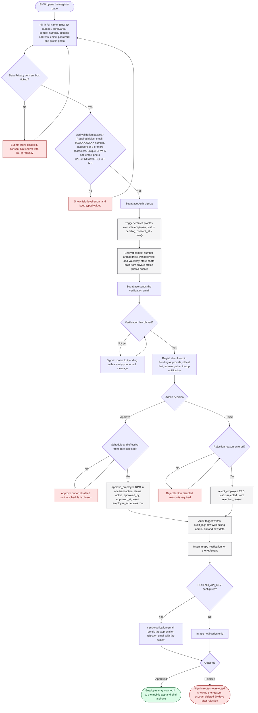
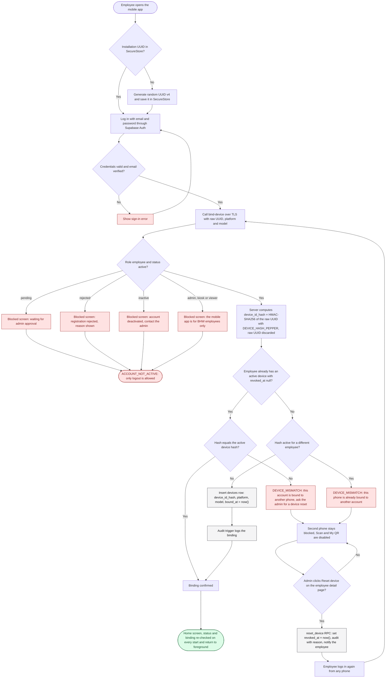
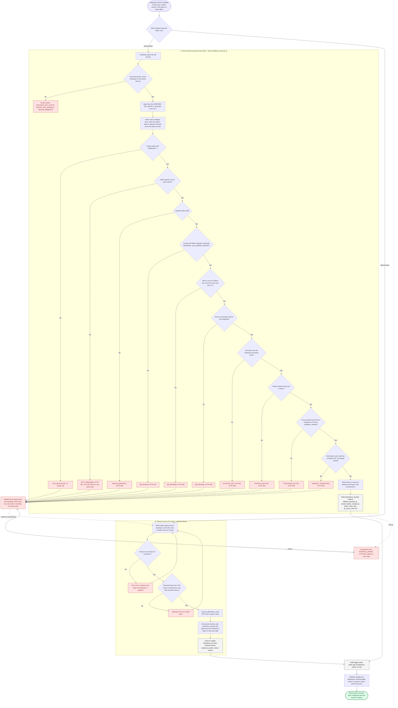
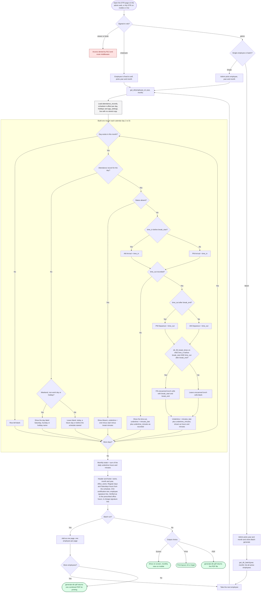
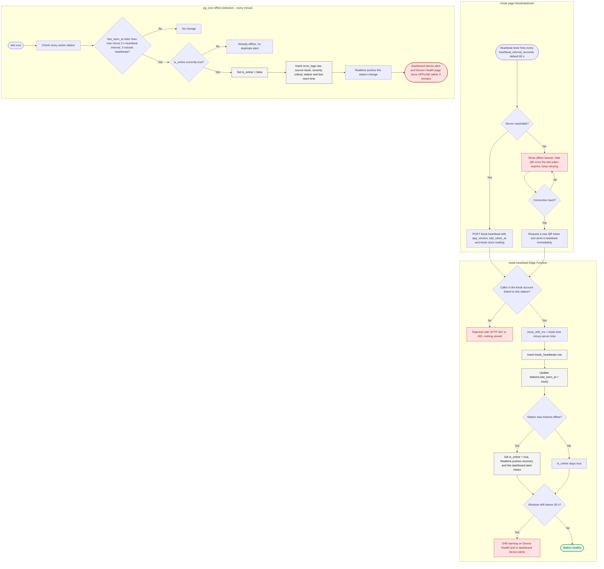
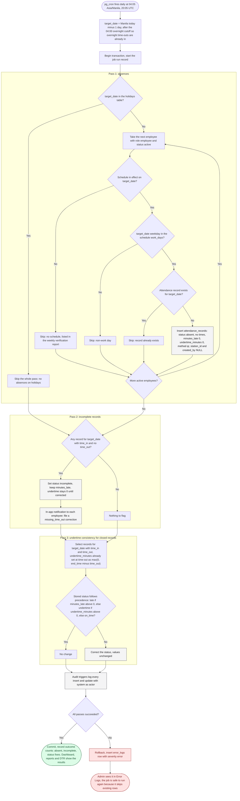

> **Role speaking: System Analyst**

# 06 – Process Flowcharts

This document shows the eight core processes of the BHW QR Attendance System as Mermaid flowcharts (`flowchart TD`). Each chart has a short explanation and a references line that links it to the functional requirements in [`02-functional-requirements.md`](./02-functional-requirements.md), the binding decisions in [`00-assumptions-and-decisions.md`](./00-assumptions-and-decisions.md) and the business rules in `05-business-rules.md`.

Business rules are cited by their topic name (for example "BR: time-in vs time-out decision") together with the decision ID they come from. The BR numbers themselves are kept in `05-business-rules.md`, so the links here stay correct even if that list is renumbered.

All times are Asia/Manila and come from the server clock, never from a phone or kiosk clock (FR-114).

## Notation

| Shape | Meaning |
| --- | --- |
| Rounded pill `([ ])` | Start or end of a flow |
| Rectangle `[ ]` | Action or process step |
| Diamond `{ }` | Decision (Yes / No or a named choice) |
| Dashed arrow `-.->` | Exceptional path (unexpected error, race condition, reconnect) |
| Red node | Rejection or failure result shown to the user |
| Green node | Successful end result |
| Grey node | Database write (record, log or audit row) |

## Index

| # | Flowchart | Main actors | Functional requirements | Decisions |
| --- | --- | --- | --- | --- |
| 1 | Registration and approval | Employee, Admin, System | FR-01–FR-10, FR-21–FR-26, FR-142–FR-144 | D-01, D-02, D-04, D-29, D-31, D-32, D-33 |
| 2 | Device binding on first mobile login | Employee, Admin, System | FR-27–FR-34, FR-140, FR-141 | D-01, D-05, D-06, D-07 |
| 3 | Scan to attend | Employee, Kiosk, System | FR-44–FR-61, FR-97, FR-121 | D-08–D-11, Section D, D-13–D-20 |
| 4 | Fallback (personal QR and manual entry) | Employee, Admin, System | FR-62–FR-67, FR-129 | D-12, D-14–D-19, D-28 |
| 5 | Correction request approval | Employee, Admin, System | FR-68–FR-77, FR-85, FR-142–FR-144 | D-25–D-28, D-33 |
| 6 | DTR generation | Admin, Employee, System | FR-78–FR-85 | D-19, D-22–D-24 |
| 7 | Kiosk health monitoring | Kiosk, System, Admin | FR-41, FR-100, FR-109–FR-112, FR-118, FR-119, FR-148 | D-03, D-34 |
| 8 | End-of-day job | System | FR-145, FR-146, FR-151 | D-13, D-16–D-19, D-21 |

---

## 1. Registration and approval

A BHW registers on the public `/register` page. Submission is blocked until the Data Privacy consent box is ticked and every field passes the shared zod schema. Supabase Auth then creates the account, and a trigger adds a `profiles` row with role `employee` and status `pending`. The contact number and address are encrypted, and the photo goes to the private `profile-photos` bucket. The registration appears in the admin's Pending Approvals list only after the email address is verified. The admin either approves it, which requires choosing a schedule and effective-from date and runs as one transaction, or rejects it with a required reason. Both outcomes are audited and send the registrant an in-app notification. An email is also sent when `RESEND_API_KEY` is configured. A rejected registration is deleted 90 days after rejection.

**References:** FR-01, FR-02, FR-03, FR-04, FR-05, FR-06, FR-07, FR-08, FR-21, FR-22, FR-23, FR-24, FR-26, FR-142, FR-143, FR-144 · BR: device binding/reset (an approved employee binds next), schedule changes (effective-from on approval) · D-01, D-02, D-04, D-29, D-31, D-32, D-33

---

## 2. Device binding on first mobile login

On first launch, the app creates a random installation UUID and saves it in SecureStore. After login, it calls `bind-device`. If the account is not an active employee, the app shows the Blocked screen and allows only logout. Pending, rejected and inactive accounts each get their own message, and rejected accounts see the reason. For an active employee, the server hashes the raw ID with `DEVICE_HASH_PEPPER` and stores only the hash. If the hash matches the employee's active device, the binding is confirmed. If the employee already has a different active phone, or the phone is already bound to another active employee, the request is rejected with `DEVICE_MISMATCH`. If neither is true, a new `devices` row is inserted and audited. A blocked second phone stays blocked until the admin uses "Reset device", which sets `revoked_at`. The next login from any phone then binds that phone. The app checks status and binding again each time it starts or returns to the foreground.

**References:** FR-27, FR-28, FR-29, FR-30, FR-31, FR-32, FR-33, FR-34, FR-140, FR-141, FR-144 · BR: device binding/reset · D-01, D-05, D-06, D-07

---

## 3. Scan to attend

The flow begins on the phone. An optional phone fingerprint or Face ID unlock comes first, followed by the pre-scan health check. Its codes (`BIOMETRIC_FAILED`, `CAMERA_DENIED`, `LOCATION_DENIED`, `LOCATION_UNAVAILABLE`, `OFFLINE`) never reach the server, and scans are never queued offline. The app then reads the kiosk QR, accepts only `BHWQR1:` content, adds a selfie when `selfie_required` is on, and calls `record-attendance`. The Edge Function runs the 15 checks of decisions Section D in the fixed order and stops at the first failure. Step 5 has two outcomes: `DEVICE_NOT_BOUND` when no device is bound, and `DEVICE_MISMATCH` when a different phone is bound. Between step 13 and step 14, the function finds the work date with the overnight rule. A scan before 04:00 Manila closes the previous day's open record. Step 14 needs this work date to know whether the day is already closed. When all checks pass, the time-in or time-out decision runs. Time-in computes `minutes_late` from the start time once the grace period is exceeded. Time-out computes `undertime_minutes` and applies the status precedence late > undertime > on_time. Non-work days, holidays and employees without a schedule are stored as `on_time` with a note. The attendance row, the `qr_nonce_uses` row and a successful `scan_attempts` row are written in one transaction. If a parallel request hits the `qr_nonce_uses` primary key, the transaction rolls back and returns `QR_REUSED`. Realtime then updates the dashboard within 2 seconds. Every failed attempt is also written to `scan_attempts`, with `employee_id` empty when the JWT is invalid. Any unexpected exception returns `INTERNAL_ERROR` and is written to `error_logs`. The app shows an animated success or failure overlay with haptic feedback and a plain-language English or Filipino message.

**References:** FR-44, FR-45, FR-46, FR-47, FR-48, FR-49, FR-50, FR-51, FR-52, FR-53, FR-54, FR-55, FR-56, FR-57, FR-58, FR-59, FR-61, FR-97, FR-114, FR-121 · BR: time-in vs time-out decision, status computation with grace period, undertime computation, cooldown, scans after midnight, holidays, schedule changes · D-08, D-09, D-10, D-11, Section D (steps 1–15 and `INTERNAL_ERROR`), D-13, D-14, D-15, D-16, D-17, D-18, D-19, D-20

```mermaid
flowchart TD
    START(["Employee taps the Scan button"])
    BIO{"Biometric unlock turned on in Profile?"}
    BIO2{"Phone fingerprint or Face ID accepted?"}
    MBIO["BIOMETRIC_FAILED: try again, nothing is sent to the server"]
    FIXRETRY(["Employee fixes the problem and taps Scan again"])
    START --> BIO
    BIO -->|Yes| BIO2
    BIO2 -->|No| MBIO

    subgraph PRE["Mobile pre-scan health check - these codes stay on the phone"]
        HC{"Camera permission granted?"}
        HC -->|No| MCAM["CAMERA_DENIED: show how to allow the camera"]
        HC -->|Yes| HL{"Location permission granted?"}
        HL -->|No| MLOC["LOCATION_DENIED: show how to allow location"]
        HL -->|Yes| HG{"GPS fix available?"}
        HG -->|No| MGPS["LOCATION_UNAVAILABLE: turn on GPS and move near a window"]
        HG -->|Yes| HN{"Internet connection available?"}
        HN -->|No| MOFF["OFFLINE: Snackbar notice, the scan is never queued"]
        HN -->|Yes| HD{"Account active and device still bound?"}
        HD -->|No| MBND["Open the Blocked or Bind Device screen"]
    end

    subgraph CAM["Mobile scan and request"]
        SC["Camera reads the kiosk QR"]
        SC --> PX{"Content starts with BHWQR1: ?"}
        PX -->|No| MPX["Not an office kiosk QR, no server call"]
        PX -->|Yes| SF{"selfie_required is on?"}
        SF -->|Yes| SFC["Capture front-camera selfie"]
        SF -->|No| CALL["POST record-attendance with token, raw device ID, lat, lng, accuracy and selfie if taken"]
        SFC --> CALL
    end

    subgraph VAL["record-attendance - fixed order, stops at the first failure"]
        V1{"Step 1: Valid JWT?"}
        V1 -->|No| E1["AUTH_REQUIRED, HTTP 401"]
        V1 -->|Yes| V2{"Step 2: At most 10 requests per minute for this user?"}
        V2 -->|No| E2["RATE_LIMITED, HTTP 429"]
        V2 -->|Yes| V3{"Step 3: Request body valid against the zod schema?"}
        V3 -->|No| E3["INVALID_REQUEST, HTTP 400"]
        V3 -->|Yes| V4{"Step 4: Role employee and status active?"}
        V4 -->|No| E4["ACCOUNT_NOT_ACTIVE, HTTP 403"]
        V4 -->|Yes| V5A{"Step 5a: Employee has an active bound device?"}
        V5A -->|No| E5A["DEVICE_NOT_BOUND, HTTP 403"]
        V5A -->|Yes| V5B{"Step 5b: HMAC hash of the sent device ID equals the active device hash?"}
        V5B -->|No| E5B["DEVICE_MISMATCH, HTTP 403"]
        V5B -->|Yes| V6{"Step 6: Token format and HMAC signature valid with the current or previous secret?"}
        V6 -->|No| E6["QR_INVALID, HTTP 400"]
        V6 -->|Yes| V7{"Step 7: Server now at or before exp, and iat at most now plus 5 s?"}
        V7 -->|No| E7["QR_EXPIRED, HTTP 400"]
        V7 -->|Yes| V8{"Step 8: Nonce exists in qr_nonces for this station?"}
        V8 -->|No| E8["QR_UNKNOWN, HTTP 400"]
        V8 -->|Yes| V9{"Step 9: Nonce not yet used by this employee in qr_nonce_uses?"}
        V9 -->|No| E9["QR_REUSED, HTTP 409"]
        V9 -->|Yes| V10{"Step 10: Station exists and is_active?"}
        V10 -->|No| E10["STATION_INACTIVE, HTTP 400"]
        V10 -->|Yes| V11{"Step 11: GPS accuracy at most max_gps_accuracy_m, default 50 m?"}
        V11 -->|No| E11["GPS_INACCURATE, HTTP 400"]
        V11 -->|Yes| V12{"Step 12: Haversine distance at most the station radius_m, default 100 m?"}
        V12 -->|No| E12["OUTSIDE_GEOFENCE, HTTP 403: move closer to the office"]
        V12 -->|Yes| V13{"Step 13: No successful scan in the last cooldown_minutes, default 5?"}
        V13 -->|No| E13["COOLDOWN_ACTIVE, HTTP 429: shows when scanning is allowed again"]
        V13 -->|Yes| WD["Resolve work date with the overnight rule: Manila time before overnight_cutoff_hour 04:00 AND previous day has time_in without time_out gives the previous day, otherwise today"]
        WD --> V14{"Step 14: Work-date record not already closed with both time_in and time_out?"}
        V14 -->|No| E14["ALREADY_COMPLETED, HTTP 409"]
        V14 -->|Yes| V15{"Step 15: Selfie present when selfie_required = true?"}
        V15 -->|No| E15["SELFIE_REQUIRED, HTTP 400"]
    end

    subgraph DEC["Time-in or time-out decision and status - server time, Asia/Manila"]
        DTYPE{"Record for the work date?"}
        DTYPE -->|"None, or absent row from the end-of-day job"| TIN["Action: TIME-IN"]
        DTYPE -->|"Has time_in, no time_out"| TOUT["Action: TIME-OUT"]
        TIN --> SA{"Schedule in effect on the work date?"}
        SA -->|No| NS["minutes_late 0, status on_time, notes: No schedule assigned"]
        SA -->|Yes| SB{"Holiday, or weekday not in schedule work_days?"}
        SB -->|Yes| NW["minutes_late 0, status on_time, notes: holiday name or Non-working day"]
        SB -->|No| SG{"time_in at or before start_time plus grace_minutes?"}
        SG -->|Yes| ONT["minutes_late 0, provisional status on_time"]
        SG -->|No| LAT["minutes_late = time_in minus start_time, provisional status late"]
        TOUT --> SD{"Record noted as holiday, non-working day or no schedule?"}
        SD -->|Yes| ZU["undertime_minutes 0, status stays on_time"]
        SD -->|No| CU["undertime_minutes = max(0, end_time minus time_out)"]
        CU --> PL{"minutes_late above 0?"}
        PL -->|Yes| SL["status late, both numbers kept"]
        PL -->|No| PU{"undertime_minutes above 0?"}
        PU -->|Yes| SUN["status undertime"]
        PU -->|No| SON["status on_time"]
    end

    subgraph DBW["One database transaction"]
        W1["Insert or update attendance_records: method qr, station_id, time_in or time_out, minutes_late, undertime_minutes, status, time_in_scan_id or time_out_scan_id"]
        W1 --> W2["Insert qr_nonce_uses row for this nonce and employee"]
        W2 --> W3["Insert scan_attempts row: success true, selfie_path if taken"]
        W3 --> W4["Audit trigger writes audit_logs"]
    end

    subgraph FAILP["Failure path"]
        LF["Insert scan_attempts row: success false, error_code, failure_reason, lat, lng, accuracy, device_id_hash, nonce, server time"]
        LF --> AF["Anomaly rules may flag the employee for admin review: 5 or more failures in 10 minutes, repeated OUTSIDE_GEOFENCE or QR_REUSED"]
        AF --> RF["Return error code, HTTP status and friendly English or Filipino message"]
        RF --> FOV(["App shows the animated failure overlay with fix guidance and error haptic"])
    end

    EXC["Unexpected exception in any step or in the transaction"]
    E99["INTERNAL_ERROR, HTTP 500"]
    ELOG["error_logs row: source edge_function, severity error, secrets removed from context"]
    RT["Realtime pushes the change: admin dashboard within 2 s, kiosk feed shows first name and time"]
    RS["Return HTTP 200 with action, Manila time, status and friendly message"]
    SUCC(["App shows the animated success overlay with success haptic"])

    BIO -->|No| HC
    BIO2 -->|Yes| HC
    HD -->|Yes| SC
    CALL --> V1
    V15 -->|Yes| DTYPE
    NS --> W1
    NW --> W1
    ONT --> W1
    LAT --> W1
    ZU --> W1
    SL --> W1
    SUN --> W1
    SON --> W1
    W2 -.->|"Primary key conflict from a parallel request, rollback"| E9
    W4 --> RT
    RT --> RS
    RS --> SUCC
    E1 --> LF
    E2 --> LF
    E3 --> LF
    E4 --> LF
    E5A --> LF
    E5B --> LF
    E6 --> LF
    E7 --> LF
    E8 --> LF
    E9 --> LF
    E10 --> LF
    E11 --> LF
    E12 --> LF
    E13 --> LF
    E14 --> LF
    E15 --> LF
    VAL -.->|"throws"| EXC
    DBW -.->|"throws, rollback"| EXC
    EXC --> E99
    E99 --> ELOG
    ELOG --> LF
    MBIO --> FIXRETRY
    MCAM --> FIXRETRY
    MLOC --> FIXRETRY
    MGPS --> FIXRETRY
    MOFF --> FIXRETRY
    MPX --> FIXRETRY

    classDef failNode fill:#fee2e2,stroke:#991b1b,color:#7f1d1d
    classDef okNode fill:#dcfce7,stroke:#166534,color:#14532d
    classDef dbNode fill:#f4f4f5,stroke:#3f3f46,color:#18181b
    class MBIO,MCAM,MLOC,MGPS,MOFF,MBND,MPX,E1,E2,E3,E4,E5A,E5B,E6,E7,E8,E9,E10,E11,E12,E13,E14,E15,E99,FOV failNode
    class SUCC okNode
    class W1,W2,W3,W4,LF,ELOG dbNode
```

**Validation step to error code summary** (same order as decisions Section D):

| Step | Check | Error code | HTTP | FR |
| --- | --- | --- | --- | --- |
| 1 | Valid JWT | `AUTH_REQUIRED` | 401 | FR-47, FR-141 |
| 2 | Rate limit, 10 requests per minute per user | `RATE_LIMITED` | 429 | FR-47 |
| 3 | Request body valid (zod) | `INVALID_REQUEST` | 400 | FR-47 |
| 4 | Role employee and status active | `ACCOUNT_NOT_ACTIVE` | 403 | FR-47, FR-28 |
| 5 | Device bound / hash matches | `DEVICE_NOT_BOUND` / `DEVICE_MISMATCH` | 403 | FR-30, FR-47 |
| 6 | Token format and HMAC signature | `QR_INVALID` | 400 | FR-37, FR-42 |
| 7 | Not expired, `iat` not more than 5 s ahead | `QR_EXPIRED` | 400 | FR-48 |
| 8 | Nonce known for the station | `QR_UNKNOWN` | 400 | FR-49 |
| 9 | Nonce not reused by this employee | `QR_REUSED` | 409 | FR-49 |
| 10 | Station exists and active | `STATION_INACTIVE` | 400 | FR-47 |
| 11 | GPS accuracy within limit | `GPS_INACCURATE` | 400 | FR-50 |
| 12 | Inside geofence | `OUTSIDE_GEOFENCE` | 403 | FR-50 |
| 13 | Cooldown passed | `COOLDOWN_ACTIVE` | 429 | FR-51 |
| 14 | Day not already completed | `ALREADY_COMPLETED` | 409 | FR-52 |
| 15 | Selfie present when required | `SELFIE_REQUIRED` | 400 | FR-57 |
| — | Unexpected error | `INTERNAL_ERROR` | 500 | FR-121 |

---

## 4. Fallback: personal QR and manual entry

When a kiosk scan cannot be completed (for example a broken phone camera, a GPS failure or an offline kiosk), the admin has two audited alternatives. **(A) Personal QR:** the employee opens My QR, and `issue-personal-qr` refuses the QR unless the employee is active and on the bound device. The admin scans the `BHWPQR1:` code on the Fallback Scan page. `record-fallback-scan` checks, in order: an active admin caller, a valid request, the signature with `PERSONAL_QR_SIGNING_SECRET`, expiry, nonce reuse, employee status, station, cooldown and day completion. Each failure uses the same error codes as the kiosk scan. Geofence and GPS checks are skipped because the admin is physically present. The record uses the same time-in/time-out, overnight and status rules as flowchart 3, with method `fallback_personal_qr`, the station chosen by the admin, and the admin as `created_by`. **(B) Manual entry:** the admin enters the employee, work date and times with a reason of at least 10 characters. Future dates or times and a time-out before the time-in are rejected. `manual_attendance_entry` recomputes late, undertime and status from the schedule in effect on that date and stores method `manual`. Both paths are audited with their reason or note and appear with a method badge on records, history and the DTR.

**References:** FR-62, FR-63, FR-64, FR-65, FR-66, FR-67, FR-121, FR-129 · BR: fallback and manual entry, time-in vs time-out decision, status computation with grace period, undertime computation, cooldown, scans after midnight · D-12, D-13, D-14, D-15, D-16, D-17, D-18, D-19, D-20, D-28

---

## 5. Correction request approval

An employee files a correction request from the mobile History screen, the Correction Request form or the web `/me` page. Eligibility is checked first:

- The work date is not in the future.
- The work date is in the current Manila month, or in the previous month while today is within the first `correction_window_days` (default 5) days of the month.
- No other pending request exists for the same work date.
- An attachment, if added, is an image or PDF of at most 5 MB.

A valid request is saved as `pending`, audited, and admins are notified. While it is pending, the employee may cancel it (`cancelled`). The admin reviews the current record beside the requested values. **Reject** requires remarks and leaves the attendance record unchanged. **Approve** runs `review_correction_request` as one transaction:

- It confirms the request is still pending.
- It upserts the attendance record with method `correction`. An `official_business` request with both times blank uses the schedule start and end times and the note "Official business".
- It recomputes late, undertime and status, marks the request approved, inserts the notification and lets the audit triggers log both changes.

If any part fails, everything rolls back. Because the DTR is built live from the records, it shows the change immediately. Outcome emails are sent when Resend is configured.

**References:** FR-68, FR-69, FR-70, FR-71, FR-72, FR-73, FR-74, FR-75, FR-76, FR-77, FR-85, FR-121, FR-142, FR-143, FR-144 · BR: correction request eligibility and approval, status computation with grace period, undertime computation · D-25, D-26, D-27, D-28, D-31, D-33

```mermaid
flowchart TD
    START(["Employee taps Request correction in mobile History or on web /me"])
    START --> FILL["Choose type: missing_time_in, missing_time_out, wrong_time or official_business. Enter work date, requested time-in and/or time-out, reason, optional attachment"]
    FILL --> REQF{"Required fields for the chosen type present?"}
    REQF -->|No| REQFERR["Form error shown under the field"]
    REQFERR --> FILL
    REQF -->|Yes| FUT{"Work date in the future?"}
    FUT -->|Yes| FUTERR["Not allowed: future dates cannot be corrected"]
    FUT -->|No| CURM{"Work date in the current Manila month?"}
    CURM -->|Yes| DUP
    CURM -->|No| PREVM{"Work date in the previous month AND today is day 1 to correction_window_days, default 5?"}
    PREVM -->|No| WINERR["Not allowed: outside the correction window"]
    PREVM -->|Yes| DUP{"Another pending request for this work date?"}
    DUP -->|Yes| DUPERR["Not allowed: one pending request per work date"]
    DUP -->|No| ATT{"Attachment added?"}
    ATT -->|Yes| ATTOK{"Image or PDF of at most 5 MB?"}
    ATTOK -->|No| ATTERR["Form error: file type or size"]
    ATTERR --> FILL
    ATTOK -->|Yes| UPLOAD["Upload to private correction-attachments bucket"]
    UPLOAD --> SAVE
    ATT -->|No| SAVE["Insert correction_requests row with status pending"]
    SAVE --> NOTIFYADM["Audit trigger logs the request, admins get an in-app notification"]
    NOTIFYADM --> CANCELQ{"Employee cancels while still pending?"}
    CANCELQ -->|Yes| CANCELLED(["Status cancelled, audited, no further action"])
    CANCELQ -->|No| REVIEW["Admin opens Correction Requests: current record beside requested values, attachment through signed URL"]
    REVIEW --> DECISION{"Admin decision"}
    DECISION -->|Reject| REMARKS{"Remarks entered?"}
    REMARKS -->|No| NEEDREM["Reject button disabled: remarks are required"]
    NEEDREM --> REMARKS
    REMARKS -->|Yes| DOREJECT["review_correction_request: status rejected, reviewed_by, reviewed_at, remarks, attendance record unchanged"]
    DOREJECT --> REJNOTE["Insert notification with remarks, audit trigger logs the change"]

    subgraph TXN["review_correction_request approve - one transaction"]
        T1{"Request still pending?"}
        T1 -->|No| T1F["Abort: already reviewed or cancelled"]
        T1 -->|Yes| T2{"official_business with both times blank?"}
        T2 -->|Yes| T3["Use the schedule start_time and end_time, notes Official business"]
        T2 -->|No| T4["Use the requested time-in and/or time-out"]
        T3 --> T5["Insert or update attendance_records for the work date with method correction"]
        T4 --> T5
        T5 --> T6["Recompute minutes_late, undertime_minutes and status by the same precedence rules"]
        T6 --> T7["Set request approved, reviewed_by, reviewed_at, optional remarks"]
        T7 --> T8["Insert in-app notification for the employee"]
        T8 --> T9["Audit triggers log the attendance change and the request change"]
    end

    COMMIT{"Transaction committed?"}
    ROLLBACK["Rollback everything, INTERNAL_ERROR written to error_logs, admin sees an error toast"]
    LIVE["Record, reports and DTR show the change at once because the DTR is built live"]
    MAILCFG{"RESEND_API_KEY configured?"}
    SENDMAIL["send-notification-email sends the outcome with remarks"]
    INAPPONLY["In-app notification only"]
    FINISH(["Employee sees the outcome and remarks in My Requests"])

    DECISION -->|Approve| T1
    T9 --> COMMIT
    COMMIT -->|No| ROLLBACK
    COMMIT -->|Yes| LIVE
    LIVE --> MAILCFG
    REJNOTE --> MAILCFG
    MAILCFG -->|Yes| SENDMAIL
    MAILCFG -->|No| INAPPONLY
    SENDMAIL --> FINISH
    INAPPONLY --> FINISH

    classDef failNode fill:#fee2e2,stroke:#991b1b,color:#7f1d1d
    classDef okNode fill:#dcfce7,stroke:#166534,color:#14532d
    classDef dbNode fill:#f4f4f5,stroke:#3f3f46,color:#18181b
    class REQFERR,FUTERR,WINERR,DUPERR,ATTERR,NEEDREM,T1F,ROLLBACK failNode
    class FINISH okNode
    class SAVE,NOTIFYADM,DOREJECT,REJNOTE,T5,T7,T8,T9 dbNode
```

---

## 6. DTR generation (single and batch, PDF)

The DTR (Civil Service Form No. 48) is always built live from `attendance_records`, the schedule in effect on each day, the `holidays` table and `app_settings`. No copy is stored, so corrections, manual entries and fallback scans show up immediately. An employee can generate only their own DTR. An admin can choose one employee or batch mode for all active employees. Viewers and kiosks are denied. For each calendar day from 1 to 31:

- Days that do not exist in the month are left blank.
- Weekends, non-work days and holidays without a scan show their label.
- Absent days show "Absent" with the full scheduled minutes as undertime.
- Otherwise time-in goes to AM or PM Arrival by comparing it with `break_start`, and time-out goes to AM or PM Departure by comparing it with `break_end`. Days without a time-out show "No time-out".
- Lunch cells are filled only when `dtr_fill_break_times` is on and the day spans the break (time-in before `break_start` and time-out after `break_end`, BR-74).
- The undertime column is `minutes_late + undertime_minutes`.

Monthly totals are the sum of the daily values. The header and footer carry the CSC certification and the two signature lines. The result can be shown on screen, printed (A4 or legal) or downloaded as a PDF from `generate-dtr-pdf`. Batch mode produces one PDF with one employee per page.

**References:** FR-78, FR-79, FR-80, FR-81, FR-82, FR-83, FR-84, FR-85, FR-134 · BR: DTR AM/PM split and totals, holidays, schedule changes · D-19, D-22, D-23, D-24

---

## 7. Kiosk health monitoring

Every 60 seconds (`heartbeat_interval_seconds`), the kiosk page sends a heartbeat with its app version, last token time and its own clock reading. `kiosk-heartbeat` accepts heartbeats only from the kiosk account linked to that station. It computes clock drift as kiosk time minus server time, stores a `kiosk_heartbeats` row and updates `stations.last_seen_at`. If the station was offline, it sets the station back online, and Realtime clears the alert on the dashboard. A drift of more than 30 seconds raises a warning on the Device Health page and among the dashboard device alerts. A pg_cron job runs every minute and checks each active station. When `last_seen_at` is older than 3 heartbeat intervals (3 minutes), the job sets `is_online = false` once and writes one critical `error_logs` row (source `kiosk`). Realtime pushes the change, so the admin sees the offline alert within 3 minutes. If the kiosk loses its connection, it shows an offline banner and hides the QR after the last token expires. When the connection returns, it immediately requests a new token and sends a heartbeat.

**References:** FR-41, FR-100, FR-109, FR-110, FR-111, FR-112, FR-118, FR-119, FR-148 · BR: none beyond the decisions below (operational rule) · D-03, D-32 (heartbeats kept 30 days), D-34

---

## 8. End-of-day job

The end-of-day job runs daily at 04:05 Asia/Manila (20:05 UTC) for the **previous** work date. That is just after the 04:00 overnight cutoff, so overnight time-outs are already recorded. The run has three passes inside one transaction:

1. **Absences.** On a holiday, this pass is skipped entirely. Otherwise, each active employee who has a schedule in effect, whose weekday is in `work_days` and who has no record gets an `absent` row with no times and zero late and undertime minutes.
2. **Incomplete records.** Every record with a time-in and no time-out becomes `incomplete`. Its `minutes_late` is kept and its undertime stays 0 until the record is corrected. The employee gets an in-app suggestion to file a `missing_time_out` correction.
3. **Undertime consistency.** For closed records, the job does not recompute the `undertime_minutes` value that was set at time-out. It only makes sure the stored status follows the precedence late > undertime > on_time.

Every insert and update is audited with the system as actor. Because the job skips rows that already exist, it is safe to run again. A failed run rolls back and writes an `error_logs` row with severity `error`.

**References:** FR-53, FR-106, FR-145, FR-146, FR-149, FR-151 · BR: forgotten time-out, holidays, undertime computation, status computation with grace period, scans after midnight, schedule changes · D-13, D-16, D-17, D-18, D-19, D-21

---

> **Backend Developer note:** Flowchart 3 is the reference for the Deno tests of `record-attendance` in Phase 3. Each of the 16 error codes, including both step 5 codes and `INTERNAL_ERROR`, needs its own test. The tests must also cover the `qr_nonce_uses` primary-key race, which returns `QR_REUSED`. In flowchart 3, the work date is resolved before step 14, so the overnight rule must live in a helper shared by `record-attendance`, `record-fallback-scan` and `manual_attendance_entry`. Flowchart 8 needs one attendance row per employee per work date, enforced by a unique index on `attendance_records(employee_id, work_date)`, so that a rerun of the job cannot create duplicate absences.
>
> **Frontend Designer / Developer note:** Flowchart 3 sets the states the mobile Scan screen must render. These are the five pre-scan health-check codes, the non-kiosk-QR message, and the success overlay and failure overlay for each server code (Tamagui overlay, haptics, English and Filipino text). Flowcharts 1 and 5 require disabled buttons with visible hints. In flowchart 1, Submit stays disabled until consent is given, Approve until a schedule is chosen, and Reject until a reason is entered. In flowchart 5, Reject stays disabled until remarks are entered. Flowchart 2 defines four variants of the mobile Blocked screen: pending, rejected with reason, inactive, and wrong role.
>
> **System Administrator note:** Flowchart 7's offline alert depends on the every-minute pg_cron job and Realtime on `stations`. Both must be enabled in production (Phase 6 go-live checklist). The job in flowchart 8 is scheduled in UTC (`5 20 * * *`), which equals 04:05 Asia/Manila.
