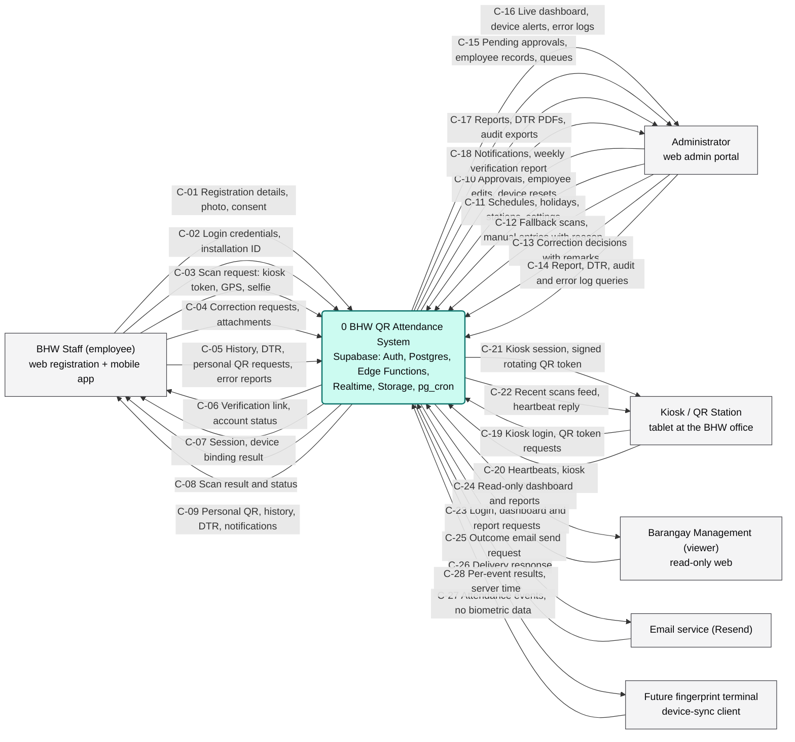
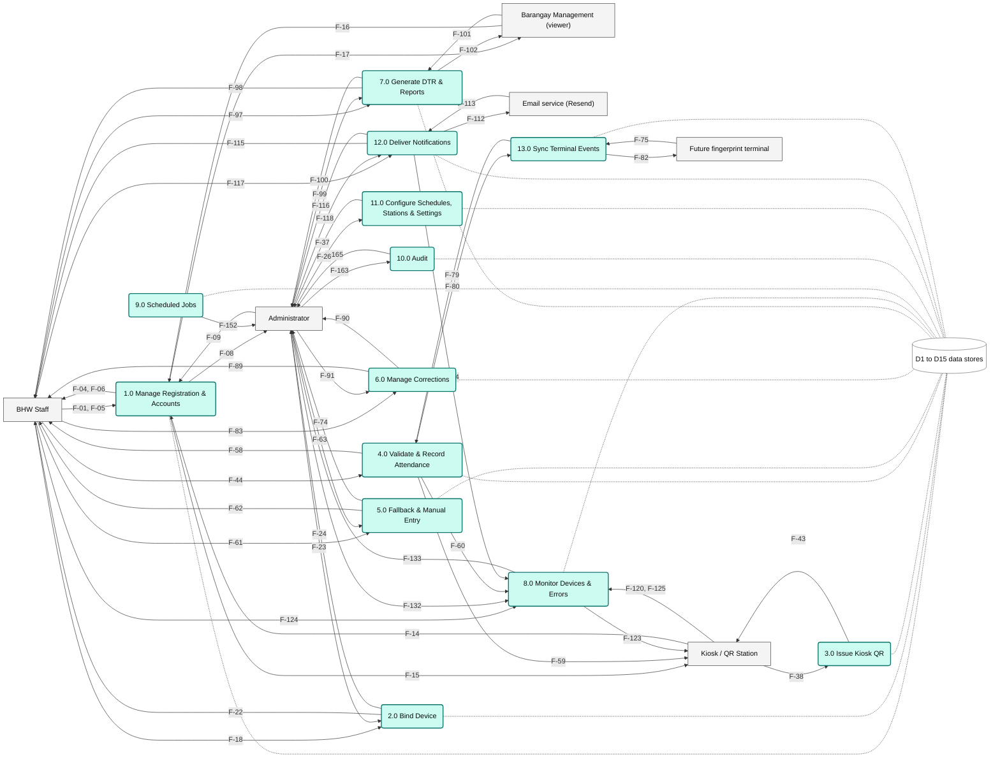
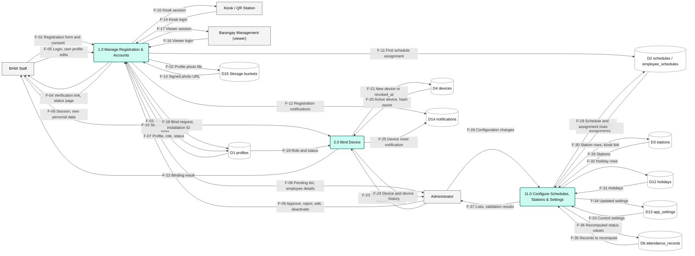
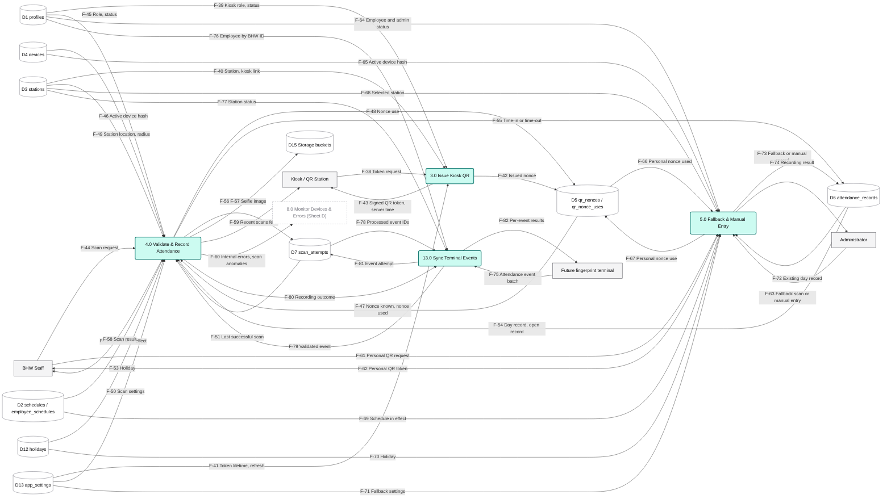
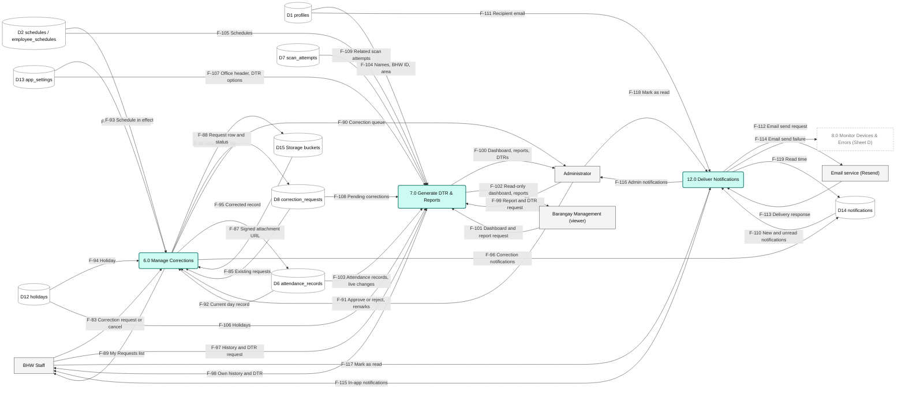
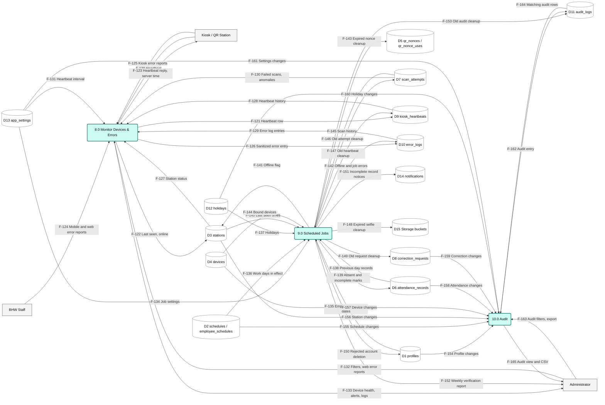

> **Role speaking: System Analyst**

# 07 – Context Diagram and Level-1 Data Flow Diagram

This document shows how data moves into, through and out of the BHW QR Attendance System. It has two levels:

- **Context diagram (Level 0):** the whole system as one process, with the six external entities around it.
- **Level-1 DFD:** the system opened up into 13 numbered processes and 15 data stores. The data stores are the real Supabase tables and buckets from [`08-erd.md`](./08-erd.md).

Every flow has an ID. Context flows use `C-xx` and Level-1 flows use `F-xx`. Section 6 checks that the two levels balance. Requirement IDs (FR-xx) come from [`02-functional-requirements.md`](./02-functional-requirements.md). Decision IDs (D-xx) come from [`00-assumptions-and-decisions.md`](./00-assumptions-and-decisions.md).

All dates and times are Asia/Manila. "Server time" means the database or Edge Function clock, never the phone, kiosk or terminal clock (FR-114).

## 1. Notation

The diagrams follow Gane-Sarson conventions as closely as Mermaid allows:

| Symbol | Gane-Sarson meaning | Mermaid shape used here | Example |
| --- | --- | --- | --- |
| External entity | A person, device or outside service that sends or receives data but is outside the system | Rectangle, grey | `BHW Staff` |
| Process | Work that changes or moves data, numbered `1.0`, `2.0`, ... | Rounded rectangle, teal | `4.0 Validate & Record Attendance` |
| Data store | Data at rest, numbered `D1`, `D2`, ... | Cylinder | `D6 attendance_records` |
| Data flow | Data moving in the direction of the arrow, labelled with its ID and content | Labelled arrow | `F-44 Scan request` |
| Off-sheet process | A process drawn in full on another sheet, shown only so a flow can reach it | Dashed rectangle | `8.0 Monitor Devices & Errors` |

DFD rules applied:

1. Data never flows directly between two data stores, or between an external entity and a data store. A process always sits in between.
2. Every process has at least one input and at least one output.
3. Flows between two external entities are not drawn. Two exist in real life and are described in section 3.3.
4. Each Level-1 flow is drawn exactly once, on the sheet of the process that owns it. The flow table in section 5 is the complete list.

## 2. Context diagram (Level 0)

### 2.1 External entities

| Entity | Who or what it is | Channel | Role in Supabase Auth |
| --- | --- | --- | --- |
| BHW Staff (employee) | Barangay Health Worker who registers, binds one phone and scans to time in and out | Web (`/register`, `/me`) and Expo mobile app | `employee` (D-01, D-02) |
| Administrator | Office staff who approves registrations and runs the system | Web admin portal | `admin` |
| Kiosk / QR Station | Tablet or monitor at the office showing `/kiosk/[stationId]` | Web, full screen | `kiosk`, linked to one station (D-03) |
| Barangay Management (viewer) | Barangay officials who check attendance | Web, read-only dashboard and reports | `viewer` |
| Email service (Resend) | Outside email API used by `send-notification-email` | HTTPS API, only when `RESEND_API_KEY` is set (D-33) | None (server-to-server) |
| Future fingerprint terminal | A biometric terminal the barangay may add later. Templates stay on the terminal; only attendance events are sent | HTTPS `device-sync` Edge Function (FR-116) | None. It uses the terminal credential defined in the `device-sync` contract |

### 2.2 Context data flows

| ID | From | To | Data | Notes |
| --- | --- | --- | --- | --- |
| C-01 | BHW Staff | System | Full name, BHW ID number, purok/area, contact number, optional address, email, password, profile photo, Data Privacy consent | FR-01 to FR-07. Level 1: F-01 |
| C-02 | BHW Staff | System | Email and password; raw installation ID, platform and model at first mobile login; own profile edits | Raw ID only over TLS, never stored (D-05). Level 1: F-05, F-18 |
| C-03 | BHW Staff | System | Scanned kiosk token, raw installation ID, latitude, longitude, GPS accuracy, mocked-location flag, optional selfie | FR-46, FR-57, FR-58. Level 1: F-44 |
| C-04 | BHW Staff | System | Correction request (type, work date, requested times, reason, optional attachment) or cancellation | FR-68 to FR-72. Level 1: F-83 |
| C-05 | BHW Staff | System | History and DTR month requests, personal QR requests, mobile and web error reports, notification read marks | FR-60, FR-62, FR-84, FR-120, FR-142. Level 1: F-61, F-97, F-117, F-124 |
| C-06 | System | BHW Staff | Email verification link (Supabase Auth), pending / rejected (with reason) / inactive status pages | FR-04, FR-08. Level 1: F-04 |
| C-07 | System | BHW Staff | Session with role and status, device binding result or Blocked screen reason | FR-28, FR-30, FR-34. Level 1: F-06, F-22 |
| C-08 | System | BHW Staff | Success or error code, friendly English/Filipino message, time-in or time-out, server time, status, cooldown end time | FR-51, FR-56. Level 1: F-58 |
| C-09 | System | BHW Staff | Rotating personal QR, own history, DTR view and PDF, correction request statuses and remarks, in-app notifications | FR-62, FR-71, FR-84, FR-142. Level 1: F-62, F-89, F-98, F-115 |
| C-10 | Administrator | System | Admin login, approval with schedule and effective date, rejection with reason, employee edits, deactivation, new admin/kiosk/viewer accounts, erasure request, device reset with reason | FR-09, FR-13 to FR-15, FR-20, FR-22, FR-23, FR-32. Level 1: F-09, F-23 |
| C-11 | Administrator | System | Schedules and assignments, holidays, stations (coordinates, radius, kiosk link), `app_settings` values, recompute request | FR-102 to FR-108, FR-132. Level 1: F-26 |
| C-12 | Administrator | System | Scanned personal QR with station and note, or manual entry with reason of at least 10 characters | FR-63 to FR-65. Level 1: F-63 |
| C-13 | Administrator | System | Approve or reject a correction request, with remarks | FR-74. Level 1: F-91 |
| C-14 | Administrator | System | Report and DTR filters, attendance record searches, error log and device health filters, audit filters and export requests, web error reports, notification read marks | FR-86 to FR-94, FR-120, FR-123, FR-128. Level 1: F-99, F-118, F-132, F-163 |
| C-15 | System | Administrator | Pending approvals, employee list and details, device history, configuration lists, fallback and manual entry results, correction queue | FR-11, FR-12, FR-21, FR-33, FR-73. Level 1: F-08, F-24, F-37, F-74, F-90 |
| C-16 | System | Administrator | Live dashboard, device health, offline and clock drift alerts, error logs, failed scans, anomaly flags | FR-95 to FR-100, FR-110 to FR-113, FR-123. Level 1: F-100, F-133 |
| C-17 | System | Administrator | Daily, weekly and monthly reports (screen, CSV, PDF), single and batch DTR PDFs, audit log view and CSV | FR-82, FR-83, FR-86 to FR-91, FR-128, FR-131. Level 1: F-100, F-165 |
| C-18 | System | Administrator | In-app notifications (new registration, new correction request), weekly periodic verification report | FR-144, FR-149. Level 1: F-116, F-152 |
| C-19 | Kiosk / QR Station | System | Kiosk account login, QR token request every 15 s | D-03, FR-36. Level 1: F-14, F-38 |
| C-20 | Kiosk / QR Station | System | Heartbeat every 60 s (app version, kiosk clock, last token time), kiosk error reports | FR-109, FR-120. Level 1: F-120, F-125 |
| C-21 | System | Kiosk / QR Station | Kiosk session, signed `BHWQR1:` token with expiry and server time | FR-37, FR-39. Level 1: F-15, F-43 |
| C-22 | System | Kiosk / QR Station | Recent successful scans at its own station (first name, label, time), heartbeat reply with server time | FR-40, FR-109. Level 1: F-59, F-123 |
| C-23 | Barangay Management | System | Viewer login, dashboard and report requests | FR-93. Level 1: F-16, F-101 |
| C-24 | System | Barangay Management | Viewer session, read-only dashboard and reports without contact data | FR-93, FR-101. Level 1: F-17, F-102 |
| C-25 | System | Email service (Resend) | Recipient email, subject and body for registration approved/rejected and correction approved/rejected | Sent only when `RESEND_API_KEY` is set (D-33, FR-143). Level 1: F-112 |
| C-26 | Email service (Resend) | System | Message ID or error | Failures are logged (FR-121). Level 1: F-113 |
| C-27 | Future fingerprint terminal | System | Terminal credential, station ID, events (event ID, BHW ID number, capture time) | No fingerprint templates or images (D-30). Level 1: F-75 |
| C-28 | System | Future fingerprint terminal | Result per event (accepted, duplicate or rejected with error code), server time | FR-116, FR-117. Level 1: F-82 |

## 3. Level-1 DFD: processes and data stores

### 3.1 Processes

| No. | Process | What it does | Implemented by (Phase 3/4/5) | Main FRs |
| --- | --- | --- | --- | --- |
| 1.0 | Manage Registration & Accounts | Registration with consent, email verification, login and sessions, approval or rejection, employee records, staff accounts, data access and erasure | Supabase Auth, signup trigger, `/register`, `/login`, `/me`, RPCs `approve_employee`, `reject_employee`, `deactivate_employee`, `get_profile_private` | FR-01 to FR-26, FR-137 to FR-141 |
| 2.0 | Bind Device | Binds one phone per employee, checks status on app start, resets devices | Edge Function `bind-device`, RPC `reset_device` | FR-27 to FR-34 |
| 3.0 | Issue Kiosk QR | Issues a signed 30 s token every 15 s and registers its nonce | Edge Function `issue-qr-token` | FR-35 to FR-43 |
| 4.0 | Validate & Record Attendance | Runs the fixed 15-step validation, decides time-in or time-out, computes status, logs every attempt, feeds the kiosk | Edge Function `record-attendance`, SQL `compute_attendance_status()`, `haversine_distance_m()`, `manila_today()` | FR-44 to FR-61, FR-114 |
| 5.0 | Fallback & Manual Entry | Issues the rotating personal QR, records admin fallback scans and manual entries | Edge Functions `issue-personal-qr`, `record-fallback-scan`, RPC `manual_attendance_entry` | FR-62 to FR-67 |
| 6.0 | Manage Corrections | Files, cancels and reviews correction requests; approval updates the record in one transaction | RLS insert/update on `correction_requests`, RPC `review_correction_request` | FR-68 to FR-77 |
| 7.0 | Generate DTR & Reports | Builds CSC Form 48 DTRs, daily/weekly/monthly reports, employee history and the live dashboard | RPCs `get_dtr`, `get_dtr_batch`, `get_daily_summary`, `get_weekly_summary`, `get_monthly_summary`, `get_employee_history`, `get_dashboard_today`; Edge Function `generate-dtr-pdf`; Realtime | FR-78 to FR-101 |
| 8.0 | Monitor Devices & Errors | Receives kiosk heartbeats and error reports, shows Device Health, Error Logs, failed scans and anomaly flags | Edge Functions `kiosk-heartbeat`, `log-error`; Device Health and Error Logs pages | FR-108 to FR-113, FR-118 to FR-125 |
| 9.0 | Scheduled Jobs | End-of-day absence and incomplete marking, offline detection, nonce cleanup, weekly verification, retention cleanup | pg_cron jobs | FR-145 to FR-151 |
| 10.0 | Audit | Writes an append-only audit row for every change to audited tables; lets the admin search and export | Audit triggers, Audit Log page | FR-126 to FR-131 |
| 11.0 | Configure Schedules, Stations & Settings | Maintains schedules and assignments, holidays, stations and `app_settings`; recomputes past records on request | Admin pages with admin-only RLS writes, recompute RPC | FR-16, FR-102 to FR-108, FR-132 to FR-134 |
| 12.0 | Deliver Notifications | Shows in-app notifications and sends outcome emails | `notifications` table with Realtime, Edge Function `send-notification-email` | FR-24, FR-76, FR-142 to FR-145 |
| 13.0 | Sync Terminal Events | Accepts attendance events from a future fingerprint terminal, at most once per event ID | Edge Function `device-sync` | FR-116, FR-117 |

### 3.2 Data stores

| ID | Store (actual tables / buckets) | Contents | Retention (D-32) |
| --- | --- | --- | --- |
| D1 | `profiles` (with `auth.users`, managed by Supabase Auth) | Identity, role, status, consent, encrypted contact number and address, approval data | Rejected registrations deleted 90 days after rejection; others kept while the account exists |
| D2 | `schedules`, `employee_schedules` | Work days, start/end, grace, break times; effective-dated assignments | Kept (needed to explain past records) |
| D3 | `stations` | Name, coordinates, radius, active flag, `kiosk_user_id`, `last_seen_at`, `is_online` | Kept |
| D4 | `devices` | `device_id_hash`, platform, model, `bound_at`, `revoked_at` | Kept with the account |
| D5 | `qr_nonces`, `qr_nonce_uses` | Issued kiosk nonces; nonce use per employee (kiosk and personal QR) | 1 day |
| D6 | `attendance_records` | One row per employee per work date: times, status, late and undertime minutes, method, notes | 5 years |
| D7 | `scan_attempts` | Every scan attempt, success or failure, with error code, location and device hash; also `device-sync` events | 1 year |
| D8 | `correction_requests` | Requests, status, reviewer, remarks, attachment path | 5 years |
| D9 | `kiosk_heartbeats` | Heartbeat history with app version, clock drift, last token time | 30 days |
| D10 | `error_logs` | Errors from Edge Functions, kiosk, mobile and web, plus offline alerts and scan anomaly warnings | 180 days |
| D11 | `audit_logs` | Actor, action, table, record ID, old and new data | 5 years |
| D12 | `holidays` | Date and name of each holiday | Kept |
| D13 | `app_settings` | Single row (`id = 1`) with every key in section M of the decisions file | Kept |
| D14 | `notifications` | In-app messages per user with kind and read time | 1 year (D-32); also removed when the account is deleted |
| D15 | Storage buckets `profile-photos`, `selfies`, `correction-attachments` | Private files, served only through signed URLs of 60 minutes or less (D-31) | Selfies 30 days; photos until erasure or account deletion; attachments with their request |

### 3.3 Flows that are not drawn

Two real flows run between external entities, so DFD rule 3 keeps them off the diagrams:

- **Kiosk to BHW Staff (optical):** the kiosk screen shows the QR and the phone camera reads it. The token reaches the system again inside the employee's scan request (F-44).
- **Email service to BHW Staff:** Resend delivers the email to the employee's inbox. The system only sees the delivery response (F-113).

## 4. Level-1 DFD diagrams

The Level-1 DFD has 13 processes, 15 data stores and 165 flows. One diagram with all of them cannot be read on screen or on paper, so it is shown as an overview plus four sheets, as is done for multi-page DFDs. The sheets together are the complete Level-1 DFD.

| Sheet | Processes | Flows |
| --- | --- | --- |
| A – Accounts and configuration | 1.0, 2.0, 11.0 | F-01 to F-37 |
| B – Attendance capture | 3.0, 4.0, 5.0, 13.0 | F-38 to F-82 |
| C – Corrections, outputs and notifications | 6.0, 7.0, 12.0 | F-83 to F-119 |
| D – Monitoring, scheduled jobs and audit | 8.0, 9.0, 10.0 | F-120 to F-165 |

### 4.1 Overview (external entities and processes)

Arrows are labelled with flow IDs only; see section 5 for the data. All 15 data stores are drawn as one node here; the sheets show each store separately.

### 4.2 Sheet A – Accounts and configuration (1.0, 2.0, 11.0)

### 4.3 Sheet B – Attendance capture (3.0, 4.0, 5.0, 13.0)

### 4.4 Sheet C – Corrections, outputs and notifications (6.0, 7.0, 12.0)

### 4.5 Sheet D – Monitoring, scheduled jobs and audit (8.0, 9.0, 10.0)

Flows F-60 (from 4.0) and F-114 (from 12.0) also enter 8.0; they are drawn on Sheets B and C.

## 5. Level-1 data flow table

"E" = external entity, "P" = process, "D" = data store. Every row matches exactly one arrow on Sheets A to D.

### 5.1 Sheet A – Accounts and configuration

| ID | From | To | Data | Notes |
| --- | --- | --- | --- | --- |
| F-01 | BHW Staff | 1.0 Manage Registration & Accounts | Full name, BHW ID number, purok/area, contact number, optional address, email, password, profile photo, consent tick | Validated with the shared zod schema; consent unticked by default (FR-01 to FR-03) |
| F-02 | 1.0 | D15 Storage (`profile-photos`) | Profile photo file (JPEG, PNG or WebP, at most 5 MB); deletion on verified erasure | Only the storage path is kept in `profiles.photo_url` (FR-06, FR-20, D-31) |
| F-03 | 1.0 | D1 `profiles` | New row: role `employee`, status `pending`, `consent_at`, email, photo path, `contact_number_enc`, `address_enc` | Created by the signup trigger; role and status never come from the client (FR-05, FR-07, D-29) |
| F-04 | 1.0 | BHW Staff | Email verification link (Supabase Auth mailer); `/pending`, `/rejected` (with reason) or inactive page | Registration is reviewed only after email verification (FR-04, FR-08, D-04) |
| F-05 | BHW Staff | 1.0 | Email and password; own contact number, address and photo edits; personal data access request | Name, BHW ID and area changes go through the admin (FR-18, FR-19, FR-137) |
| F-06 | 1.0 | BHW Staff | Session (JWT) with role and status; own profile with decrypted contact and address; copy of own personal data | Mobile keeps the session in SecureStore (FR-18, FR-19, FR-140) |
| F-07 | D1 `profiles` | 1.0 | Profile, role and status; email-verified pending registrations; decrypted fields through `get_profile_private` | Decrypted values only for the owner and admins (FR-12, FR-21, D-29) |
| F-08 | 1.0 | Administrator | Admin session; Pending Approvals list; employee list, detail and pending-count badge | Search and filters by status, area, schedule (FR-11, FR-12, FR-21, FR-25) |
| F-09 | Administrator | 1.0 | Admin login; approve with schedule and effective-from date; reject with reason; employee edits; deactivate or reactivate; new admin, kiosk or viewer account; verified erasure request | Approval needs a schedule (FR-09, FR-13 to FR-15, FR-20, FR-22, FR-23) |
| F-10 | 1.0 | D1 `profiles` | Status (`active`, `rejected`, `inactive`), `approved_by`, `approved_at`, `rejection_reason`, edited fields, erased fields | Audited through F-154 (FR-22, FR-23, FR-26) |
| F-11 | 1.0 | D2 `employee_schedules` | First assignment: employee, schedule, `effective_from` | Written in the same transaction as approval (FR-22) |
| F-12 | 1.0 | D14 `notifications` | `registration_approved` / `registration_rejected` to the employee; `new_registration` to admins | Delivered by 12.0 (FR-24, FR-144) |
| F-13 | D15 Storage | 1.0 | Signed URL of the profile photo, valid 60 minutes or less | D-31, FR-12 |
| F-14 | Kiosk / QR Station | 1.0 | Kiosk account email and password | Kiosk accounts are created by the admin (D-02, D-03) |
| F-15 | 1.0 | Kiosk / QR Station | Kiosk session with role `kiosk` and the linked station ID | `/kiosk/[stationId]` is served only to the linked kiosk (FR-35) |
| F-16 | Barangay Management | 1.0 | Viewer account email and password | FR-137 |
| F-17 | 1.0 | Barangay Management | Viewer session with role `viewer` | Read-only by RLS and middleware (FR-93, FR-138) |
| F-18 | BHW Staff | 2.0 Bind Device | JWT, raw installation UUID (TLS only), platform, model | Sent at first login and on every app start or return to foreground (FR-27, FR-28, FR-34, D-05) |
| F-19 | D1 `profiles` | 2.0 | Caller role and status | Not `active` leads to the Blocked screen (FR-28) |
| F-20 | D4 `devices` | 2.0 | The employee's active device; the employee who holds the same hash, if any; device history | Unique partial indexes enforce one active device each way (D-06, FR-30, FR-33) |
| F-21 | 2.0 | D4 `devices` | New row (`device_id_hash` = HMAC of raw ID, platform, model, `bound_at`) or `revoked_at` on reset | Raw ID never stored (FR-29, FR-31, FR-32, D-05, D-07) |
| F-22 | 2.0 | BHW Staff | Bound, `DEVICE_MISMATCH` or `ACCOUNT_NOT_ACTIVE` with the reason for the Blocked screen | FR-28, FR-30, FR-34 |
| F-23 | Administrator | 2.0 | Reset device command for one employee, with reason | Reason goes into the audit entry (FR-32, FR-129) |
| F-24 | 2.0 | Administrator | Current device (platform, model, bound date) and full device history | FR-17, FR-33 |
| F-25 | 2.0 | D14 `notifications` | `device_reset` notice to the employee | FR-144 |
| F-26 | Administrator | 11.0 Configure | Schedule create, edit or delete; schedule assignment; holiday; station (name, coordinates, radius, active, kiosk account); `app_settings` values; recompute request for an employee and date range | FR-16, FR-102 to FR-108, FR-132 |
| F-27 | D2 `schedules`, `employee_schedules` | 11.0 | Existing schedules and assignments | Used for overlap checks and to block deleting a used schedule (FR-104, FR-107) |
| F-28 | 11.0 | D2 `schedules`, `employee_schedules` | Schedule rows (work days, start, end, grace, break start and end); effective-dated assignments | Validation per FR-103; past records are not recomputed automatically (D-19) |
| F-29 | D3 `stations` | 11.0 | Station list and current values | FR-108 |
| F-30 | 11.0 | D3 `stations` | Station rows including `kiosk_user_id`, `radius_m`, `is_active` | One kiosk account per station (D-03, FR-14, FR-108) |
| F-31 | D12 `holidays` | 11.0 | Holiday list | FR-106 |
| F-32 | 11.0 | D12 `holidays` | Holiday date and name | FR-106 |
| F-33 | D13 `app_settings` | 11.0 | Current values of every key | FR-132 |
| F-34 | 11.0 | D13 `app_settings` | Changed values (single row `id = 1`) | Applied on the next request without redeploy (FR-133) |
| F-35 | D6 `attendance_records` | 11.0 | Records of the chosen employee and date range | Recompute only (FR-105) |
| F-36 | 11.0 | D6 `attendance_records` | Recomputed `minutes_late`, `undertime_minutes`, status | Audited through F-158 (FR-105, D-19) |
| F-37 | 11.0 | Administrator | Lists, validation errors, confirmations | Plain-language messages (FR-103, FR-107) |

### 5.2 Sheet B – Attendance capture

| ID | From | To | Data | Notes |
| --- | --- | --- | --- | --- |
| F-38 | Kiosk / QR Station | 3.0 Issue Kiosk QR | Kiosk JWT and station ID, every `token_refresh_seconds` and right after a reconnect | FR-36, FR-118 |
| F-39 | D1 `profiles` | 3.0 | Caller role `kiosk` and status `active` | D-03 |
| F-40 | D3 `stations` | 3.0 | `is_active`, `kiosk_user_id` match, station name | FR-35 |
| F-41 | D13 `app_settings` | 3.0 | `token_lifetime_seconds` (30), `token_refresh_seconds` (15), `office_name` | D-09, FR-134 |
| F-42 | 3.0 | D5 `qr_nonces` | Nonce (uuid v4), station ID, `issued_at`, `expires_at` | Registry used for the `QR_UNKNOWN` check (FR-38, D-10) |
| F-43 | 3.0 | Kiosk / QR Station | `BHWQR1:` + signed token `{v, sid, n, iat, exp}`, server time, next refresh time | HMAC-SHA256 with server-only `QR_SIGNING_SECRET` (FR-37, FR-39, D-08) |
| F-44 | BHW Staff | 4.0 Validate & Record Attendance | JWT, scanned token, raw installation ID, latitude, longitude, GPS accuracy, mocked-location flag, optional selfie | Sent only after the pre-scan health check; never queued offline (FR-45, FR-46, FR-57, FR-59) |
| F-45 | D1 `profiles` | 4.0 | Role, status, first name | Step 4 `ACCOUNT_NOT_ACTIVE` |
| F-46 | D4 `devices` | 4.0 | Active `device_id_hash` of the employee | Step 5 `DEVICE_NOT_BOUND` / `DEVICE_MISMATCH` |
| F-47 | D5 `qr_nonces`, `qr_nonce_uses` | 4.0 | Whether the nonce was issued for that station; whether this employee already used it | Steps 8 and 9 `QR_UNKNOWN`, `QR_REUSED` (FR-49, D-10) |
| F-48 | 4.0 | D5 `qr_nonce_uses` | `(nonce, employee_id)` | Composite primary key blocks a second use (D-10) |
| F-49 | D3 `stations` | 4.0 | Latitude, longitude, `radius_m`, `is_active` | Steps 10 and 12 `STATION_INACTIVE`, `OUTSIDE_GEOFENCE` (FR-50) |
| F-50 | D13 `app_settings` | 4.0 | `max_gps_accuracy_m`, `geofence_radius_m`, `cooldown_minutes`, `overnight_cutoff_hour`, `selfie_required` | Read on every request (FR-133) |
| F-51 | D7 `scan_attempts` | 4.0 | Time of the employee's last successful scan; recent failures | Step 13 `COOLDOWN_ACTIVE` (D-20); anomaly check (FR-58) |
| F-52 | D2 `schedules`, `employee_schedules` | 4.0 | Schedule in effect on the work date (work days, start, end, grace, break) | No schedule gives `on_time` with note (D-19) |
| F-53 | D12 `holidays` | 4.0 | Holiday name for the work date, if any | Non-work day rule (D-18, FR-54) |
| F-54 | D6 `attendance_records` | 4.0 | Record for the work date; previous day's open record before the overnight cutoff | Time-in vs time-out decision, step 14 `ALREADY_COMPLETED` (D-13, D-14) |
| F-55 | 4.0 | D6 `attendance_records` | Time-in insert or time-out update: server times, station, method `qr`, `minutes_late`, `undertime_minutes`, status, notes, scan IDs | Only Edge Functions and RPCs may write (FR-52, FR-53, FR-61, D-15 to D-17) |
| F-56 | 4.0 | D7 `scan_attempts` | Employee, station, success flag, `error_code`, failure reason, latitude, longitude, accuracy, `device_id_hash`, nonce, selfie path | Every attempt, success or failure (FR-55) |
| F-57 | 4.0 | D15 Storage (`selfies`) | Selfie image when `selfie_required` is on | Deleted after 30 days by F-148 (FR-57, D-32) |
| F-58 | 4.0 | BHW Staff | Success flag, error code, friendly English/Filipino message, time-in or time-out label, server time, status, cooldown end | Shown in the animated result overlay (FR-51, FR-56) |
| F-59 | 4.0 | Kiosk / QR Station | First name, time-in/time-out label and time of each successful scan at that station (Realtime broadcast on channel `station:<id>`, not a table subscription) | No other personal data on the kiosk (FR-40) |
| F-60 | 4.0 | 8.0 Monitor Devices & Errors | `INTERNAL_ERROR` details with function name and sanitized context; `scan_anomaly` warnings (5 or more failures in 10 minutes, repeated `OUTSIDE_GEOFENCE` or `QR_REUSED`, mocked location; UC-60) | 8.0 writes them to `error_logs` (FR-58, FR-121, FR-122) |
| F-61 | BHW Staff | 5.0 Fallback & Manual Entry | JWT and raw installation ID, every 15 s while My QR is open | FR-62 |
| F-62 | 5.0 | BHW Staff | `BHWPQR1:` + signed token `{v, eid, n, iat, exp}`, valid 30 s | Signed with `PERSONAL_QR_SIGNING_SECRET` (FR-62, D-12) |
| F-63 | Administrator | 5.0 | Scanned personal QR, chosen station and optional note; or manual entry (employee, work date, time-in and/or time-out, reason of at least 10 characters) | FR-63 to FR-65 |
| F-64 | D1 `profiles` | 5.0 | Employee status; caller is admin | Only active employees; only admins record (FR-15, FR-141) |
| F-65 | D4 `devices` | 5.0 | Active device hash of the employee | Personal QR only on the bound device (FR-62) |
| F-66 | D5 `qr_nonce_uses` | 5.0 | Whether the personal QR nonce was already used | `QR_REUSED` (FR-63) |
| F-67 | 5.0 | D5 `qr_nonce_uses` | `(nonce, employee_id)` of the personal QR | Personal nonces have no `qr_nonces` row (see `08-erd.md`) |
| F-68 | D3 `stations` | 5.0 | Station chosen by the admin | Recorded on the attendance row (FR-64) |
| F-69 | D2 `schedules`, `employee_schedules` | 5.0 | Schedule in effect on the work date | Same status rules as a kiosk scan (FR-63, FR-67) |
| F-70 | D12 `holidays` | 5.0 | Holiday name for the work date | D-18 |
| F-71 | D13 `app_settings` | 5.0 | `token_lifetime_seconds`, `token_refresh_seconds`, `overnight_cutoff_hour` | D-12, D-13 |
| F-72 | D6 `attendance_records` | 5.0 | Existing record for the work date | Time-in vs time-out decision (D-14) |
| F-73 | 5.0 | D6 `attendance_records` | Record with method `fallback_personal_qr` or `manual`, `created_by` = admin, notes with reason, computed status | Future dates rejected; audited with reason through F-158 (FR-64 to FR-67, FR-129) |
| F-74 | 5.0 | Administrator | Time-in or time-out recorded with status, or error code (`QR_EXPIRED`, `QR_REUSED`, `ACCOUNT_NOT_ACTIVE`, future date) | FR-63, FR-67 |
| F-75 | Future fingerprint terminal | 13.0 Sync Terminal Events | Terminal credential, station ID, events (event ID uuid, BHW ID number, capture time) | No fingerprint templates or images (D-30, FR-116) |
| F-76 | D1 `profiles` | 13.0 | Employee matching the BHW ID number, role and status | Same active-employee rule as 4.0 |
| F-77 | D3 `stations` | 13.0 | Station `is_active` | FR-116 |
| F-78 | D7 `scan_attempts` | 13.0 | Event IDs already processed for that employee, with their original result | At-most-once processing (FR-117) |
| F-79 | 13.0 | 4.0 | Validated event: employee, station, server receive time | 4.0 applies the same work-date, time-in/time-out and status rules (D-13 to D-17) |
| F-80 | 4.0 | 13.0 | Time-in or time-out with status, or error code | Returned per event |
| F-81 | 13.0 | D7 `scan_attempts` | Attempt row with the event ID in `nonce`, success flag, error code | Idempotency without a new table (see `08-erd.md` section 7) |
| F-82 | 13.0 | Future fingerprint terminal | Per-event result (accepted, duplicate with original result, or rejected with code), server time | Terminal corrects its clock from server time (FR-114, FR-117) |

### 5.3 Sheet C – Corrections, outputs and notifications

| ID | From | To | Data | Notes |
| --- | --- | --- | --- | --- |
| F-83 | BHW Staff | 6.0 Manage Corrections | Type (`missing_time_in`, `missing_time_out`, `wrong_time`, `official_business`), work date, requested time-in and/or time-out, reason, optional attachment; or cancel of own pending request | From mobile or web `/me` (FR-68, FR-72, D-25) |
| F-84 | D13 `app_settings` | 6.0 | `correction_window_days` (5) | Eligibility rule (FR-69, D-26) |
| F-85 | D8 `correction_requests` | 6.0 | Pending request for the same work date; the employee's requests; the request under review | One pending request per employee per date (D-26) |
| F-86 | 6.0 | D15 Storage (`correction-attachments`) | Image or PDF, at most 5 MB | FR-70, D-31 |
| F-87 | D15 Storage | 6.0 | Signed attachment URL, valid 60 minutes or less | Shown to the admin reviewer (FR-70) |
| F-88 | 6.0 | D8 `correction_requests` | New request (`pending`) or status change to `cancelled`, `approved` or `rejected` with `reviewed_by`, `reviewed_at`, remarks | Audited through F-159 (FR-68, FR-72, FR-74, FR-77) |
| F-89 | 6.0 | BHW Staff | My Requests list with status, dates and remarks; eligibility errors | FR-71 |
| F-90 | 6.0 | Administrator | Correction queue with filters, current record beside the requested values, attachment link | FR-73 |
| F-91 | Administrator | 6.0 | Approve or reject, remarks (required on rejection) | FR-74 |
| F-92 | D6 `attendance_records` | 6.0 | Current record for the work date, if any | FR-73, FR-74 |
| F-93 | D2 `schedules`, `employee_schedules` | 6.0 | Schedule in effect on the work date | Official business with blank times uses schedule start and end (FR-75, D-28) |
| F-94 | D12 `holidays` | 6.0 | Holiday name for the work date | D-18 |
| F-95 | 6.0 | D6 `attendance_records` | Inserted or updated record with method `correction`, recomputed late, undertime and status | Same transaction as F-88 approval and F-96 (FR-74, D-27, D-28) |
| F-96 | 6.0 | D14 `notifications` | `correction_approved` / `correction_rejected` to the employee; `new_correction_request` to admins | FR-76, FR-144 |
| F-97 | BHW Staff | 7.0 Generate DTR & Reports | History filter (week or month), DTR month, PDF download request | Own data only by RLS (FR-60, FR-84) |
| F-98 | 7.0 | BHW Staff | Today card, This Week progress, history, own DTR view and PDF | Cached on the phone for offline viewing (FR-60, FR-82, FR-84, FR-115) |
| F-99 | Administrator | 7.0 | Report type and filters (date range, employee, area, status), DTR month for one or all employees, attendance record search, export format | FR-83, FR-86 to FR-91, FR-94 |
| F-100 | 7.0 | Administrator | Live dashboard (stat cards, weekly chart, live scans, today's table, pending counts); reports on screen, CSV and PDF; single and batch DTR PDFs; attendance record list | Dashboard updates within 2 s through Realtime (FR-95 to FR-99, FR-82, FR-83, FR-90, FR-91) |
| F-101 | Barangay Management | 7.0 | Dashboard and report requests with filters | FR-93 |
| F-102 | 7.0 | Barangay Management | Read-only dashboard and reports, no action buttons and no contact data | FR-93, FR-101 |
| F-103 | D6 `attendance_records` | 7.0 | Records for the period and Realtime change events | Totals computed from raw records so they match exactly; DTR built fresh each time (FR-85, FR-92, FR-97) |
| F-104 | D1 `profiles` | 7.0 | Full name, BHW ID number, area, status; pending registration count | No contact data in reports (FR-93, FR-99) |
| F-105 | D2 `schedules`, `employee_schedules` | 7.0 | Schedule per day: start, end, break start and end, work days | DTR AM/PM split, "Regular days" and "Saturdays" lines, absent undertime (D-22 to D-24) |
| F-106 | D12 `holidays` | 7.0 | Holidays in the period | Day labels on the DTR, report day counts (D-22) |
| F-107 | D13 `app_settings` | 7.0 | `office_name`, `office_address`, `dtr_fill_break_times` | Report and DTR headers (FR-91, FR-134, D-22) |
| F-108 | D8 `correction_requests` | 7.0 | Pending correction count; requests linked to a record | Dashboard counts and record links (FR-94, FR-99) |
| F-109 | D7 `scan_attempts` | 7.0 | Scan attempts linked to a record | Attendance Records page links (FR-94) |
| F-110 | D14 `notifications` | 12.0 Deliver Notifications | New and unread notifications per user | Realtime pushes new rows (FR-142) |
| F-111 | D1 `profiles` | 12.0 | Recipient email and full name | D-33 |
| F-112 | 12.0 | Email service (Resend) | Recipient, subject and body for registration and correction outcomes | Only when `RESEND_API_KEY` is set; otherwise in-app only (FR-143, D-33) |
| F-113 | Email service (Resend) | 12.0 | Message ID or error | FR-143 |
| F-114 | 12.0 | 8.0 Monitor Devices & Errors | Email send failure with function name and sanitized context | Logged to `error_logs` by 8.0 (FR-121, FR-122) |
| F-115 | 12.0 | BHW Staff | In-app notifications and unread count (web `/me` and mobile) | FR-142, FR-145 |
| F-116 | 12.0 | Administrator | `new_registration` and `new_correction_request` notifications | FR-144 |
| F-117 | BHW Staff | 12.0 | Mark as read | FR-142 |
| F-118 | Administrator | 12.0 | Mark as read | FR-142 |
| F-119 | 12.0 | D14 `notifications` | `read_at` | FR-142 |

### 5.4 Sheet D – Monitoring, scheduled jobs and audit

| ID | From | To | Data | Notes |
| --- | --- | --- | --- | --- |
| F-120 | Kiosk / QR Station | 8.0 Monitor Devices & Errors | Kiosk JWT, station ID, app version, kiosk `Date.now()`, last token time; every 60 s and right after a reconnect | FR-109, FR-118 |
| F-121 | 8.0 | D9 `kiosk_heartbeats` | Station ID, app version, `clock_drift_ms` (kiosk time minus server time), `last_token_at` | Drift above 30 s is a warning (FR-109, FR-119, D-34) |
| F-122 | 8.0 | D3 `stations` | `last_seen_at` = server time, `is_online` = true | Realtime pushes the change to the dashboard (D-34) |
| F-123 | 8.0 | Kiosk / QR Station | Acknowledgement with server time | Kiosk clock shows server time, not the tablet clock (FR-39, FR-114) |
| F-124 | BHW Staff | 8.0 | Mobile and web error reports: source, severity, message, context | Mobile keeps unsent reports while offline (errors only, never scans) (FR-120, FR-125) |
| F-125 | Kiosk / QR Station | 8.0 | Kiosk error reports: severity, message, context | FR-120 |
| F-126 | 8.0 | D10 `error_logs` | Source, severity, message, sanitized context, user ID, server time | Secrets, tokens, raw device IDs and decrypted fields removed (FR-120 to FR-122) |
| F-127 | D3 `stations` | 8.0 | Online status, last seen time per station | FR-111 |
| F-128 | D9 `kiosk_heartbeats` | 8.0 | Last 30 days of heartbeats, latest app version, drift and last token time | FR-111, FR-112 |
| F-129 | D10 `error_logs` | 8.0 | Entries matching filters; critical entries of the last 24 hours | FR-100, FR-123 |
| F-130 | D7 `scan_attempts` | 8.0 | Failed attempts of the last 24 hours by error code and station; anomaly patterns | Anomaly flags are computed by query, no extra table (FR-58, FR-113, FR-124) |
| F-131 | D13 `app_settings` | 8.0 | `heartbeat_interval_seconds` | D-34 |
| F-132 | Administrator | 8.0 | Error log filters (source, severity, date range), Device Health view; web error reports from the admin portal | FR-120, FR-123 |
| F-133 | 8.0 | Administrator | Device Health page, offline and drift alerts, Error Logs list and detail, failed scans, anomaly flags | Offline kiosk shown within 3 minutes (FR-100, FR-110, FR-111, FR-113, FR-123, FR-124) |
| F-134 | D13 `app_settings` | 9.0 Scheduled Jobs | `overnight_cutoff_hour`, `heartbeat_interval_seconds`, `selfie_retention_days` | Job timings (D-21, D-32, D-34) |
| F-135 | D1 `profiles` | 9.0 | Active employees; rejected registrations with review date; pending and last-scan dates for stale accounts | FR-146, FR-149, FR-150 |
| F-136 | D2 `schedules`, `employee_schedules` | 9.0 | Schedule in effect and work days for the previous work date; employees without a schedule | FR-146, FR-149 |
| F-137 | D12 `holidays` | 9.0 | Holiday on the previous work date | No absences on holidays (D-18, D-21) |
| F-138 | D6 `attendance_records` | 9.0 | Records of the previous work date; records older than 5 years | FR-146, FR-150 |
| F-139 | 9.0 | D6 `attendance_records` | New `absent` rows; `incomplete` status on records without time-out; deletion after 5 years | Daily at 04:05 Manila (FR-146, FR-150, D-21, D-32) |
| F-140 | D3 `stations` | 9.0 | `last_seen_at` of each station | Checked every minute (FR-148) |
| F-141 | 9.0 | D3 `stations` | `is_online` = false when `last_seen_at` is older than 3 heartbeat intervals | Realtime pushes the change (FR-110, D-34) |
| F-142 | 9.0 | D10 `error_logs` | Critical kiosk offline entry; job failure entry (severity `error`); deletion after 180 days | FR-110, FR-150, FR-151 |
| F-143 | 9.0 | D5 `qr_nonces`, `qr_nonce_uses` | Deletion of rows older than 1 day | Hourly (FR-147, D-32) |
| F-144 | D4 `devices` | 9.0 | Active employees without a bound device | Weekly verification (FR-149) |
| F-145 | D7 `scan_attempts` | 9.0 | Anomaly patterns of the week; last scan per employee; rows older than 1 year | FR-149, FR-150 |
| F-146 | 9.0 | D7 `scan_attempts` | Deletion of rows older than 1 year | FR-150, D-32 |
| F-147 | 9.0 | D9 `kiosk_heartbeats` | Deletion of rows older than 30 days | FR-150, D-32 |
| F-148 | 9.0 | D15 Storage | Deletion of selfies older than `selfie_retention_days`; photos of deleted rejected registrations | FR-150, D-32 |
| F-149 | 9.0 | D8 `correction_requests` | Deletion of requests older than 5 years | FR-150, D-32 |
| F-150 | 9.0 | D1 `profiles` | Deletion of rejected registrations 90 days after rejection (through `auth.users`) | Cascade described in `08-erd.md` (FR-150, D-32) |
| F-151 | 9.0 | D14 `notifications` | `record_incomplete` notice suggesting a `missing_time_out` request | FR-145 |
| F-152 | 9.0 | Administrator | Weekly periodic verification report: no bound device, no schedule, anomaly flags, stale accounts | FR-149 |
| F-153 | 9.0 | D11 `audit_logs` | Deletion of rows older than 5 years | Runs as the database owner inside pg_cron, never through the API (FR-127, FR-150, D-32) |
| F-154 | D1 `profiles` | 10.0 Audit | Old and new row, actor, action (trigger) | Encrypted fields stored only as "[changed]" (FR-126, FR-130) |
| F-155 | D2 `schedules`, `employee_schedules` | 10.0 | Old and new row, actor, action (trigger) | FR-126 |
| F-156 | D3 `stations` | 10.0 | Old and new row, actor, action (trigger) | FR-126 |
| F-157 | D4 `devices` | 10.0 | Old and new row, actor, action, reset reason (trigger) | FR-126, FR-129 |
| F-158 | D6 `attendance_records` | 10.0 | Old and new row, actor, action, reason for manual, fallback, correction and recompute changes (trigger) | Covers the acceptance criterion "every manual correction appears in the audit log with a reason" (FR-126, FR-129) |
| F-159 | D8 `correction_requests` | 10.0 | Old and new row, actor, action, remarks (trigger) | FR-77, FR-126 |
| F-160 | D12 `holidays` | 10.0 | Old and new row, actor, action (trigger) | FR-126 |
| F-161 | D13 `app_settings` | 10.0 | Old and new row, actor, action (trigger) | FR-126 |
| F-162 | 10.0 | D11 `audit_logs` | `actor_id`, action, `table_name`, `record_id`, `old_data`, `new_data`, server time | Append-only; no role can update or delete through the API (FR-126, FR-127) |
| F-163 | Administrator | 10.0 | Audit filters (actor, table, action, date range), CSV export request | Viewers, employees and kiosks are denied (FR-128, FR-131) |
| F-164 | D11 `audit_logs` | 10.0 | Audit rows matching the filters | FR-128 |
| F-165 | 10.0 | Administrator | Audit Log page with old and new values side by side; CSV export | FR-128, FR-131 |

## 6. Balancing check (Level 0 against Level 1)

A DFD is balanced when every flow that crosses the system boundary on the Level-1 diagram also appears on the context diagram, and the reverse. The table groups the 52 boundary flows of Level 1 under the 28 context flows. Internal flows (process to store, store to process, process to process) do not cross the boundary and are not listed.

| External entity | Context flows | Level-1 boundary flows | Balanced |
| --- | --- | --- | --- |
| BHW Staff | C-01 to C-09 | F-01, F-04, F-05, F-06, F-18, F-22, F-44, F-58, F-61, F-62, F-83, F-89, F-97, F-98, F-115, F-117, F-124 (17) | Yes |
| Administrator | C-10 to C-18 | F-08, F-09, F-23, F-24, F-26, F-37, F-63, F-74, F-90, F-91, F-99, F-100, F-116, F-118, F-132, F-133, F-152, F-163, F-165 (19) | Yes |
| Kiosk / QR Station | C-19 to C-22 | F-14, F-15, F-38, F-43, F-59, F-120, F-123, F-125 (8) | Yes |
| Barangay Management (viewer) | C-23, C-24 | F-16, F-17, F-101, F-102 (4) | Yes |
| Email service (Resend) | C-25, C-26 | F-112, F-113 (2) | Yes |
| Future fingerprint terminal | C-27, C-28 | F-75, F-82 (2) | Yes |

Data is also conserved inside Level 1:

- Every data store is both written and read: D1 (F-03, F-10, F-150 / F-07, F-19, F-39, ...), D5 (F-42, F-48, F-67, F-143 / F-47, F-66), D9 (F-121, F-147 / F-128), D10 (F-126, F-142 / F-129), D11 (F-162, F-153 / F-164), D14 (F-12, F-25, F-96, F-151, F-119 / F-110), D15 (F-02, F-57, F-86, F-148 / F-13, F-87), and so on for the rest.
- Every process has at least one input and one output. 9.0 Scheduled Jobs has no external input because pg_cron starts it on a timer; its inputs are store reads (F-134 to F-138, F-140, F-144, F-145).
- `attendance_records` (D6) is written only by 4.0, 5.0, 6.0, 9.0 and 11.0, which are Edge Functions, admin RPCs, the approved-correction transaction and pg_cron. No external entity writes it directly (FR-61).

## 7. How the main acceptance criteria show up in the DFD

| Acceptance criterion | Where it is visible |
| --- | --- |
| A pending user cannot use the mobile app | F-19 and F-22 (2.0 sends the Blocked screen reason); F-45 (4.0 step 4) |
| A kiosk QR screenshot older than 30 seconds is rejected | F-43 carries `exp`; 4.0 checks it against server time before any write (F-44 to F-58) |
| The same QR cannot be used twice by the same user | F-47 and F-48 against D5 `qr_nonce_uses` |
| Scans outside the geofence are rejected with a clear message | F-49, F-50 and the error code in F-58 |
| The admin dashboard updates within 2 seconds of a successful scan | F-55 into D6, then F-103 (Realtime) and F-100 to the admin |
| Reports match the raw records exactly | F-103 reads D6 directly; no copied totals |
| Every manual correction appears in the audit log with a reason | F-73 and F-95 into D6, then F-158 and F-162 into D11 |
| An approved correction updates the record and the DTR | F-95 updates D6; the DTR is rebuilt from D6 on each request (F-103) |
| The DTR follows CSC Form 48 and its totals match | F-103, F-105, F-106, F-107 into 7.0 |
| An offline kiosk shows within 3 minutes | F-140, F-141, F-142, then F-127 and F-133 |
| Errors from Edge Functions, kiosk and mobile appear in Error Logs | F-60, F-114, F-124, F-125, F-132 into 8.0, then F-126 |
| Sensitive fields encrypted, no biometric data stored | F-03 and F-10 write only `*_enc` columns; F-75 carries no biometric data; F-154 stores encrypted fields only as "[changed]" |

> **Backend Developer note:** Each Edge Function owns exactly one Level-1 process (or part of one), so the DFD is also the deployment map for Phase 3: `issue-qr-token` = 3.0, `record-attendance` = 4.0, `bind-device` = 2.0, `issue-personal-qr` and `record-fallback-scan` = 5.0, `kiosk-heartbeat` and `log-error` = 8.0, `device-sync` = 13.0, `generate-dtr-pdf` = 7.0, `send-notification-email` = 12.0. F-60 and F-114 are drawn only from 4.0 and 12.0 to keep the sheets readable, but every Edge Function sends its own `INTERNAL_ERROR` to `error_logs` through the shared `_shared/` logger in the same way (FR-121). The `device-sync` path (F-75 to F-82) reuses the 4.0 recording rules through F-79 and F-80 instead of copying them, so a fingerprint terminal and a QR scan can never classify the same day differently.

> **Software Engineer note:** The system boundary in section 2 is also the trust boundary. Everything that enters through a C-flow is untrusted and is validated with the shared zod schemas in `packages/types` before it reaches a data store. Server time is used for every stored timestamp, so client clocks (F-44, F-75, F-120) only feed drift measurement. The flows that carry secrets or raw identifiers (F-18, F-44, F-61 raw installation ID; F-43, F-62 signed tokens) must never be logged as-is. F-126 strips them before they reach `error_logs`.

> **System Administrator note:** Only two flows leave Supabase for an outside service: F-112 to Resend and F-82 to a future terminal. `RESEND_API_KEY` and the terminal credential are server-only Edge Function secrets and are never shipped to the web or mobile bundles. If `RESEND_API_KEY` is not set, F-112 and F-113 do not occur and 12.0 delivers in-app only (D-33).
