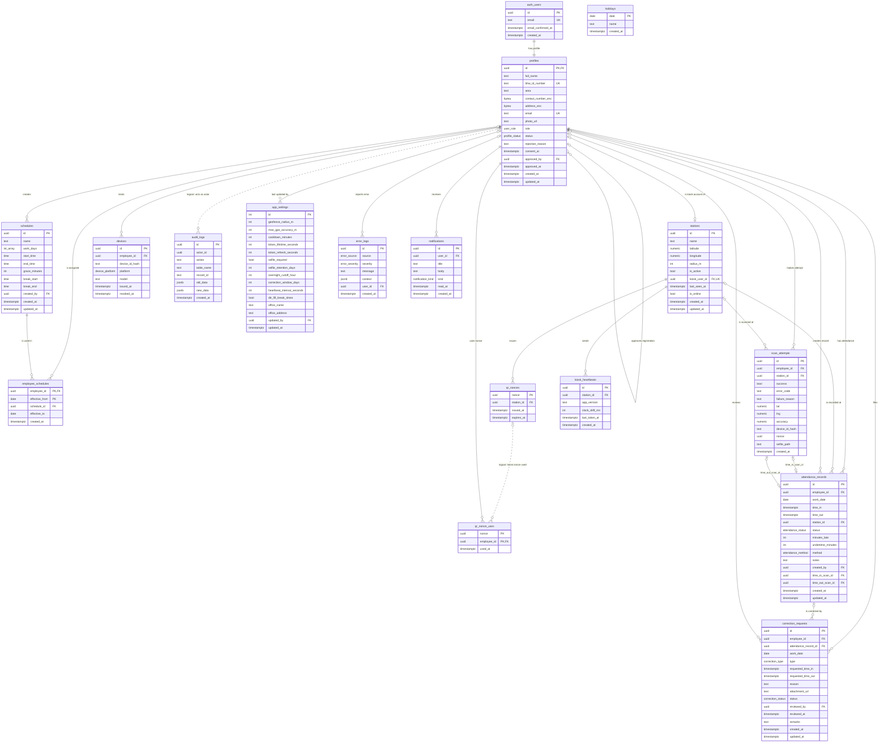

> **Role speaking: System Analyst**

# 08 – Entity Relationship Diagram (ERD)

This document is the logical data model of the BHW QR Attendance System. It covers every table in the `DATABASE` section of `development.md`, plus the extra tables and columns from section L of `00-assumptions-and-decisions.md`. The Phase 3 migrations will be written from it. Column names match the spec exactly. Where the decisions file changes how a spec column is stored (for example, encrypted contact number), the change is explained in section 7.

Supabase's `auth.users` table is drawn as `auth_users` because Mermaid does not allow dots in entity names. Every other table lives in the `public` schema.

## 1. Conventions

| Item | Convention |
| --- | --- |
| Primary keys | `uuid` with default `gen_random_uuid()`, except where the spec names a natural key: `holidays.date`, `qr_nonces.nonce`, `app_settings.id = 1`, and the composite keys of `employee_schedules` and `qr_nonce_uses` |
| Timestamps | `timestamptz`, always written with the server clock (`now()`), never a phone or kiosk clock (FR-114) |
| Calendar dates | `date` columns (`work_date`, `effective_from`, `holidays.date`) hold the **Asia/Manila** calendar date, computed as `(now() AT TIME ZONE 'Asia/Manila')::date` (helper `manila_today()`) |
| Times of day | `time` columns (`start_time`, `end_time`, `break_start`, `break_end`) are Manila wall-clock times |
| `work_days` | `int[]` of ISO weekday numbers: 1 = Monday … 7 = Sunday (the same as `extract(isodow …)`). The seed schedule is `{1,2,3,4,5}` |
| Coordinates and accuracy | `numeric` (latitude, longitude, GPS accuracy in metres) |
| Type names in the diagram | `uuid`, `text`, `int`, `bool`, `date`, `time`, `timestamptz`, `numeric`, `jsonb`, `bytea`, `int_array` (= `int[]`), and the enum type names from section 4 |
| Key markers | `PK` primary key, `FK` foreign key, `UK` unique |
| Line style | A solid line is an enforced foreign key. A dotted line is a logical reference with no FK constraint, on purpose (see section 3) |

## 2. ERD

`holidays` has no foreign keys. `app_settings` has one, `updated_by` (R-25), which only records the admin who last saved the settings. Neither table is joined by a foreign key from another table. The status computation, the end-of-day job, the DTR and every Edge Function read them by value: by date for holidays, and by the single row `id = 1` for settings.

## 3. Relationships

| # | Parent | Child (FK column) | Cardinality | Nullable FK | On delete | Meaning |
| --- | --- | --- | --- | --- | --- | --- |
| R-01 | `auth_users` | `profiles.id` | 1 to 1 | No | CASCADE | Every auth user gets one profile from the profile-on-signup trigger (FR-05) |
| R-02 | `profiles` | `profiles.approved_by` | 0..1 to many | Yes | SET NULL | Admin who reviewed the registration (FR-22) |
| R-03 | `profiles` | `devices.employee_id` | 1 to many | No | CASCADE | Device history. Only one active device at a time (D-06) |
| R-04 | `profiles` | `employee_schedules.employee_id` | 1 to many | No | CASCADE | Effective-dated schedule assignments (D-19, FR-104). An employee who has attendance records cannot be deleted anyway (R-11 RESTRICT), so the cascade only removes the assignments of profiles with no attendance, such as a rejected registration |
| R-05 | `schedules` | `employee_schedules.schedule_id` | 1 to many | No | RESTRICT | A schedule that was ever assigned cannot be deleted (FR-107) |
| R-06 | `profiles` | `schedules.created_by` | 0..1 to many | Yes | SET NULL | Admin who created the schedule |
| R-07 | `profiles` | `stations.kiosk_user_id` | 0..1 to 0..1 | Yes | SET NULL | One kiosk account per station, one station per kiosk account (D-03) |
| R-08 | `stations` | `qr_nonces.station_id` | 1 to many | No | CASCADE | Registry of issued kiosk nonces (D-10) |
| R-09 | `qr_nonces` | `qr_nonce_uses.nonce` | 0..1 to many (logical) | n/a | none | Kiosk nonces are found in `qr_nonces`. Personal-QR nonces (D-12) are never put in `qr_nonces`, so the column has no FK |
| R-10 | `profiles` | `qr_nonce_uses.employee_id` | 1 to many | No | CASCADE | "Single use per employee" (D-10, FR-49) |
| R-11 | `profiles` | `attendance_records.employee_id` | 1 to many | No | RESTRICT | One record per employee per work date |
| R-12 | `stations` | `attendance_records.station_id` | 0..1 to many | Yes | RESTRICT | Empty for manual, correction and job-created `absent` rows |
| R-13 | `profiles` | `attendance_records.created_by` | 0..1 to many | Yes | SET NULL | The employee for `qr`, the admin for `fallback_personal_qr`, `manual` and `correction`, and empty for rows the end-of-day job inserts |
| R-14 | `scan_attempts` | `attendance_records.time_in_scan_id` | 0..1 to 0..1 | Yes | SET NULL | The successful attempt that created the time-in. SET NULL because `scan_attempts` is kept 1 year and attendance 5 years (D-32) |
| R-15 | `scan_attempts` | `attendance_records.time_out_scan_id` | 0..1 to 0..1 | Yes | SET NULL | The successful attempt that recorded the time-out |
| R-16 | `profiles` | `scan_attempts.employee_id` | 0..1 to many | Yes | SET NULL | Empty when the caller could not be identified (`AUTH_REQUIRED`) |
| R-17 | `stations` | `scan_attempts.station_id` | 0..1 to many | Yes | SET NULL | Empty when the token could not be decoded (`QR_INVALID`). Stations are deactivated, not deleted, while attendance references them (R-12 RESTRICT) |
| R-18 | `profiles` | `audit_logs.actor_id` | 0..1 to many (logical) | Yes | none | No FK, so the append-only audit trail never blocks a profile deletion and is never changed by a cascade (FR-127). Empty for pg_cron jobs |
| R-19 | `profiles` | `correction_requests.employee_id` | 1 to many | No | RESTRICT | Requests filed by the employee (FR-68) |
| R-20 | `attendance_records` | `correction_requests.attendance_record_id` | 0..1 to many | Yes | SET NULL | Empty when no record exists yet for the date (for example, a missing time-in with no scan) |
| R-21 | `profiles` | `correction_requests.reviewed_by` | 0..1 to many | Yes | SET NULL | Admin who approved or rejected the request (FR-74). The review itself stays in `audit_logs`, whose `actor_id` has no FK (R-18) |
| R-22 | `stations` | `kiosk_heartbeats.station_id` | 1 to many | No | CASCADE | Heartbeat history, kept 30 days (FR-109, FR-112) |
| R-23 | `profiles` | `error_logs.user_id` | 0..1 to many | Yes | SET NULL | Empty for system and pg_cron errors |
| R-24 | `profiles` | `notifications.user_id` | 1 to many | No | CASCADE | In-app messages (D-33, FR-142) |
| R-25 | `profiles` | `app_settings.updated_by` | 0..1 to many | Yes | SET NULL | Admin who last saved the settings (FR-132). The full change history is in `audit_logs` |

## 4. Enums

| Enum type | Values (in order) | Used by | Source |
| --- | --- | --- | --- |
| `user_role` | `admin`, `employee`, `kiosk`, `viewer` | `profiles.role` | Spec, D-01 |
| `profile_status` | `pending`, `active`, `rejected`, `inactive` | `profiles.status` | Spec, D-01 |
| `attendance_status` | `on_time`, `late`, `absent`, `undertime`, `incomplete` | `attendance_records.status` | Spec, D-17 |
| `attendance_method` | `qr`, `fallback_personal_qr`, `manual`, `correction` | `attendance_records.method` | Spec, D-28 (`correction` added) |
| `correction_type` | `missing_time_in`, `missing_time_out`, `wrong_time`, `official_business` | `correction_requests.type` | Spec, D-25 |
| `correction_status` | `pending`, `approved`, `rejected`, `cancelled` | `correction_requests.status` | Spec, D-27 (`cancelled` added) |
| `error_source` | `edge_function`, `kiosk`, `mobile`, `web` | `error_logs.source` | Spec |
| `error_severity` | `info`, `warning`, `error`, `critical` | `error_logs.severity` | Spec |
| `device_platform` | `android`, `ios` | `devices.platform` | Added here (same as data dictionary section 3) |
| `notification_kind` | `registration_approved`, `registration_rejected`, `correction_approved`, `correction_rejected`, `device_reset`, `record_incomplete`, `new_registration`, `new_correction_request`, `kiosk_offline`, `periodic_verification` | `notifications.kind` | D-33, D-34, FR-144, FR-145, FR-149. The first six go to employees, the last four to admins |

One column uses `text` with a `CHECK` instead of an enum, because its value list will change more often and changing a Postgres enum needs a migration:

- `scan_attempts.error_code`: one of `AUTH_REQUIRED`, `RATE_LIMITED`, `INVALID_REQUEST`, `ACCOUNT_NOT_ACTIVE`, `DEVICE_NOT_BOUND`, `DEVICE_MISMATCH`, `QR_INVALID`, `QR_EXPIRED`, `QR_UNKNOWN`, `QR_REUSED`, `STATION_INACTIVE`, `GPS_INACCURATE`, `OUTSIDE_GEOFENCE`, `COOLDOWN_ACTIVE`, `ALREADY_COMPLETED`, `SELFIE_REQUIRED`, `INTERNAL_ERROR` (decisions file, section D). Mobile-only pre-scan codes are never stored here.

## 5. Key constraints and indexes

**profiles**
- `UNIQUE (bhw_id_number)` and `UNIQUE (email)` (FR-02).
- `id` is both the primary key and an FK to `auth.users(id) ON DELETE CASCADE`.
- `CHECK (status <> 'rejected' OR char_length(btrim(rejection_reason)) >= 10)` (FR-23, BR-13).
- `CHECK (char_length(full_name) BETWEEN 2 AND 100)` (BR-10).
- `CHECK (role <> 'employee' OR consent_at IS NOT NULL)`: employees cannot exist without Data Privacy consent (FR-03).
- Defaults: `role = 'employee'`, `status = 'pending'`. The signup trigger ignores any role or status sent by the client (FR-05, FR-09).
- Index `(status, role, created_at)` for Pending Approvals, oldest first (FR-21).

**schedules**
- `CHECK (end_time > start_time)`, `CHECK (grace_minutes BETWEEN 0 AND 60)`, `CHECK (break_start >= start_time AND break_end <= end_time AND break_end > break_start)` (FR-103).
- `CHECK (cardinality(work_days) >= 1 AND work_days <@ ARRAY[1,2,3,4,5,6,7])`.
- Defaults: `break_start = '12:00'`, `break_end = '13:00'` (D-19).

**employee_schedules**
- Composite `PRIMARY KEY (employee_id, effective_from)`.
- `CHECK (effective_to IS NULL OR effective_to >= effective_from)`.
- No overlapping assignments per employee: `EXCLUDE USING gist (employee_id WITH =, daterange(effective_from, effective_to, '[]') WITH &&)` (needs the `btree_gist` extension) (FR-104).
- Index `(schedule_id)` for the delete guard in FR-107.

**stations**
- `UNIQUE (kiosk_user_id)` (D-03). A trigger checks that the linked profile has role `kiosk`.
- `CHECK (latitude BETWEEN -90 AND 90 AND longitude BETWEEN -180 AND 180)`, `CHECK (radius_m IS NULL OR radius_m BETWEEN 10 AND 1000)`.
- `radius_m` is nullable: NULL means "use `app_settings.geofence_radius_m`" (default 100 m), so changing the setting updates every station without its own radius (data dictionary 5.4).
- Defaults: `is_active = true`, `is_online = false`.
- Index `(is_online, last_seen_at)` for the every-minute offline detection job (D-34, FR-148).

**devices**
- `CREATE UNIQUE INDEX devices_one_active_per_employee ON devices (employee_id) WHERE revoked_at IS NULL` (D-06).
- `CREATE UNIQUE INDEX devices_one_active_per_hash ON devices (device_id_hash) WHERE revoked_at IS NULL` (D-06).
- `CHECK (device_id_hash ~ '^[0-9a-f]{64}$')`: hex HMAC-SHA256 only. Raw IDs are never stored (D-05, FR-29).
- Index `(employee_id, bound_at DESC)` for device history (FR-33).

**qr_nonces / qr_nonce_uses**
- `qr_nonces`: `PRIMARY KEY (nonce)`, `CHECK (expires_at > issued_at)`, index `(station_id, issued_at DESC)`, index `(issued_at)` for the hourly cleanup (FR-147).
- `qr_nonce_uses`: composite `PRIMARY KEY (nonce, employee_id)` (D-10). The insert happens in the same transaction as the attendance write, so if two requests race, the second fails on the key and gets `QR_REUSED` (FR-49). Index `(used_at)` for the hourly cleanup.

**attendance_records**
- `UNIQUE (employee_id, work_date)`: one record per employee per Manila work date (D-14).
- `CHECK (minutes_late >= 0 AND undertime_minutes >= 0)`. Both default to `0`.
- `CHECK (time_out IS NULL OR (time_in IS NOT NULL AND time_out > time_in))`.
- `CHECK (status <> 'absent' OR (time_in IS NULL AND time_out IS NULL))`.
- `CHECK (method NOT IN ('qr','fallback_personal_qr') OR station_id IS NOT NULL OR (status = 'absent' AND created_by IS NULL))` (FR-64). The exemption covers only the end-of-day job's `absent` rows, which use `method = 'qr'`, `station_id` NULL and `created_by` NULL (R-12, R-13, D-21).
- `CHECK (method NOT IN ('fallback_personal_qr','manual','correction') OR created_by IS NOT NULL)`.
- `CHECK (method <> 'manual' OR char_length(btrim(notes)) >= 10)`: the manual-entry reason is kept in `notes` (FR-65).
- `updated_at` is set by a `BEFORE UPDATE` trigger.
- Indexes `(work_date, status)` for the dashboard and reports, `(station_id, work_date)`, and partial `(work_date) WHERE time_in IS NOT NULL AND time_out IS NULL` for the end-of-day job (D-21).
- RLS has no insert or update policy for any client role. Writes come only through Edge Functions (service role) and `SECURITY DEFINER` admin RPCs (FR-61).

**scan_attempts**
- `CHECK ((success AND error_code IS NULL) OR (NOT success AND error_code IS NOT NULL))`, plus the error-code `CHECK` list in section 4.
- Partial index `(employee_id, created_at DESC) WHERE success` for the cooldown check (D-20, FR-51).
- Index `(employee_id, created_at DESC)` for anomaly detection (FR-58), `(station_id, created_at DESC)` for Device Health (FR-113), `(created_at)` for retention (FR-150).
- Index `(employee_id, nonce)`, which `device-sync` uses as its idempotency lookup (FR-117, see section 7).

**audit_logs**
- Append-only. RLS gives `SELECT` to admin only. No `UPDATE` or `DELETE` policy exists, and a `BEFORE UPDATE OR DELETE` trigger raises an exception except for the retention job's role (FR-127, D-32).
- `record_id` is `text` so it can hold uuid keys and natural keys (`holidays.date`, `employee_schedules` as `employee_id|effective_from`, `app_settings` `1`).
- Indexes `(table_name, record_id)`, `(actor_id, created_at DESC)`, `(created_at DESC)` (FR-128).

**holidays / app_settings**
- `holidays`: `PRIMARY KEY (date)`, `CHECK (btrim(name) <> '')`.
- `app_settings`: `PRIMARY KEY (id)`, `CHECK (id = 1)` (single row). Range checks: `geofence_radius_m BETWEEN 10 AND 1000`, `max_gps_accuracy_m BETWEEN 5 AND 200`, `cooldown_minutes BETWEEN 1 AND 60`, `token_lifetime_seconds BETWEEN 15 AND 120`, `token_refresh_seconds BETWEEN 5 AND 60`, `token_refresh_seconds < token_lifetime_seconds`, `overnight_cutoff_hour BETWEEN 0 AND 6`, `correction_window_days BETWEEN 0 AND 15`, `heartbeat_interval_seconds BETWEEN 30 AND 300`, `selfie_retention_days BETWEEN 1 AND 365`. Defaults follow section M of the decisions file (FR-132).
- `app_settings.updated_by` is an FK to `profiles(id) ON DELETE SET NULL` (R-25), and `updated_at` is set by a `BEFORE UPDATE` trigger.

**correction_requests**
- `CREATE UNIQUE INDEX correction_one_pending_per_day ON correction_requests (employee_id, work_date) WHERE status = 'pending'` (D-26, FR-69).
- `CHECK (type <> 'missing_time_in' OR requested_time_in IS NOT NULL)`, `CHECK (type <> 'missing_time_out' OR requested_time_out IS NOT NULL)`, `CHECK (type <> 'wrong_time' OR requested_time_in IS NOT NULL OR requested_time_out IS NOT NULL)`. `official_business` may leave both times blank (D-28).
- `CHECK (requested_time_out IS NULL OR requested_time_in IS NULL OR requested_time_out > requested_time_in)`.
- `CHECK (status NOT IN ('approved','rejected') OR (reviewed_by IS NOT NULL AND reviewed_at IS NOT NULL))`, `CHECK (status <> 'rejected' OR char_length(btrim(remarks)) >= 10)` (FR-74, BR-70).
- `CHECK (char_length(btrim(reason)) BETWEEN 10 AND 1000)` (BR-66).
- The date eligibility window (D-26) depends on `now()`, so it is enforced by the insert RLS policy and an RPC check, not by a `CHECK` constraint.
- Indexes `(status, created_at)` for the admin queue (FR-73) and `(employee_id, created_at DESC)` for My Requests (FR-71).

**kiosk_heartbeats / error_logs / notifications**
- `kiosk_heartbeats`: index `(station_id, created_at DESC)` for history and the latest drift (FR-111, FR-112), `(created_at)` for 30-day retention.
- `error_logs`: indexes `(created_at DESC)`, `(source, severity, created_at DESC)` (FR-123). `CHECK (btrim(message) <> '')`.
- `notifications`: partial index `(user_id, created_at DESC) WHERE read_at IS NULL` for the unread badge (FR-142).

**Timestamps on mutable tables**: `created_at timestamptz NOT NULL DEFAULT now()` on every table that has it in section 2, and `updated_at timestamptz NOT NULL DEFAULT now()` refreshed by the `BEFORE UPDATE` trigger `set_updated_at()` on `profiles`, `schedules`, `stations`, `attendance_records`, `app_settings` and `correction_requests` (data dictionary section 1).

**All tables**: RLS enabled on every table (FR-138). Audit triggers on `attendance_records`, `profiles`, `devices`, `correction_requests`, `schedules`, `employee_schedules`, `stations`, `holidays`, `app_settings` (FR-126). Encrypted columns are written to the audit log only as `"[changed]"` (or `"[unchanged]"`) (FR-130).

## 6. Views and RPC outputs

### 6.1 `dtr_month(p_employee_id uuid, p_year int, p_month int)` function

The spec's "`dtr_month` SQL view / RPC" is built as a **set-returning SQL function**, not a view, because a plain view cannot take the employee and the month as parameters (data dictionary section 2, item 10, and section 7.1). It returns `SETOF dtr_row` (a composite type) with **always 31 rows**, one per day number, to match the 31 printed lines of CSC Form No. 48 (FR-78). Days that do not exist in the month (for example 30 and 31 in February) have `work_date = NULL` and every other column empty.

It runs `generate_series` over the calendar days of the month and left-joins the employee's `attendance_records`, the schedule in effect on each date (through `employee_schedules`), `holidays` and `app_settings`. If no schedule applies, it uses the default break of 12:00–13:00 (D-19). Days with no record show the weekday label (`Saturday`, `Sunday`) or the holiday name in `remark`, with empty time cells and 0 undertime (D-22). Nothing is stored (FR-85).

Access: `dtr_month` is called by `get_dtr` and `get_dtr_batch`, which check the caller first: an employee may request only their own ID and an admin any employee; viewers and kiosks are refused (FR-84, FR-141, BR 3.1). On the table itself, employees see only their own rows and admins see all rows; viewers and kiosks have no direct SELECT on `attendance_records` and read aggregates only through the report RPCs (FR-93, NFR-31).

| Column | Type | Rule |
| --- | --- | --- |
| `day` | smallint | Day number 1–31 |
| `work_date` | date | Manila calendar date; NULL for a day that does not exist in the month |
| `am_arrival` | time | `time_in` in Manila time when `time_in < work_date + break_start`, otherwise null (D-22) |
| `am_departure` | time | `time_out` in Manila time when `time_out <= work_date + break_end`, otherwise the schedule's `break_start` only if `dtr_fill_break_times` is on AND `time_in < work_date + break_start` AND `time_out > work_date + break_end` (BR-74); else null |
| `pm_arrival` | time | `time_in` in Manila time when `time_in >= work_date + break_start`, otherwise the schedule's `break_end` only if `dtr_fill_break_times` is on AND `time_in < work_date + break_start` AND `time_out > work_date + break_end` (BR-74); else null |
| `pm_departure` | time | `time_out` in Manila time when `time_out > work_date + break_end`. The comparison uses full timestamps, so an after-midnight time-out (D-13) always lands here |
| `undertime_hours` | smallint | Daily undertime total / 60. The daily total is `minutes_late + undertime_minutes`; for an `absent` work day it is the full scheduled minutes `(end_time − start_time) − (break_end − break_start)` (D-23) |
| `undertime_minutes` | smallint | Remainder minutes 0–59 of the same daily total |
| `remark` | text | `Saturday`, `Sunday`, holiday name, `Absent`, `No time-out`, `Official business`, `Non-working day`, `No schedule assigned`, or NULL on a normal day |
| `status` | attendance_status | From the record; NULL when no record (on-screen badge only, not printed) |
| `method` | attendance_method | From the record; NULL when no record. Used for the method badge (FR-66) |

### 6.2 `get_dtr(employee_id uuid, year int, month int)`

Returns one header object, the 31 rows of `dtr_month` and the totals. The DTR is rebuilt on every call and never stored (FR-85).

The result is one `jsonb` document with the same keys as data dictionary section 7.2:

| Part | Keys |
| --- | --- |
| Header | `employee.id`, `employee.full_name`, `employee.bhw_id_number`, `period.year`, `period.month`, `period.label` (for example "October 2026"), `office.name`, `office.address`, `office_hours.regular_days` (for example "Mon–Fri, 08:00–12:00 / 13:00–17:00"), `office_hours.saturdays` (Saturday hours, or empty when Saturday is not a work day) |
| Rows | `rows`: always 31 rows from `dtr_month`; days that do not exist in the month have `work_date` NULL. Each row has `day`, `work_date`, `am_arrival`, `am_departure`, `pm_arrival`, `pm_departure`, `undertime_hours`, `undertime_minutes`, `remark`, `status`, `method` |
| Totals | `totals.undertime_total_minutes` (the sum of the daily `undertime_hours × 60 + undertime_minutes`), `totals.undertime_hours` / `totals.undertime_minutes` (the same total normalised so minutes < 60), `totals.days_present`, `totals.days_absent`, `totals.days_late`, `totals.days_undertime`, `totals.days_incomplete` |
| Footer | `certification` (the D-24 wording), `verified_label` ("Verified as to the prescribed office hours:"), `generated_at` (server time of generation) |

### 6.3 `get_dtr_batch(year int, month int)`

Admin only. Returns a set of `get_dtr` results, one for each employee who was `active` at any time during the month, ordered by `full_name` (FR-83). `generate-dtr-pdf` renders them one employee per page.

### 6.4 `get_profile_private(profile_id uuid)`

A `SECURITY DEFINER` function, callable by the profile owner or an admin. It returns `id`, `contact_number` (text) and `address` (text), decrypted with `pgp_sym_decrypt` using the Vault secret `profile_encryption_key` (D-29). Viewers and kiosks get an error.

Report RPCs (`get_daily_summary`, `get_weekly_summary`, `get_monthly_summary`, `get_employee_history`, `get_dashboard_today`) read `attendance_records` directly with the same status values stored by the scan path, so their totals equal the raw records (FR-92). Their exact output columns are defined in Phase 3.

## 7. Differences from the spec column list (explained)

| Spec item | ERD form | Reason |
| --- | --- | --- |
| `profiles.contact_number` | `profiles.contact_number_enc bytea` (plus `address_enc bytea`) | D-29 and FR-07 forbid plain-text storage. The plain value is available only through `get_profile_private` |
| `profiles.photo_url`, `correction_requests.attachment_url` | Names kept, but they hold the **storage path** in the private bucket, not a public URL | D-31: clients get signed URLs that expire within 60 min |
| `audit_logs.record_id` | `text` | Audited tables include natural and composite keys (section 5) |
| `qr_nonce_uses` | Adds `used_at timestamptz DEFAULT now()` | Needed for the hourly 1-day cleanup (D-32, FR-147), because personal-QR nonces have no `qr_nonces` row to join to |
| `app_settings` (geofence radius, cooldown, token lifetime, selfie on/off) | A single-row table with one typed column per key from section M | Typed columns allow range `CHECK`s and are read in one query by every Edge Function |
| `employee_schedules` (no key in spec) | Composite PK `(employee_id, effective_from)` | An employee has at most one assignment starting on a given date |
| Anomaly flags (FR-58) | No new table | Every flag is persisted as an `error_logs` row (source `edge_function`, severity `warning`, `context.kind = 'scan_anomaly'`, with employee, station and error codes) by `record-attendance` after each attempt (UC-60). Flags are raised for 5 or more failures in 10 minutes, repeated `OUTSIDE_GEOFENCE` or `QR_REUSED`, and a mocked location, and the same flag is not written again within 10 minutes. `scan_attempts` is only the input of the check. Device Health (FR-113) and the weekly verification report (FR-149) read the flags from `error_logs` |
| `device-sync` idempotency (FR-117) | No new table | The terminal's event ID (uuid) is stored in `scan_attempts.nonce`. A repeated event from the same employee is answered with the original result. This keeps the "no schema change" promise of the Study Recommendation |

> **Backend Developer note:** `reject_employee` also fills `approved_by` and `approved_at` with the admin who reviewed the registration and the review time. For both outcomes these columns mean "reviewed by / reviewed at", and `status` tells which outcome it was. The 90-day deletion of rejected registrations (D-32) uses `approved_at` and deletes the `auth.users` row. That cascades to `profiles`, `devices`, `employee_schedules`, `notifications` and `qr_nonce_uses`, and sets `scan_attempts.employee_id` and `error_logs.user_id` to null. `audit_logs` keeps its rows because `actor_id` has no FK. Realtime publication covers `attendance_records`, `scan_attempts` (dashboard live scans, admin only), `stations` (online/offline changes), `correction_requests`, `profiles` (pending count) and `notifications`. The kiosk feed is a Realtime broadcast, not a table subscription: after a successful scan, `record-attendance` / `record-fallback-scan` send `{first_name, label, time}` on the private channel `station:<id>`, which only the kiosk account linked to that station may join (Realtime authorization policy on `realtime.messages`). The kiosk therefore needs no SELECT on any table (D-03, FR-40, NFR-31).

> **Frontend Designer / Developer note:** Screens show `photo_url` and `attachment_url` only through signed URLs from the server. The DTR page and PDF read `get_dtr` / `get_dtr_batch` and never compute AM/PM cells on the client. Method badges (`qr`, `fallback_personal_qr`, `manual`, `correction`) and status badges come straight from the enums in section 4.

> **System Administrator note:** The migrations need the extensions `pgcrypto`, `btree_gist`, `pg_cron` and `supabase_vault`. The Vault secret `profile_encryption_key` must exist before the first registration is accepted.
