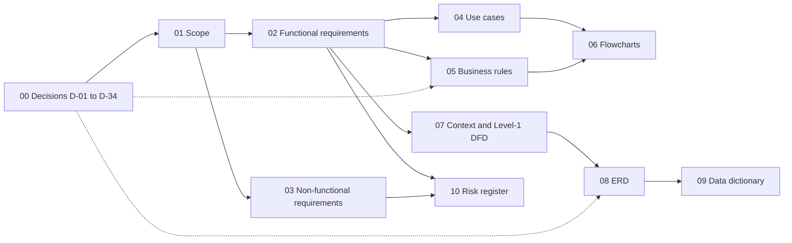

> **Role speaking: System Analyst**

# Phase 1 – System Analysis (Index)

**Project:** BHW QR Attendance System (replaces the originally proposed fingerprint biometric system)
**Client setting:** Barangay Kalawag II Health Workers (BHW) Office, Philippines
**Proponent:** Janine Ariane Raganas, BSIT-2B
**Backend:** Supabase (Auth, Postgres with Row Level Security, Edge Functions, Realtime, Storage, pg_cron)
**Timezone:** Asia/Manila for every date, time, report and scheduled job.

This folder holds the full System Analysis for the project. It turns the Study Recommendation in `development.md` into numbered requirements, use cases, business rules, diagrams, a data model and a risk register that the later phases (architecture, backend, web, mobile, testing) build from.

Read [`00-assumptions-and-decisions.md`](./00-assumptions-and-decisions.md) first. Its decisions D-01 to D-34 are binding on every other document and on all later phases. If a later phase needs to change a decision, that file is updated first and the affected roles are noted there.

---

## 1. Documents

| # | Document | What it contains |
| --- | --- | --- |
| 00 | [Assumptions and Canonical Decisions](./00-assumptions-and-decisions.md) | The single source of truth: 34 binding decisions (D-01 to D-34), the fixed 15-step scan validation order with error codes and HTTP statuses, extra tables and columns beyond the spec, and the 13 `app_settings` keys with defaults. |
| 01 | [Scope Statement](./01-scope.md) | Purpose, 20 in-scope modules, coverage of all 16 Study Recommendation rows, deliverables, 12 out-of-scope items with reasons, assumptions, constraints and stakeholders. |
| 02 | [Functional Requirements](./02-functional-requirements.md) | FR-01 to FR-151 grouped into 20 modules with MoSCoW priority, each traced to the Study Recommendation table, plus traceability matrices for the recommendation rows and the acceptance criteria. |
| 03 | [Non-Functional Requirements](./03-non-functional-requirements.md) | NFR-01 to NFR-73 for performance, security, privacy (RA 10173), usability, reliability, compatibility, maintainability and auditability, each with a measurable target. |
| 04 | [Use Cases](./04-use-cases.md) | Actor list, a use case overview diagram, and UC-01 to UC-63 for all five actors (precondition, main flow, alternate flows, postcondition), with error code and acceptance criteria coverage. |
| 05 | [Business Rules](./05-business-rules.md) | BR-01 to BR-98: time-in/time-out decision, status with grace period, undertime, cooldown, scans after midnight, forgotten time-out, holidays, schedule changes, device reset, fallback, correction eligibility, DTR AM/PM split and totals, retention, plus the 38-code error catalog. |
| 06 | [Process Flowcharts](./06-flowcharts.md) | Eight Mermaid flowcharts: registration and approval, device binding, scan to attend (every failure branch), fallback, correction request approval, DTR generation, kiosk health monitoring, end-of-day job. |
| 07 | [Context Diagram and Level-1 DFD](./07-context-and-dfd.md) | Level 0 context diagram with six external entities, Level-1 DFD with 13 processes and 15 data stores drawn as an overview plus four sheets, full flow tables and a balancing check. |
| 08 | [Entity Relationship Diagram](./08-erd.md) | Mermaid ERD of all 16 public tables plus `auth.users`, relationships, 10 enums, key constraints and indexes, DTR and report RPC outputs, and differences from the spec column list. |
| 09 | [Data Dictionary](./09-data-dictionary.md) | Every column of the 16 tables (148 columns) with type, constraint, description and sample value, plus enums, RLS and retention per table, storage buckets and RPC return types. |
| 10 | [Risk Register](./10-risks.md) | 41 risks (R-01 to R-41) in six categories with likelihood, impact, mitigation, owner role and residual rating, a heat map, early-warning indicators and review cadence. |

### How the documents depend on each other

---

## 2. Key numbers

These counts were taken from the documents themselves (rows with a defined ID, not mentions).

| Item | Count | Where | Breakdown |
| --- | --- | --- | --- |
| Binding decisions | **34** | 00 | D-01 to D-34, plus the fixed validation order (15 steps) and 13 `app_settings` keys |
| Functional requirements | **151** | 02 | FR-01 to FR-151 across 20 modules |
| Non-functional requirements | **73** | 03 | Performance 9, Security 12, Privacy 12, Usability 11, Reliability 8, Compatibility 7, Maintainability 8, Auditability 6 |
| Use cases | **63** | 04 | BHW Staff 17, Administrator 25, Kiosk 5, System 14, Barangay Management (viewer) 2 |
| Business rules | **98** | 05 | BR-01 to BR-98 in 14 sections |
| Error codes | **38** | 05 | 17 `record-attendance` codes, 5 mobile-only pre-scan codes, 16 codes used by other Edge Functions and RPCs |
| Flowcharts | **8** | 06 | One Mermaid flowchart per core process |
| Context diagram and DFD sheets | **6** | 07 | 1 context diagram (Level 0), 1 Level-1 overview, 4 Level-1 sheets; 13 processes, 15 data stores |
| Database tables | **16** | 08, 09 | 14 tables from the spec plus `qr_nonce_uses` and `notifications` (D-10, D-33) |
| Table columns documented | **148** | 09 | Every column of the 16 tables |
| Enums | **10** | 08, 09 | `user_role`, `profile_status`, `attendance_status`, `attendance_method`, `correction_type`, `correction_status`, `error_source`, `error_severity`, `device_platform`, `notification_kind` |
| Risks | **41** | 10 | Security 10, Privacy/Legal 5, Technical 12, Operational 7, Adoption 3, Schedule 4; residual High 0, Medium 9, Low 32 |
| Mermaid diagrams in total | **16** | 04, 06, 07, 08 | 1 use case overview, 8 flowcharts, 6 context/DFD diagrams, 1 ERD |

### Coverage checks

| Check | Result | Where to verify |
| --- | --- | --- |
| Every Study Recommendation row (16) traced to at least one FR | Yes | `02-functional-requirements.md`, Traceability Matrix A; `01-scope.md` section 2.2 |
| Every acceptance criterion (12) traced to FRs | Yes | `02-functional-requirements.md`, Traceability Matrix B |
| Every acceptance criterion covered by a use case | Yes | `04-use-cases.md` section 10 |
| Every `record-attendance` error code reachable in a use case | Yes | `04-use-cases.md` section 9; `06-flowcharts.md` flowchart 3 |
| Every actor in `development.md` has use cases | Yes (5 of 5) | `04-use-cases.md` sections 4 to 8 |
| Context diagram balances with the Level-1 DFD | Yes | `07-context-and-dfd.md` section 6 |
| Every table in the ERD is in the data dictionary | Yes (16 of 16) | `08-erd.md` section 2; `09-data-dictionary.md` section 5 |
| No risk left at High residual | Yes (0 High) | `10-risks.md` section 3.3 |

---

## 3. Phase 1 summary

### What was built

Phase 1 produced eleven analysis documents (00 to 10) plus this index, all in Markdown with Mermaid diagrams:

- **Decisions (00):** closed every open point in the spec, for example the token format and HMAC signing (D-08), "single-use nonce" meaning single use per employee because a kiosk QR is shared by everyone in line (D-10), the fixed scan validation order (section D), scans after midnight (D-13), lateness counted from start time (D-15), status precedence (D-17), the CSC Form No. 48 AM/PM split and undertime column (D-22, D-23), correction eligibility window (D-26), field encryption with pgcrypto and Supabase Vault (D-29) and the retention schedule (D-32).
- **Requirements (01 to 03):** scope, 151 functional requirements and 73 non-functional requirements, traced to the Study Recommendation table and the acceptance criteria.
- **Behavior (04 to 06):** 63 use cases for all five actors, 98 business rules with worked DTR example and state tables, and 8 process flowcharts that show every failure branch.
- **Data (07 to 09):** context diagram and Level-1 DFD, the ERD of 16 tables and 10 enums, and a data dictionary of 148 columns with sample values.
- **Risks (10):** 41 risks with mitigations tied to FR, NFR and D numbers, and indicators for the nine Medium residual risks.

Phase 1 contains analysis only. It contains no source code, so there is nothing to install or run yet.

### How to view it

Open the files in any Markdown viewer that renders Mermaid:

- **GitHub or GitLab:** push the repository and open `docs/phase-1-system-analysis/` in the browser. Mermaid blocks render automatically.
- **VS Code:** install the **Markdown Preview Mermaid Support** extension (`bierner.markdown-mermaid`), open any file and press `Ctrl+Shift+V` (or `Ctrl+K V` for a side-by-side preview).
- **Mermaid Live Editor** (`mermaid.live`): paste a single diagram block to view or export it as PNG/SVG for the capstone manuscript.

Start with this README, then `00-assumptions-and-decisions.md`, then read the documents in number order.

### What Phase 2 will take from Phase 1

Phase 2 (Architecture & Setup, by the Software Engineer and System Administrator) uses these Phase 1 outputs directly:

| Phase 2 deliverable | Phase 1 input |
| --- | --- |
| Mermaid architecture diagram | The 13 Level-1 DFD processes and the Edge Functions, RPCs and pg_cron jobs named for each (`07-context-and-dfd.md` section 3.1) |
| `packages/types` zod schemas (registration, scan request/response, attendance record, report filters) | Column types and constraints (`09-data-dictionary.md`), enums (`08-erd.md` section 4), error codes (`05-business-rules.md` section 15), token formats (D-08, D-12) |
| Roles × modules access matrix | Roles and statuses (D-01 to D-03), role permission summary (`05-business-rules.md` section 3.1), Authentication & Role-Based Access FRs (FR-137 to FR-141), RLS notes per table (`09-data-dictionary.md`) |
| `.env.example` with server-only variables marked | Secrets named in the decisions: `QR_SIGNING_SECRET`, `QR_SIGNING_SECRET_PREVIOUS` (D-08, D-11), `PERSONAL_QR_SIGNING_SECRET` (D-12), `DEVICE_HASH_PEPPER` (D-05), `RESEND_API_KEY` (D-33); Vault secret `profile_encryption_key` (D-29) |
| Supabase setup (auth, storage buckets, redirect URLs) | Email confirmation on (D-04), private buckets `profile-photos`, `selfies`, `correction-attachments` with signed URLs of 60 minutes or less (D-31) |
| HMAC secret rotation procedure | D-11 (accept current and previous secret for 60 s after rotation) |
| Retention schedule, backup/restore plan | D-32 and `05-business-rules.md` section 14.1; data store retention in `07-context-and-dfd.md` section 3.2 |
| Consent and privacy notice text | Privacy NFRs (NFR-22 to NFR-33) and Registration FRs on consent |
| Testing strategy and coverage targets | Acceptance criteria traceability (`02`), measurable NFR targets (`03`), error code coverage (`04` section 9) |
| Monorepo and library choices | Compatibility and maintainability NFRs (`03`), technical risks such as UI library conflicts (R-21) owned by the Software Engineer |

> **Software Engineer note:** the field names, enum values and error codes in `08-erd.md`, `09-data-dictionary.md` and `05-business-rules.md` are the contract for `packages/types`. Phase 2 must copy them exactly; a rename there is a change to the decisions file first.

> **System Administrator note:** the secrets, buckets, retention periods and pg_cron schedule (D-21 runs at 04:05 Asia/Manila, which is 20:05 UTC) listed above are the starting point for the Phase 2 environment setup, backup plan and secret rotation procedure.
