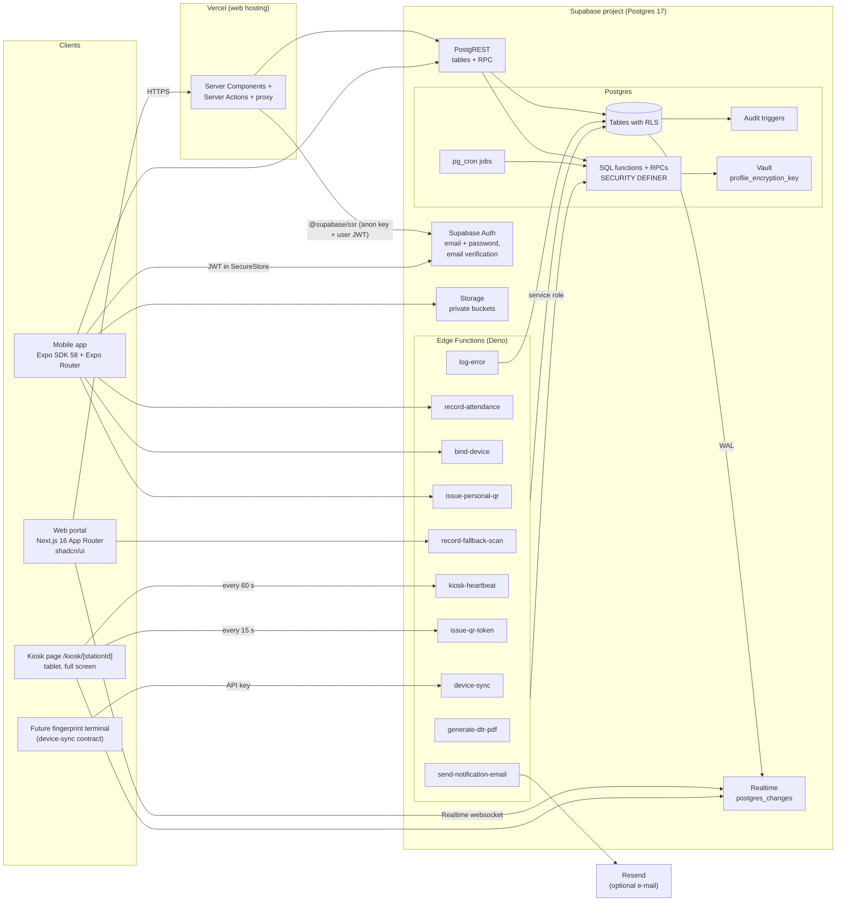
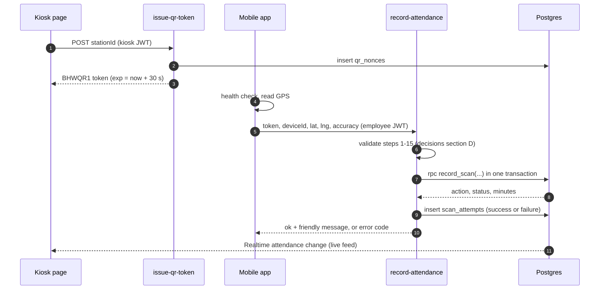

# 01 – Architecture

> **Role speaking: Software Engineer** (System Administrator notes where hosting and secrets are affected)

## 1. Architecture diagram



## 2. Components and responsibilities

| Component | Responsibility | Talks to | Notes |
| --- | --- | --- | --- |
| `apps/web` | Registration, admin portal, viewer dashboard, employee `/me`, kiosk page, fallback scan | Supabase Auth, PostgREST RPCs, Realtime, Edge Functions | Server Actions call admin RPCs with the user's JWT, so RLS and role checks still apply. The service-role client is used only for actions the RPCs cannot do (creating kiosk/viewer auth users). |
| `apps/mobile` | Employee app: bind device, scan, history, corrections, DTR, personal QR | Supabase Auth, Edge Functions, PostgREST (own rows), Storage | Session in SecureStore; never queues scans offline (BR-40). |
| Kiosk page | Shows rotating signed QR, Manila server clock, live feed, heartbeat | `issue-qr-token`, `kiosk-heartbeat`, `log-error`, Realtime | Logged in as a `kiosk` user bound to one station (D-03). |
| Edge Functions | Every operation that needs a secret (HMAC keys, device pepper) or must be atomic across several tables | Postgres through the service-role client | Share `_shared/` (CORS, HMAC, admin client, error codes, rate limiter, auth helper). |
| Postgres | Source of truth; RLS on every table; status computation, DTR and reports in SQL | — | Timezone logic always `Asia/Manila`. |
| pg_cron | End-of-day absence/incomplete marking, nonce cleanup, offline detection, periodic verification, retention | SQL functions | Times in UTC in `cron.schedule`, documented in Manila time. |
| Realtime | Live dashboard (attendance inserts/updates), kiosk feed, station online status | Web, kiosk | Publication limited to `attendance_records`, `stations`, `correction_requests`, `notifications`. |
| Storage | Profile photos, selfies, correction attachments | Web, mobile | Private buckets; signed URLs ≤ 60 min (D-31). |

## 3. Key runtime sequences

### 3.1 Scan to attend



### 3.2 Where each rule lives

| Rule | Implemented in | Why there |
| --- | --- | --- |
| Token signing and verification | `_shared/hmac.ts` | Secret must stay server-side. |
| Validation order (section D) | `record-attendance/validate.ts` | Pure, unit-tested with Deno for every failure. |
| Time-in vs time-out, status, undertime, overnight rule | SQL `record_scan()` → `compute_attendance_status()` | Same code path for kiosk, fallback, manual entry, corrections, device-sync and recompute, so reports always match. |
| DTR rows | SQL `dtr_month()` / `get_dtr()` | One definition used by web, mobile and PDF. |
| Role checks | RLS + RPC guards + web proxy + Edge Function guards | Defence in depth (BR-17, BR-18). |

## 4. Monorepo layout

```
/apps/web                 Next.js admin portal, registration, kiosk (Tailwind v4 + shadcn/ui)
/apps/mobile              Expo employee app (NativeWind/Tailwind v3 + RN Reusables + gluestack + Paper + Tamagui)
/packages/types           zod schemas, enums, error catalog (generated from docs), generated DB types
/packages/design-tokens   tokens.ts -> web.css (Tailwind v4), tailwind-preset.cjs (NativeWind), Paper and Tamagui themes
/supabase                 config.toml, migrations/, seed.sql, functions/, tests/ (pgTAP)
/docs                     phase-by-phase documentation
```

Dependency rule: `apps/*` may import `packages/*`; `packages/*` never import `apps/*`; `packages/types` and `packages/design-tokens` have no runtime dependency on React or React Native. Edge Functions cannot import from `packages/` at deploy time, so the error catalog is generated into `supabase/functions/_shared/error-codes.generated.ts` by `pnpm --filter @bhw/types gen:errors`.

## 5. Technology versions (resolved 2026-10-31)

| Area | Choice | Version line |
| --- | --- | --- |
| Monorepo | pnpm workspaces + Turborepo | pnpm 11, turbo 2 |
| Language | TypeScript strict | 5.9 (TypeScript 7 native compiler not yet supported by Next/Expo tooling) |
| Web | Next.js App Router, React 19, Tailwind CSS v4, shadcn/ui CLI 4 | next 16 |
| Mobile | Expo SDK 58, Expo Router, React Native 0.8x | expo 58 |
| Mobile styling | NativeWind 4 (needs Tailwind CSS 3.4 — separate from web's Tailwind 4; both read `@bhw/design-tokens`) | nativewind 4.2 |
| Backend | Supabase (Postgres 17, Deno 2 Edge Runtime), supabase-js 2 | CLI 2.12x |
| Validation | zod 4 | 4.6 |

> **System Administrator note:** Two Tailwind majors in one repo is deliberate: NativeWind 4 is not compatible with Tailwind 4. With `nodeLinker: hoisted`, each app gets its own `tailwindcss` in `apps/*/node_modules` when versions differ. Re-evaluate when NativeWind 5 (Tailwind 4) is stable.
