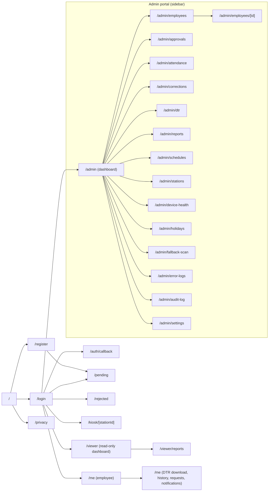

# Phase 4 – Web Application

> **Role speaking: Frontend Designer / Developer** (Software Engineer notes where security is affected)

## 1. Design spec

| Aspect | Decision |
| --- | --- |
| Look | shadcn/ui neutral (zinc) with health-teal brand accent `#0f766e`; tokens from `@bhw/design-tokens/web.css` only — no hex values in components |
| Type | Inter (next/font), 14 px base on data pages, 16 px on forms; tabular numbers (`tabular-nums`) in tables, clocks and counters |
| Radius | 6 px controls, 12 px cards, full-round status badges (`StatusBadge`) |
| Layout | Admin: shadcn `sidebar-07` block (collapsible icon sidebar) + breadcrumb header + content max-width 1400 px. Auth pages: `login-03`/`signup-03` two-column block, Aceternity background on the left panel only. Kiosk: full-screen dark, no chrome |
| Density | Tables use the TanStack data-table pattern: sticky header, 40 px rows, column visibility, pagination 25/50/100, CSV export |
| States | Every data view has Skeleton loading, empty state (icon + one sentence + action), and error Alert with retry |
| Feedback | Sonner toasts for actions; destructive actions confirm in a Dialog; reasons ≥ 10 characters enforced inline |
| Motion | Motion for page/dialog transitions and live-scan list items only; Magic UI NumberTicker on dashboard stat cards and BorderBeam on the kiosk QR card; all disabled under `prefers-reduced-motion` |
| Accessibility | Labels on every input, visible focus ring (`ring-ring`), full keyboard support, `aria-live="polite"` on the live scan list and kiosk status, contrast ≥ 4.5:1, touch targets ≥ 44 px on the kiosk and fallback scan pages |
| Language | English UI with Filipino messages for errors from the shared catalog (`errorMessage(code, lang)`) |
| Print | DTR and reports have a print stylesheet: A4 (DTR: two copies on landscape, CSC Form 48), barangay header, no navigation |

## 2. Sitemap

## 3. Route protection

`proxy.ts` refreshes the session and enforces `lib/auth/routes.ts`:

| Situation | Result |
| --- | --- |
| Not signed in, protected route | Redirect to `/login?next=<path>` |
| Signed in, status `pending` | Only `/pending` (+ public routes) |
| Signed in, status `rejected` | Only `/rejected` |
| Signed in, status `inactive` | Signed out, `/login?error=inactive` |
| Role not allowed for prefix | Redirect to the role's home (`HOME_BY_ROLE`) |
| Signed in on `/login` or `/register` | Redirect to the role's home |

> **Software Engineer note:** the proxy is a convenience layer. RLS, `assert_admin()` in every admin RPC and the Edge Function guards remain the security boundary (BR-17, BR-18). Server Actions re-check the role before calling the service-role client.

## 4. Kiosk data refresh

The kiosk account cannot read `attendance_records` through RLS (it only sees its own station), so the
recent-scans feed polls the `get_kiosk_feed(p_station_id, 10)` RPC every **5 s** instead of using a
Realtime subscription. One small RPC every 5 s per kiosk is cheap, and a scan appears on the kiosk within
5 s (the 2-second target in AC-05 applies to the admin dashboard, which uses Realtime). The QR token refreshes every
`token_refresh_seconds` (15 s) and the heartbeat runs every 60 s; on the browser `online` event the kiosk
immediately fetches a new token and sends a heartbeat (FR-118).

## 5. Screens delivered

| Area | Routes |
| --- | --- |
| Public / auth | `/`, `/login`, `/login/new-password`, `/register`, `/pending`, `/rejected`, `/privacy`, `/auth/callback` |
| Admin | `/admin` (live dashboard), `/admin/employees`, `/admin/employees/[id]`, `/admin/approvals`, `/admin/attendance`, `/admin/corrections`, `/admin/fallback-scan`, `/admin/dtr`, `/admin/reports`, `/admin/schedules`, `/admin/holidays`, `/admin/stations`, `/admin/settings`, `/admin/device-health`, `/admin/error-logs`, `/admin/audit-log` |
| Viewer (read-only) | `/viewer`, `/viewer/reports` |
| Employee | `/me` |
| Kiosk | `/kiosk`, `/kiosk/[stationId]` |

## 6. Verification (2026-11-01, against the hosted dev project)

| Check | Result |
| --- | --- |
| `tsc --noEmit` | 0 errors |
| `eslint .` | 0 problems |
| Vitest | 22 files, 220 tests pass |
| `next build` (Cache Components) | 32 routes; portal pages are Partial Prerender (static shell + streamed session data) |
| Playwright against `next start` | 8 pass: landing, kiosk QR refresh + countdown, kiosk offline banner + recovery, monthly report totals = sum of rows (AC-06), every admin page renders (17), viewer pages, employee `/me` |
| Playwright `register-approve-login` | Not run: it creates a real user on the hosted project and needs `E2E_SERVICE_ROLE_KEY` plus custom SMTP (Supabase's default mailer only delivers to project members) |

### Integration fixes made during verification

- **Server → client props:** the portal layouts passed nav config containing icon components to client components, which crashed every admin page at runtime; navigation is now selected by key (`nav="admin"`).
- **Cache Components:** layouts that read the session now render it inside `<Suspense>`; the server Supabase client calls `connection()` so `supabase-js` never reads `Date.now()` during prerendering.
- **Backend follow-ups** (migrations `20261101000800`, `20261101000900`): a `missing_time_in` correction now also applies its time-out (BR-63); pending approvals return `consent_at`; changing the overnight cutoff reschedules the end-of-day job; length checks aligned with the data dictionary; `get_report_areas()` for report filters.
- **DTR PDF footer** (`generate-dtr-pdf/render.ts`): the "In Charge" line was drawn below the page edge; the layout was tightened (now y ≥ 37 pt) and the function redeployed.
- **Design tokens:** `warning` / `success` colors added for monitoring screens.

### Open items for go-live

- Fill in the Data Protection Officer contact (`DPO_CONTACT` in `components/auth/privacy-notice.tsx`).
- Set `SUPABASE_SERVICE_ROLE_KEY` in the web server environment to enable creating staff accounts and storing registration photos.
- Configure custom SMTP (Resend) in Supabase Auth so verification e-mails reach real addresses.
