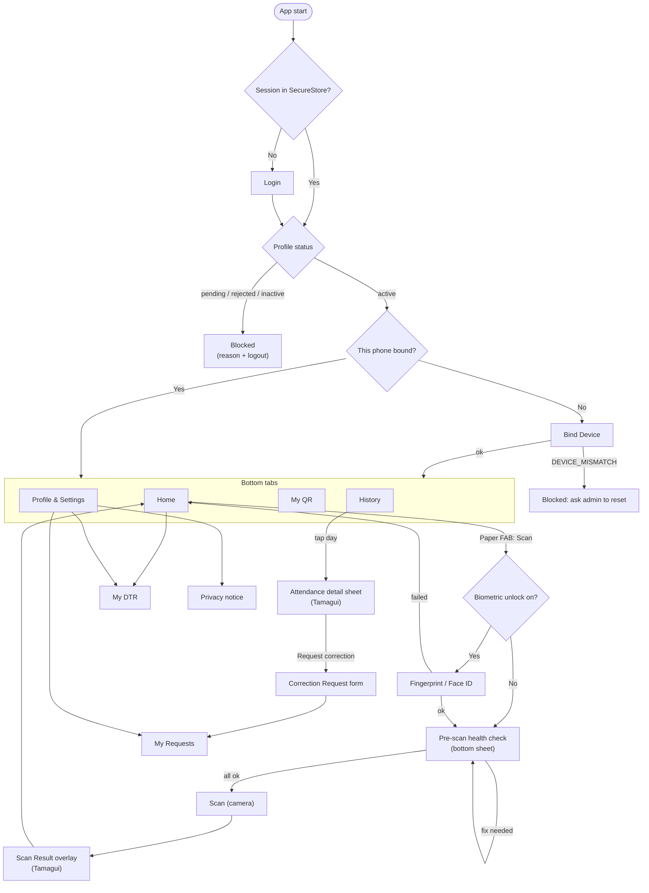

# Phase 5 – Mobile Application (Expo)

> **Role speaking: Frontend Designer / Developer** (Software Engineer notes where security or reliability is affected)

## 1. Screen flow

## 2. Wireframes (description per screen)

| Screen | Layout | Libraries |
| --- | --- | --- |
| **Login** | Brand mark + "BHW Attendance", email, password (show/hide), Login button (44 px), "Register on the website" link, language toggle EN/FIL | RN Reusables Input/Label/Button/Text, gluestack FormControl for validation messages |
| **Blocked** | Large icon, title by status ("Waiting for approval" / "Registration not approved" + reason / "Account deactivated" / "Phone not registered to you"), what to do next, Logout | RN Reusables Card/Text/Button |
| **Bind Device** | Explanation ("This phone will be your attendance phone"), phone model, Bind button, privacy note (only a hashed ID is stored) | RN Reusables Card/Button, gluestack Spinner |
| **Home** | Greeting + date (Manila), Today card (status badge, time in/out, schedule), This Week progress (days present / scheduled), Recent 5 records, notifications banner, **Paper FAB "Scan"** bottom-right, offline Paper Snackbar | RN Reusables Card/Badge/Progress/Text, Paper FAB/Snackbar |
| **Pre-scan health check** | Bottom sheet listing camera, location permission, GPS accuracy (live metres), internet, phone still bound — each with ✓ / ✕ and a "Fix" action | gluestack Actionsheet, Spinner |
| **Scan** | Full-screen dark camera, teal square viewfinder with corner marks, hint text, torch toggle, cancel | expo-camera CameraView, NativeWind |
| **Scan Result** | Animated overlay: big check/cross, "Time-in recorded 08:01", status badge, station; or friendly error EN + FIL with fix button; haptics success/error; auto-dismiss 4 s | Tamagui (AnimatePresence/YStack) + expo-haptics |
| **History** | Paper SegmentedButtons (This week / This month / Last month), list of days with status badge and times; tap → Tamagui bottom sheet with details and "Request correction" | Paper SegmentedButtons, Tamagui Sheet, RN Reusables Badge |
| **Correction Request** | Date, type (gluestack Actionsheet picker), time-in/out pickers, reason (≥10 chars), optional photo/PDF attachment, Submit | gluestack FormControl + Actionsheet, RN Reusables Input/Button |
| **My Requests** | List with status badges (pending/approved/rejected/cancelled), remarks, cancel pending | RN Reusables Card/Badge |
| **My DTR** | Month selector, 31-day compact table (AM/PM arrival/departure, undertime), totals, "Download PDF" (Edge Function) and share | RN Reusables Text/Separator/Button |
| **My QR** | Rotating personal QR (15 s refresh) with countdown, instructions "Show this to the admin if scanning fails" | react-native-qrcode-svg, RN Reusables Progress |
| **Profile & Settings** | Avatar, name, BHW ID, area, bound phone; toggles: dark mode, biometric unlock, language EN/FIL; privacy notice; logout | RN Reusables Avatar/Card/Text, Switch (RN core styled by NativeWind) |

## 3. Behaviour rules

| Rule | Implementation |
| --- | --- |
| Session | Supabase session in SecureStore (chunked); auto-refresh while the app is in the foreground |
| Auth guard | Root layout reads session → profile (`role`, `status`) → device binding; routes to Login / Blocked / Bind Device / Tabs |
| Data | TanStack Query; history/DTR/requests cached and re-fetched on reconnect (FR-115) |
| Offline | Paper Snackbar "You are offline"; scan button disabled; **scans are never queued offline** — a queued QR would be expired (30 s) and the server must use its own time (BR-02, BR-40), so a delayed scan could never be valid and would only produce false failures |
| Errors | Every server code → `errorMessage(code, lang, params)` from `@bhw/types` (EN/FIL catalog); unexpected errors are sent to `log-error` |
| Haptics | Success: `notificationAsync(Success)`; failure: `notificationAsync(Error)` |
| Accessibility | Touch targets ≥ 44 px, `accessibilityLabel` on icons, result overlay announced with `accessibilityLiveRegion="assertive"` |
| Low-end Android | Camera only mounted on the Scan screen; no animations when "Remove animations" is on (`AccessibilityInfo.isReduceMotionEnabled`) |

## 4. Verification (2026-11-01)

| Check | Result |
| --- | --- |
| `tsc --noEmit` | 0 errors |
| `expo lint` | 0 problems |
| Jest + React Native Testing Library | 14 suites, 85 tests pass — scan result handling (success/late/geofence/actions/unknown code), pre-scan health check (camera, location, GPS accuracy, services off, offline, wrong phone), auth gate (AC-01), Blocked screen per reason, scan result overlay, Home in the full five-library provider tree, history ranges, correction eligibility (D-26), DTR formatting/table, QR countdown, Tamagui detail sheet |
| `expo export --platform android` | Bundles all screens and the five UI libraries together |
| `expo-doctor` | 20/20 checks passed |
| Live API checks (demo accounts) | `get_employee_history`, `get_dtr`, `generate-dtr-pdf` (application/pdf), `issue-personal-qr` (`DEVICE_MISMATCH` for an unbound phone), correction error codes |
| On a real phone | **Not yet** — camera scanning, GPS, haptics and biometric unlock need a manual run (see apps/mobile/README.md "Trying it on a phone") |

### Integration fixes

- Signing out from any screen now clears TanStack Query caches, offline snapshots and the cached profile (personal data must not stay on the phone).
- Opening the app offline with a saved session uses the last profile seen online instead of sending the user to Login; with no cache yet it retries every 5 s.
- A `DEVICE_MISMATCH` while binding moves the gate to the Blocked screen.

### Known limitations

- The gluestack v2 Toast uses React Native's deprecated `SafeAreaView` (console warning only).
- Some screen copy lives in per-feature `copy.ts` / `strings.ts` files (EN + FIL) rather than the shared `STRINGS` table; every user-facing string is still bilingual.
